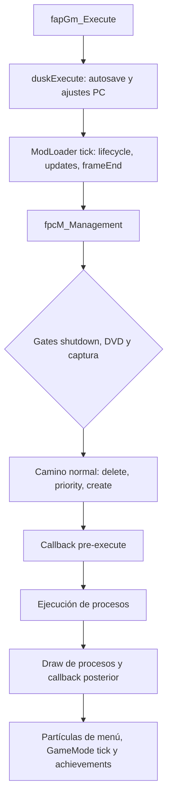

# Arquitectura y fronteras de ejecución

Fuente exclusiva `40457c6adb381928e4b5fef6ed459ed291edd5e2`; objetivo Windows x64 / DX12 / GZ2E01. Síntesis **CROSSCHECKED selectiva** de los flujos citados; no reconstrucción completa del bootstrap ni prueba del juego.

## Capas y contratos

| Capa | Entradas y responsabilidad observada | Frontera y evidencia |
| --- | --- | --- |
| SDK de mods | Metadata/imports/exports versionados, contextos de propietario, servicios y helpers de hooks | [SDK](SDK_AND_SERVICES.md), [ABI](HOOKING_AND_ABI.md); HOOK-001/002/027. GameService 2.0 es marcador de época ABI, sin métodos. |
| Loader Dusklight | Descubrir bundle, seleccionar biblioteca por plataforma/runtime, resolver dependencias, activar, actualizar y retirar | HOOK-013..020, [runtime](systems/runtime_and_lifecycle.md). Init fallida no habilita shutdown; callback de servicio y código externo requieren rollback propio. |
| Juego y gestor de procesos | Escenas, perfiles, solicitudes de creación/borrado, ejecución y draw de procesos | ARCH-001, PLAYER-019..023, [actores](systems/actors_ai_npcs.md). Un ID de creación no es un actor ya inicializado. |
| Estado y recursos | Bancos activos/guardados, eventos, room/layer, heaps, archives y recursos referenciados | WORLD-001..017, ROOT-001..006, PRES-001..006. Cambiar escena puede invalidar objetos que el mod cacheó. |
| Presentación y compatibilidad | J3D/J2D, audio/partículas/cámara y servicios Gfx/Window; adaptaciones PC hacia Aurora/Borealis | [presentación](systems/cameras_rendering.md), [recursos](systems/resources_archives_overlays.md). Gfx usa WebGPU; interior del backend DX12 no auditado. |

La existencia de una clase o función en estas capas no certifica que pueda enlazarse o hookearse en el EXE Windows. Los nombres son localizadores, con clasificación y condiciones en el índice de símbolos.

## Tick: secuencia normal y gates

**ARCH-001 / ROOT-007 / HOOK-018:** [f_ap_game.cpp L807-L843](https://github.com/TwilitRealm/dusklight/blob/40457c6adb381928e4b5fef6ed459ed291edd5e2/src/f_ap/f_ap_game.cpp#L807-L843), [f_pc_manager.cpp L52-L118](https://github.com/TwilitRealm/dusklight/blob/40457c6adb381928e4b5fef6ed459ed291edd5e2/src/f_pc/f_pc_manager.cpp#L52-L118). El diagrama resume el camino normal: borrado puede omitirse por estado de partículas, y captura altera execute/draw. En PC `separatePresentation` también cambia cuándo se pinta. No confundir un tick de mod, una ejecución de actor y un frame presentado por GPU.

El nombre Draw tampoco significa ausencia de mutaciones gameplay: `dScnPly_Draw` llama `Ccsp()->Move()` y borra flags de movimiento del background ([d_s_play.cpp L545-L558](https://github.com/TwilitRealm/dusklight/blob/40457c6adb381928e4b5fef6ed459ed291edd5e2/src/d/d_s_play.cpp#L545-L558); evidencia PLAYER-013). Interceptar “antes de render” exige comprobar el consumidor y su fase real.

## Estados de mod y teardown

La activación registra exports, resuelve imports/hooks y llama initialize. `active`, `initialized`, `loadFailed` y `servicesRegistered` son estados distintos; solo éxito de initialize establece `initialized`. El orden de retirada es módulos deactivating → shutdown cuando procede → retirar exports → módulos detached → retirar biblioteca. Dependientes se apagan antes de proveedores al aplicar cambios de lifecycle (HOOK-015/016/017/020).

Esperar un tick para descargar bibliotecas retiradas no es una barrera universal de callbacks o workers. Gfx sincroniza sus tipos retirados en su fase; ActorService puede conservar perfiles si la destrucción no termina y su cleanup solo registra ese fallo. Un hilo o recurso externo del mod exige su propio fin de actividad. Véanse HOOK-019/029/030 y [cancelación de callbacks](systems/callback_ownership_and_cancellation.md).

## Escenas, datos y punteros

DZS/DZR se decodifican como chunks; stage y room usan tablas diferentes. Room load espera recursos, asigna zona y consume room.dzr. Ediciones StageService se aplican al registro antes de crear actor; ActorService solicita procesos y registra perfiles propios. Room/stage destruction puede liberar archive/heap, y retirada de una edición no deshace objetos ya instanciados (WORLD-001..005, PLAYER-019..023).

`getSave` copia banco guardado a memoria activa; `putSave` devuelve el banco. La serialización vanilla realiza ajustes transitorios y normaliza al cargar; los blobs del mod viven en sidecars con identidad de archivo/slot. El callback de save completado antecede al intento de flush de sidecars, sin transacción conjunta observada (WORLD-010..017). No usar un snapshot de punteros ni una escritura de bytes vanilla como persistencia propia.

## Límites

La ruta completa main/menú/title, todos los gates de pausa/captura/errores, orden relativo de cada profile y el backend externo siguen pendientes de trazado integral. Los informes describen rutas concretas y contraejemplos a supuestos generales; no acreditan el juego completo ni otros discos/versiones. Los IDs remiten al [ledger](EVIDENCE_LEDGER.json), que conserva firma, rutas y rangos de cada afirmación.

CP-R10: [file-select→PLAY](systems/runtime_and_lifecycle.md) contrasta solicitud/cleanup/creación/pausa por overlap (ARCH-002..007). La cola borra antes de crear; aceptación no implica destino ejecutándose ni rollback al menú. Extiende ARCH-001 sin acreditar otras rutas bootstrap.
