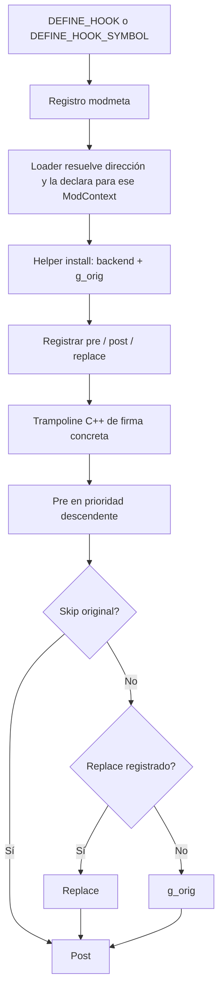

# Hooks, símbolos y ABI de .dusk

Ámbito: commit `40457c6adb381928e4b5fef6ed459ed291edd5e2`, Windows x64 / DX12 como destino. Revisión estática de contratos, implementación y consumidores; no se compiló ni se ejecutó un hook. La capacidad general del SDK y la disponibilidad real de un target concreto son dos evidencias distintas. Véase [ciclo de vida](systems/runtime_and_lifecycle.md) y [servicios](SDK_AND_SERVICES.md).

## Contrato ABI declarado y validaciones del loader

La ABI nativa exige ModResult de cuatro bytes, ServiceHeader versionado y registros modmeta alineados a ocho bytes; el parser exige exactamente un header y ABI_VERSION coincidente.

**HOOK-001 · STATIC_CROSSCHECKED** — [sdk/include/mods/api.h:49–59](https://github.com/TwilitRealm/dusklight/blob/40457c6adb381928e4b5fef6ed459ed291edd5e2/sdk/include/mods/api.h#L49-L59); [sdk/include/mods/api.h:107–118](https://github.com/TwilitRealm/dusklight/blob/40457c6adb381928e4b5fef6ed459ed291edd5e2/sdk/include/mods/api.h#L107-L118); [sdk/include/mods/api.h:130–146](https://github.com/TwilitRealm/dusklight/blob/40457c6adb381928e4b5fef6ed459ed291edd5e2/sdk/include/mods/api.h#L130-L146); [src/dusk/mods/loader/natives.cpp:175–229](https://github.com/TwilitRealm/dusklight/blob/40457c6adb381928e4b5fef6ed459ed291edd5e2/src/dusk/mods/loader/natives.cpp#L175-L229); [src/dusk/mods/loader/natives.cpp:325–339](https://github.com/TwilitRealm/dusklight/blob/40457c6adb381928e4b5fef6ed459ed291edd5e2/src/dusk/mods/loader/natives.cpp#L325-L339)

El registro empareja id y major, exige minor suficiente, rechaza duplicados; SERVICE_HAS mide el final del campo y debe acompañarse de NULL para campos posteriores al minor importado. No valida todas las funciones de una tabla privada.

**HOOK-002 · STATIC_CROSSCHECKED** — [sdk/include/mods/api.h:76–118](https://github.com/TwilitRealm/dusklight/blob/40457c6adb381928e4b5fef6ed459ed291edd5e2/sdk/include/mods/api.h#L76-L118); [src/dusk/mods/svc/registry.cpp:31–49](https://github.com/TwilitRealm/dusklight/blob/40457c6adb381928e4b5fef6ed459ed291edd5e2/src/dusk/mods/svc/registry.cpp#L31-L49); [src/dusk/mods/svc/registry.cpp:81–108](https://github.com/TwilitRealm/dusklight/blob/40457c6adb381928e4b5fef6ed459ed291edd5e2/src/dusk/mods/svc/registry.cpp#L81-L108); [src/dusk/mods/svc/registry.cpp:145–160](https://github.com/TwilitRealm/dusklight/blob/40457c6adb381928e4b5fef6ed459ed291edd5e2/src/dusk/mods/svc/registry.cpp#L145-L160); [src/dusk/mods/svc/registry.cpp:362–392](https://github.com/TwilitRealm/dusklight/blob/40457c6adb381928e4b5fef6ed459ed291edd5e2/src/dusk/mods/svc/registry.cpp#L362-L392)

add_mod acepta fmt/game/webgpu; game y webgpu requieren enlace host. En Windows se usa import library .lib y datos DUSK_GAME_DATA dllimport; encabezado o símbolo local no garantiza export enlazable.

**HOOK-011 · STATIC_CROSSCHECKED** — [cmake/ModSDK.cmake:139–212](https://github.com/TwilitRealm/dusklight/blob/40457c6adb381928e4b5fef6ed459ed291edd5e2/cmake/ModSDK.cmake#L139-L212); [cmake/ModSDK.cmake:275–298](https://github.com/TwilitRealm/dusklight/blob/40457c6adb381928e4b5fef6ed459ed291edd5e2/cmake/ModSDK.cmake#L275-L298); [include/global.h:123–128](https://github.com/TwilitRealm/dusklight/blob/40457c6adb381928e4b5fef6ed459ed291edd5e2/include/global.h#L123-L128); [cmake/WindowsExports.cmake:5–8](https://github.com/TwilitRealm/dusklight/blob/40457c6adb381928e4b5fef6ed459ed291edd5e2/cmake/WindowsExports.cmake#L5-L8); [cmake/WindowsExports.cmake:57–91](https://github.com/TwilitRealm/dusklight/blob/40457c6adb381928e4b5fef6ed459ed291edd5e2/cmake/WindowsExports.cmake#L57-L91)

GameABIConfig comparte TARGET_PC VERSION=0 PARTIAL_DEBUG y assets/GZ2E01; fuerza global.h y agrega game_feature.cpp. No valida offsets para otra arquitectura/version/conjunto de defines.

**HOOK-012 · SOURCE_OBSERVED** — [cmake/GameABIConfig.cmake:6–19](https://github.com/TwilitRealm/dusklight/blob/40457c6adb381928e4b5fef6ed459ed291edd5e2/cmake/GameABIConfig.cmake#L6-L19); [cmake/GameABIConfig.cmake:39–60](https://github.com/TwilitRealm/dusklight/blob/40457c6adb381928e4b5fef6ed459ed291edd5e2/cmake/GameABIConfig.cmake#L39-L60)

Un .dusk nativo Windows MSVC x64 busca lib/windows-amd64/mod.dll y carga con LoadLibraryExW SEARCH_DLL_LOAD_DIR|DEFAULT_DIRS; otros recursos de la plataforma se extraen en directorio por generación.

**HOOK-013 · STATIC_CROSSCHECKED** — [src/dusk/mods/loader/natives.cpp:25–35](https://github.com/TwilitRealm/dusklight/blob/40457c6adb381928e4b5fef6ed459ed291edd5e2/src/dusk/mods/loader/natives.cpp#L25-L35); [src/dusk/mods/loader/natives.cpp:386–403](https://github.com/TwilitRealm/dusklight/blob/40457c6adb381928e4b5fef6ed459ed291edd5e2/src/dusk/mods/loader/natives.cpp#L386-L403); [src/dusk/mods/loader/natives.cpp:429–485](https://github.com/TwilitRealm/dusklight/blob/40457c6adb381928e4b5fef6ed459ed291edd5e2/src/dusk/mods/loader/natives.cpp#L429-L485); [src/dusk/mods/loader/native_module.cpp:10–19](https://github.com/TwilitRealm/dusklight/blob/40457c6adb381928e4b5fef6ed459ed291edd5e2/src/dusk/mods/loader/native_module.cpp#L10-L19)

load_native exige cinco exports mod_meta/mod_ctx/mod_initialize/mod_update/mod_shutdown y valida metadatos antes de aceptar la biblioteca.

**HOOK-014 · SOURCE_OBSERVED** — [src/dusk/mods/loader/natives.cpp:488–528](https://github.com/TwilitRealm/dusklight/blob/40457c6adb381928e4b5fef6ed459ed291edd5e2/src/dusk/mods/loader/natives.cpp#L488-L528)

Una tabla privada que promete minor N pero contiene NULL o layout erróneo viola el contrato: el registro genérico no conoce los tamaños/campos particulares para probarlos todos. La ABI de servicios no estabiliza por sí sola clases C++ del juego, sus vtables o sus heaps. No deben trasplantarse offsets GC/Wii a punteros PC.

## Camino de un hook

DEFINE_HOOK emite metadatos tipados; DEFINE_HOOK_SYMBOL exige firma manual y todos los targets se resuelven/declararan antes de inicializar. Instalar target no declarado devuelve INVALID_ARGUMENT.

**HOOK-003 · STATIC_CROSSCHECKED** — [sdk/include/mods/svc/hook.hpp:100–169](https://github.com/TwilitRealm/dusklight/blob/40457c6adb381928e4b5fef6ed459ed291edd5e2/sdk/include/mods/svc/hook.hpp#L100-L169); [src/dusk/mods/loader/loader.cpp:228–236](https://github.com/TwilitRealm/dusklight/blob/40457c6adb381928e4b5fef6ed459ed291edd5e2/src/dusk/mods/loader/loader.cpp#L228-L236); [src/dusk/mods/svc/hook.cpp:98–115](https://github.com/TwilitRealm/dusklight/blob/40457c6adb381928e4b5fef6ed459ed291edd5e2/src/dusk/mods/svc/hook.cpp#L98-L115); [src/dusk/mods/svc/hook.cpp:993–1046](https://github.com/TwilitRealm/dusklight/blob/40457c6adb381928e4b5fef6ed459ed291edd5e2/src/dusk/mods/svc/hook.cpp#L993-L1046)

HookImpl genera un trampoline C++ con this explícito, argumentos direccionables y retorno inicializado con `R{}`; pre puede cancelar original y reemplazo, post se ejecuta tras cualquiera de esos caminos.

**HOOK-004 · STATIC_CROSSCHECKED** — [sdk/include/mods/svc/hook.hpp:15–90](https://github.com/TwilitRealm/dusklight/blob/40457c6adb381928e4b5fef6ed459ed291edd5e2/sdk/include/mods/svc/hook.hpp#L15-L90); [src/dusk/mods/svc/hook.cpp:576–651](https://github.com/TwilitRealm/dusklight/blob/40457c6adb381928e4b5fef6ed459ed291edd5e2/src/dusk/mods/svc/hook.cpp#L576-L651)

Prioridad descendente y orden de registro gobiernan pre y post; replace tiene un único slot y takeover lo sobrescribe. No existe pila de reemplazos previos que restaure el slot al retirar al ganador.

**HOOK-005 · STATIC_CROSSCHECKED** — [src/dusk/mods/svc/hook.cpp:138–153](https://github.com/TwilitRealm/dusklight/blob/40457c6adb381928e4b5fef6ed459ed291edd5e2/src/dusk/mods/svc/hook.cpp#L138-L153); [src/dusk/mods/svc/hook.cpp:453–515](https://github.com/TwilitRealm/dusklight/blob/40457c6adb381928e4b5fef6ed459ed291edd5e2/src/dusk/mods/svc/hook.cpp#L453-L515); [src/dusk/mods/svc/hook.cpp:888–898](https://github.com/TwilitRealm/dusklight/blob/40457c6adb381928e4b5fef6ed459ed291edd5e2/src/dusk/mods/svc/hook.cpp#L888-L898)

El primer install crea backend y candidatos posteriores comparten original; funchook parchea entrada, y se advierte que llamadas inline no quedan cubiertas.

**HOOK-006 · SOURCE_OBSERVED** — [src/dusk/mods/svc/hook.cpp:244–298](https://github.com/TwilitRealm/dusklight/blob/40457c6adb381928e4b5fef6ed459ed291edd5e2/src/dusk/mods/svc/hook.cpp#L244-L298); [src/dusk/mods/svc/hook.cpp:394–450](https://github.com/TwilitRealm/dusklight/blob/40457c6adb381928e4b5fef6ed459ed291edd5e2/src/dusk/mods/svc/hook.cpp#L394-L450)

`args` contiene direcciones de los parámetros locales del trampoline; `mods::arg<T>` copia y `mods::arg_ref<T>` ofrece referencia. El receptor ocupa índice 0. Los punteros a `args`/`retval` viven solo durante esa llamada: conservarlos para otro frame sería un uso fuera de vigencia. Esta última restricción es `STATIC_INFERRED` del almacenamiento local mostrado en HOOK-004. Un pre que cancela debe definir un resultado semánticamente válido, aunque el trampoline inicializa el slot no void con `R result{}`.

El reemplazo que quiere llamar original utiliza `g_orig`. Invocar la entrada parcheada de nuevo puede reentrar en el hook; la política de recursión del futuro mod debe ser explícita. Esto es inferencia del detour y de la llamada separada a `g_orig`, no una prueba de reentrancia de todos los targets.

## Resolución, exportación y disponibilidad

resolve usa manifiesto embebido validado contra identidad del ejecutable: Windows GUID/age PDB; devuelve UNSUPPORTED sin manifest, UNAVAILABLE ausente, CONFLICT ambiguo.

**HOOK-008 · STATIC_CROSSCHECKED** — [src/dusk/mods/manifest.cpp:110–152](https://github.com/TwilitRealm/dusklight/blob/40457c6adb381928e4b5fef6ed459ed291edd5e2/src/dusk/mods/manifest.cpp#L110-L152); [src/dusk/mods/manifest.cpp:242–296](https://github.com/TwilitRealm/dusklight/blob/40457c6adb381928e4b5fef6ed459ed291edd5e2/src/dusk/mods/manifest.cpp#L242-L296); [src/dusk/mods/manifest.cpp:362–394](https://github.com/TwilitRealm/dusklight/blob/40457c6adb381928e4b5fef6ed459ed291edd5e2/src/dusk/mods/manifest.cpp#L362-L394); [src/dusk/mods/svc/hook.cpp:960–975](https://github.com/TwilitRealm/dusklight/blob/40457c6adb381928e4b5fef6ed459ed291edd5e2/src/dusk/mods/svc/hook.cpp#L960-L975)

Windows x64 sigue stubs de importación/incremental linking y decodifica pointer-to-member virtual; prefiere overrider por display name y rechaza ajustes secundarios no resolubles. Registro extendido materializa hasta 24 bytes.

**HOOK-009 · STATIC_CROSSCHECKED** — [src/dusk/mods/svc/hook.cpp:162–186](https://github.com/TwilitRealm/dusklight/blob/40457c6adb381928e4b5fef6ed459ed291edd5e2/src/dusk/mods/svc/hook.cpp#L162-L186); [src/dusk/mods/svc/hook.cpp:772–838](https://github.com/TwilitRealm/dusklight/blob/40457c6adb381928e4b5fef6ed459ed291edd5e2/src/dusk/mods/svc/hook.cpp#L772-L838); [sdk/include/mods/api.h:231–254](https://github.com/TwilitRealm/dusklight/blob/40457c6adb381928e4b5fef6ed459ed291edd5e2/sdk/include/mods/api.h#L231-L254); [sdk/include/mods/meta.hpp:296–331](https://github.com/TwilitRealm/dusklight/blob/40457c6adb381928e4b5fef6ed459ed291edd5e2/sdk/include/mods/meta.hpp#L296-L331); [src/dusk/mods/svc/hook.cpp:1032–1035](https://github.com/TwilitRealm/dusklight/blob/40457c6adb381928e4b5fef6ed459ed291edd5e2/src/dusk/mods/svc/hook.cpp#L1032-L1035)

La ruta CMake Windows con code mods habilitados usa funchook; prepatch se habilita para Apple arm64. Estas opciones no prueban el backend de un ejecutable Windows no inspeccionado.

**HOOK-010 · STATIC_CROSSCHECKED** — [CMakeLists.txt:94–116](https://github.com/TwilitRealm/dusklight/blob/40457c6adb381928e4b5fef6ed459ed291edd5e2/CMakeLists.txt#L94-L116); [CMakeLists.txt:283–300](https://github.com/TwilitRealm/dusklight/blob/40457c6adb381928e4b5fef6ed459ed291edd5e2/CMakeLists.txt#L283-L300); [src/dusk/mods/svc/hook.cpp:269–298](https://github.com/TwilitRealm/dusklight/blob/40457c6adb381928e4b5fef6ed459ed291edd5e2/src/dusk/mods/svc/hook.cpp#L269-L298)

Existe diferencia de precisión documental: la prosa Hooking by name agrupa missing/ambiguous/no manifest como UNAVAILABLE al instalar; HookService.resolve por separado distingue UNSUPPORTED/UNAVAILABLE/CONFLICT.

**HOOK-026 · STATIC_CROSSCHECKED** — [docs/modding.md:1380–1411](https://github.com/TwilitRealm/dusklight/blob/40457c6adb381928e4b5fef6ed459ed291edd5e2/docs/modding.md#L1380-L1411); [sdk/include/mods/svc/hook.h:114–129](https://github.com/TwilitRealm/dusklight/blob/40457c6adb381928e4b5fef6ed459ed291edd5e2/sdk/include/mods/svc/hook.h#L114-L129); [src/dusk/mods/svc/hook.cpp:961–975](https://github.com/TwilitRealm/dusklight/blob/40457c6adb381928e4b5fef6ed459ed291edd5e2/src/dusk/mods/svc/hook.cpp#L961-L975); [sdk/include/mods/svc/hook.hpp:169–182](https://github.com/TwilitRealm/dusklight/blob/40457c6adb381928e4b5fef6ed459ed291edd5e2/sdk/include/mods/svc/hook.hpp#L169-L182)

| Evidencia disponible | Qué permite afirmar | Lo que falta para un target Windows |
| --- | --- | --- |
| Declaración/implementación fuente | Firma y flujo del commit | Símbolo existente en imagen, DLL imports y backend |
| Export en import library | Enlace estático de un nombre concreto | ABI/layout y ejecución en estado válido |
| `resolve` con flags LOCAL | Dirección local potencialmente usable por servicio | Declaración metadata, firma manual correcta y `install` exitoso |
| Flag MULTI_NAME | Dirección compartida por aliases/ICF según contrato | Confirmar todos los consumidores afectados |
| Install exitoso observado | Detour instalado en esa imagen | Cobertura inline, coexistencia y unload/scene tests |
| Prueba humana específica | Comportamiento observado en ese escenario | Generalización a todos los estados/actores |

Los flags LOCAL/MULTI_NAME y las formas display/decorated/TU alias son contrato en [hook.h](https://github.com/TwilitRealm/dusklight/blob/40457c6adb381928e4b5fef6ed459ed291edd5e2/sdk/include/mods/svc/hook.h#L30-L40) y [modding.md](https://github.com/TwilitRealm/dusklight/blob/40457c6adb381928e4b5fef6ed459ed291edd5e2/docs/modding.md#L1390-L1407). Este atlas no ha extraído el manifiesto ni la import library del ejecutable de referencia: no certifica disponibilidad binaria para ningún target nuevo.

## Ownership, conflictos y rollback

uninstall exige ModContext y el originalFnSlot exacto, borra callbacks del mod para ese target y entrega backend al candidato superviviente o lo retira. Fallo de uninstall/handoff puede dejar operación fallida y detach fatal protege contra DLL con detour vivo.

**HOOK-007 · SOURCE_OBSERVED** — [src/dusk/mods/svc/hook.cpp:300–391](https://github.com/TwilitRealm/dusklight/blob/40457c6adb381928e4b5fef6ed459ed291edd5e2/src/dusk/mods/svc/hook.cpp#L300-L391); [src/dusk/mods/svc/hook.cpp:518–574](https://github.com/TwilitRealm/dusklight/blob/40457c6adb381928e4b5fef6ed459ed291edd5e2/src/dusk/mods/svc/hook.cpp#L518-L574); [src/dusk/mods/svc/hook.cpp:888–927](https://github.com/TwilitRealm/dusklight/blob/40457c6adb381928e4b5fef6ed459ed291edd5e2/src/dusk/mods/svc/hook.cpp#L888-L927)

Las excepciones C++ de callbacks son atrapadas, marcan el mod fallido y se difiere teardown; pre fallido continúa, replace fallido devuelve error y el trampoline puede ejecutar original. No hay captura de corrupción de memoria ni garantía de concurrencia.

**HOOK-025 · STATIC_CROSSCHECKED** — [src/dusk/mods/svc/hook.cpp:125–135](https://github.com/TwilitRealm/dusklight/blob/40457c6adb381928e4b5fef6ed459ed291edd5e2/src/dusk/mods/svc/hook.cpp#L125-L135); [src/dusk/mods/svc/hook.cpp:591–627](https://github.com/TwilitRealm/dusklight/blob/40457c6adb381928e4b5fef6ed459ed291edd5e2/src/dusk/mods/svc/hook.cpp#L591-L627); [src/dusk/mods/svc/hook.cpp:640–649](https://github.com/TwilitRealm/dusklight/blob/40457c6adb381928e4b5fef6ed459ed291edd5e2/src/dusk/mods/svc/hook.cpp#L640-L649); [sdk/include/mods/svc/hook.hpp:37–44](https://github.com/TwilitRealm/dusklight/blob/40457c6adb381928e4b5fef6ed459ed291edd5e2/sdk/include/mods/svc/hook.hpp#L37-L44)

El contrato prohíbe hooks cuya función permanece en stack toda sesión, porque el cambio lifecycle entre frames no garantiza su descarga segura.

**HOOK-022 · DOC_CONTRACT** — [docs/modding.md:1469–1491](https://github.com/TwilitRealm/dusklight/blob/40457c6adb381928e4b5fef6ed459ed291edd5e2/docs/modding.md#L1469-L1491)

Antes de registrar, preferir el servicio oficial específico si cubre la operación. Si se necesita hook, el camino menos invasivo suele ser observación post o pre sin cancelación; sustituir o cancelar exige conocer invariantes de la función y otros consumidores. Es criterio de integración, no garantía universal.

Rollback mínimo de un futuro mod: detener nuevos callbacks/trabajo propio, deshacer mutaciones externas que le pertenezcan, liberar recursos propios y dejar al host retirar registros. Un `HookService::uninstall` exitoso limpia registros y detour según ownership; no restaura HP, flags, posiciones, archivos o servicios privados externos que modificó un callback. Un takeover no puede prometer restaurar el replace anterior porque solo existía un slot.

Las listas de callbacks y los mapas no ofrecen sincronización propia en la implementación examinada. Los callbacks usan el stack de la llamada y el contrato los sitúa en game thread; no se deduce permiso para instalar/retirar desde un hilo de trabajo. Pendiente: verificar escenarios de callback que altere su propia lista, fallos de handoff de varios mods y cancelación durante transitions en Windows real.

## Clasificación de integración

| Mecanismo | Estado estático | Condiciones/rollback |
| --- | --- | --- |
| OFFICIAL_SERVICE: HookService | Tabla 1.1 implementada | ModContext válido y metadatos; cleanup owner |
| TYPED_HOOK | Macros/helpers/host contrastados | FEATURES game, target enlazable/resoluble, firma y estado correctos; probar target |
| SYMBOL_HOOK | Parser y resolver contrastados | Manifest válido, nombre inequívoco y firma manual; no afirmar disponibilidad desde header |
| POTENTIAL_REQUIRES_VERIFICATION | Cualquier función del juego solo localizada | Resolver/export/binario, efectos inline/alias, lifetime, coexistencia y runtime pendientes |
| NOT_SUPPORTED_BY_CURRENT_EVIDENCE | Hook seguro de outer main loop para hot unload | Contrato advierte stack de sesión; no se propone EXE/SDK modificado |

## Huecos explícitos

No se inspeccionó PE/PDB ni import library del runtime de referencia; no se instaló ningún hook, no hubo compilación, test Windows ni prueba humana. No se generaliza Itanium/AAPCS a MSVC. No se auditó funchook de tercero internamente ni se requirió desensamblado. La semántica comprobada aquí es la implementación de Dusklight y sus contratos en el commit fijado.

## Segundo contraste: época ABI y candidatos compartidos

FEATURES game agrega sdk/src/game_feature.cpp, que emite import requerido GameService; major 2 es época ABI sin operaciones. El check protege la época declarada, no certifica layout/firma concretos ni presencia de símbolo.

**HOOK-027 · STATIC_CROSSCHECKED** — [cmake/GameABIConfig.cmake:39–60](https://github.com/TwilitRealm/dusklight/blob/40457c6adb381928e4b5fef6ed459ed291edd5e2/cmake/GameABIConfig.cmake#L39-L60); [sdk/src/game_feature.cpp:1–5](https://github.com/TwilitRealm/dusklight/blob/40457c6adb381928e4b5fef6ed459ed291edd5e2/sdk/src/game_feature.cpp#L1-L5); [sdk/include/mods/svc/game.h:9–26](https://github.com/TwilitRealm/dusklight/blob/40457c6adb381928e4b5fef6ed459ed291edd5e2/sdk/include/mods/svc/game.h#L9-L26); [src/dusk/mods/svc/registry.cpp:362–392](https://github.com/TwilitRealm/dusklight/blob/40457c6adb381928e4b5fef6ed459ed291edd5e2/src/dusk/mods/svc/registry.cpp#L362-L392)

hook_install comparte backend entre candidatos por dirección y copia original a cada slot sin comparar firmas/trampolines. El éxito de install no certifica que dos mods coincidan en ABI; cada candidato debe respetar firma del target.

**HOOK-028 · STATIC_CROSSCHECKED** — [src/dusk/mods/svc/hook.cpp:394–450](https://github.com/TwilitRealm/dusklight/blob/40457c6adb381928e4b5fef6ed459ed291edd5e2/src/dusk/mods/svc/hook.cpp#L394-L450); [sdk/include/mods/svc/hook.h:75–89](https://github.com/TwilitRealm/dusklight/blob/40457c6adb381928e4b5fef6ed459ed291edd5e2/sdk/include/mods/svc/hook.h#L75-L89); [sdk/include/mods/svc/hook.hpp:100–125](https://github.com/TwilitRealm/dusklight/blob/40457c6adb381928e4b5fef6ed459ed291edd5e2/sdk/include/mods/svc/hook.hpp#L100-L125)

La firma queda comprobada contra la declaración disponible para DEFINE_HOOK, pero una imagen/encabezado de otra revisión o un candidato SYMBOL_HOOK con firma manual incorrecta sigue siendo un riesgo. No existe negociación de firma entre candidatos a una misma dirección en el registro revisado.
