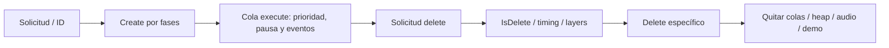

# Actores, IA y NPC

Pin: `40457c6adb381928e4b5fef6ed459ed291edd5e2`; destino solicitado: Dusklight 2.0.3, GZ2E01 USA, Windows x64 / DirectX 12. Profundidad: **ciclo de vida transversal contrastado; IA y familias NPC muestreadas**. Esta ficha observa fuente exacta; no ejecuta el juego, no compila ni implementa un mod. Los números originales de campos no se usan como offsets Windows.

## Creación, ejecución y destrucción

**PLAYER-019 · STATIC_CROSSCHECKED.** El process manager atiende borrado, cambios de prioridad y creación antes del recorrido de ejecución; `fpcEx_Execute` exige init_state=2 y proceso no pausado. `fopAc_Execute` añade pausa global, aprobación de eventos, condiciones de suspensión y copia current→old antes del método del actor. Una actualización de mod no equivale a una ejecución efectiva del actor. [src/f_pc/f_pc_manager.cpp:52-115](https://github.com/TwilitRealm/dusklight/blob/40457c6adb381928e4b5fef6ed459ed291edd5e2/src/f_pc/f_pc_manager.cpp#L52-L115); [src/f_pc/f_pc_executor.cpp:35-40](https://github.com/TwilitRealm/dusklight/blob/40457c6adb381928e4b5fef6ed459ed291edd5e2/src/f_pc/f_pc_executor.cpp#L35-L40); [src/f_op/f_op_actor.cpp:323-349](https://github.com/TwilitRealm/dusklight/blob/40457c6adb381928e4b5fef6ed459ed291edd5e2/src/f_op/f_op_actor.cpp#L323-L349).

**PLAYER-020 · STATIC_CROSSCHECKED.** `fopAc_Create` inicializa parámetros/home/current/parent/escala y consulta switches de aparición de enemigos antes del Create específico; solamente al completar la fase lo encola para dibujar. `fopAcM_create` fabrica append y devuelve un ID de solicitud; `fopAcM_SearchByID` puede devolver éxito con puntero nulo si aún se está creando. [src/f_op/f_op_actor.cpp:443-555](https://github.com/TwilitRealm/dusklight/blob/40457c6adb381928e4b5fef6ed459ed291edd5e2/src/f_op/f_op_actor.cpp#L443-L555); [src/f_op/f_op_actor_mng.cpp:152-173](https://github.com/TwilitRealm/dusklight/blob/40457c6adb381928e4b5fef6ed459ed291edd5e2/src/f_op/f_op_actor_mng.cpp#L152-L173); [src/f_op/f_op_actor_mng.cpp:258-269](https://github.com/TwilitRealm/dusklight/blob/40457c6adb381928e4b5fef6ed459ed291edd5e2/src/f_op/f_op_actor_mng.cpp#L258-L269).

**PLAYER-021 · STATIC_CROSSCHECKED.** El borrado tiene consentimiento, cola y finalización: `fpcDt_ToDeleteQ` consulta timing/layers y estado; `fopAc_Delete` llama el Delete específico y solamente al completar elimina muestras de interpolación, colas, heap, referencia de demo y objetos de audio. [src/f_pc/f_pc_deletor.cpp:18-123](https://github.com/TwilitRealm/dusklight/blob/40457c6adb381928e4b5fef6ed459ed291edd5e2/src/f_pc/f_pc_deletor.cpp#L18-L123); [src/f_op/f_op_actor.cpp:404-439](https://github.com/TwilitRealm/dusklight/blob/40457c6adb381928e4b5fef6ed459ed291edd5e2/src/f_op/f_op_actor.cpp#L404-L439).

**PLAYER-022 · STATIC_CROSSCHECKED.** ActorService registra un profile con callbacks del mod y nombre stage; exige tamaño mínimo y los cinco callbacks, rechaza nombre de otro actor mod, y asigna ProfileName dinámico. Crear por nombre usa el argument de `dStage_searchName`, sustituyendo el argument recibido. No se debe persistir un ProfileName dinámico como identidad estable entre cargas. [src/dusk/mods/svc/actor.cpp:56-123](https://github.com/TwilitRealm/dusklight/blob/40457c6adb381928e4b5fef6ed459ed291edd5e2/src/dusk/mods/svc/actor.cpp#L56-L123); [src/dusk/mods/svc/actor.cpp:239-250](https://github.com/TwilitRealm/dusklight/blob/40457c6adb381928e4b5fef6ed459ed291edd5e2/src/dusk/mods/svc/actor.cpp#L239-L250).

**PLAYER-023 · STATIC_CROSSCHECKED.** `unregister_actor` es del propietario del profile, intenta forzar/barrer eliminación y retorna MOD_UNAVAILABLE si quedan actores; entonces retiene el slot. `actor_remove_mod` solo registra error si esa operación falla. No hay una prueba de que cualquier actor asíncrono pueda retirarse sin riesgo durante hot reload. [src/dusk/mods/svc/actor.cpp:193-217](https://github.com/TwilitRealm/dusklight/blob/40457c6adb381928e4b5fef6ed459ed291edd5e2/src/dusk/mods/svc/actor.cpp#L193-L217); [src/dusk/mods/svc/actor.cpp:359-372](https://github.com/TwilitRealm/dusklight/blob/40457c6adb381928e4b5fef6ed459ed291edd5e2/src/dusk/mods/svc/actor.cpp#L359-L372).

Los profiles conectan métodos y prioridades; no significan una instancia. `ActorHandle` identifica registro SDK; `ActorId` identifica una solicitud/instancia del motor. `get_actor_id` busca por profile y no enumera todas sus instancias: [src/dusk/mods/svc/actor.cpp:287-318](https://github.com/TwilitRealm/dusklight/blob/40457c6adb381928e4b5fef6ed459ed291edd5e2/src/dusk/mods/svc/actor.cpp#L287-L318). Crear dos actores de un profile requiere gestionar dos identidades, no volver a buscar por nombre y asumir unicidad.

## IA y navegación localizada

**PLAYER-024 · STATIC_CROSSCHECKED.** El ejemplo Tektite enlaza percepción por distancia/rango de home y línea de vista, estados WAIT/CHASE/ATTACK/DAMAGE/DEATH, movimiento/Acch, animación/audio y registro del collider. Los parámetros de spawn también eligen archivos y switch de persistencia. Su IA no prueba un servicio universal de navegación o percepción. [src/d/actor/d_a_e_tt.cpp:477-528](https://github.com/TwilitRealm/dusklight/blob/40457c6adb381928e4b5fef6ed459ed291edd5e2/src/d/actor/d_a_e_tt.cpp#L477-L528); [src/d/actor/d_a_e_tt.cpp:1037-1163](https://github.com/TwilitRealm/dusklight/blob/40457c6adb381928e4b5fef6ed459ed291edd5e2/src/d/actor/d_a_e_tt.cpp#L1037-L1163); [src/d/actor/d_a_e_tt.cpp:1230-1298](https://github.com/TwilitRealm/dusklight/blob/40457c6adb381928e4b5fef6ed459ed291edd5e2/src/d/actor/d_a_e_tt.cpp#L1230-L1298); [src/f_op/f_op_actor_mng.cpp:2071-2089](https://github.com/TwilitRealm/dusklight/blob/40457c6adb381928e4b5fef6ed459ed291edd5e2/src/f_op/f_op_actor_mng.cpp#L2071-L2089).

**PLAYER-025 · STATIC_CROSSCHECKED.** `dPath_GetRoomPath` obtiene paths del stage con room=-1 o de datos de sala; valida índice/ausencia. `dPath_GetPnt` y `dPath_GetNextRoomPath` retornan referencias a puntos/paths alojados en esos datos, no copias de vida indefinida ni un navmesh general. [src/d/d_path.cpp:39-98](https://github.com/TwilitRealm/dusklight/blob/40457c6adb381928e4b5fef6ed459ed291edd5e2/src/d/d_path.cpp#L39-L98).

**PLAYER-018 · STATIC_CROSSCHECKED.** La muerte del Tektite desactiva su receptor/atención, avanza animación/efectos, crea desaparición, solicita borrado y persiste un switch de sala. Su Delete libera los dos recursos y el objeto de audio. Solicitar borrado genérico no reproduce todos esos efectos narrativos y de recursos. [src/d/actor/d_a_e_tt.cpp:812-893](https://github.com/TwilitRealm/dusklight/blob/40457c6adb381928e4b5fef6ed459ed291edd5e2/src/d/actor/d_a_e_tt.cpp#L812-L893); [src/d/actor/d_a_e_tt.cpp:1174-1191](https://github.com/TwilitRealm/dusklight/blob/40457c6adb381928e4b5fef6ed459ed291edd5e2/src/d/actor/d_a_e_tt.cpp#L1174-L1191).

La ruta observada conecta datos de colocación → recursos/heap → timers y percepción → acción → integración/Acch → matrices y collider → resultado de impacto. Sus dependencias son [stages/salas](stages_rooms_layers.md), [recursos](resources_archives_overlays.md), [colisión](movement_physics_collision.md), [combate](combat_damage.md) y [audio](audio_particles_effects.md). El esquema ayuda a investigar otros actores; no traslada parámetros ni IDs del ejemplo a otra clase.

## NPC y contratos de eventos

**PLAYER-026 · STATIC_CROSSCHECKED.** Hay familias NPC diferentes. `daNpcT_c::execute` prioriza evtProc sobre action, mueve/corrige fondo y actualiza animación, atención, colisión y pedidos de evento; `evtProc` administra talk/demo/cut. `daNpcF_c::execute` usa main y otra secuencia. Fado deriva de daNpcT_c, mientras Shad deriva de daNpcF_c: una base no cubre todos los NPC. [src/d/actor/d_a_npc.cpp:1368-1429](https://github.com/TwilitRealm/dusklight/blob/40457c6adb381928e4b5fef6ed459ed291edd5e2/src/d/actor/d_a_npc.cpp#L1368-L1429); [src/d/actor/d_a_npc.cpp:1893-1938](https://github.com/TwilitRealm/dusklight/blob/40457c6adb381928e4b5fef6ed459ed291edd5e2/src/d/actor/d_a_npc.cpp#L1893-L1938); [src/d/actor/d_a_npc4.cpp:561-614](https://github.com/TwilitRealm/dusklight/blob/40457c6adb381928e4b5fef6ed459ed291edd5e2/src/d/actor/d_a_npc4.cpp#L561-L614); [include/d/actor/d_a_npc_aru.h:40-48](https://github.com/TwilitRealm/dusklight/blob/40457c6adb381928e4b5fef6ed459ed291edd5e2/include/d/actor/d_a_npc_aru.h#L40-L48); [include/d/actor/d_a_npc_shad.h:40-44](https://github.com/TwilitRealm/dusklight/blob/40457c6adb381928e4b5fef6ed459ed291edd5e2/include/d/actor/d_a_npc_shad.h#L40-L44).

**PLAYER-027 · STATIC_CROSSCHECKED.** Ambas familias delegan diálogo a `mFlow.doFlow` y sincronizan animaciones; el talk de Shad puede crear un item de presentación y pedir DEFAULT_GETITEM antes de volver a wait. Interceptar solo el texto no reproduce el contrato de diálogo/progresión. [src/d/actor/d_a_npc.cpp:2545-2587](https://github.com/TwilitRealm/dusklight/blob/40457c6adb381928e4b5fef6ed459ed291edd5e2/src/d/actor/d_a_npc.cpp#L2545-L2587); [src/d/actor/d_a_npc4.cpp:1391-1423](https://github.com/TwilitRealm/dusklight/blob/40457c6adb381928e4b5fef6ed459ed291edd5e2/src/d/actor/d_a_npc4.cpp#L1391-L1423); [src/d/actor/d_a_npc_shad.cpp:1468-1506](https://github.com/TwilitRealm/dusklight/blob/40457c6adb381928e4b5fef6ed459ed291edd5e2/src/d/actor/d_a_npc_shad.cpp#L1468-L1506).

## Símbolos reutilizables

| Símbolo / firma | Función concreta | Fuente | Integración |
| --- | --- | --- | --- |
| `void fpcM_Management(fpcM_ManagementFunc, fpcM_ManagementFunc)` | Ordena borrado, prioridad, creación, ejecución y dibujo de procesos. | [src/f_pc/f_pc_manager.cpp:52-115](https://github.com/TwilitRealm/dusklight/blob/40457c6adb381928e4b5fef6ed459ed291edd5e2/src/f_pc/f_pc_manager.cpp#L52-L115) | `POTENTIAL_REQUIRES_VERIFICATION` |
| `int fpcEx_Execute(base_process_class* i_proc)` | Ejecuta solo un proceso inicializado y no pausado. | [src/f_pc/f_pc_executor.cpp:35-40](https://github.com/TwilitRealm/dusklight/blob/40457c6adb381928e4b5fef6ed459ed291edd5e2/src/f_pc/f_pc_executor.cpp#L35-L40) | `POTENTIAL_REQUIRES_VERIFICATION` |
| `s32 fopAcM_SearchByID(fpc_ProcID, fopAc_ac_c**)` | Consulta un ID; durante creación el out actor es nulo aunque retorna 1. | [src/f_op/f_op_actor_mng.cpp:152-162](https://github.com/TwilitRealm/dusklight/blob/40457c6adb381928e4b5fef6ed459ed291edd5e2/src/f_op/f_op_actor_mng.cpp#L152-L162) | `POTENTIAL_REQUIRES_VERIFICATION` |
| `fpc_ProcID fopAcM_create(s16, u16, u32, const cXyz*, int, const csXyz*, const cXyz*, s8, createFunc, u32, u8) [firma TARGET_PC]` | Construye append y devuelve solicitud de creación por profile. | [src/f_op/f_op_actor_mng.cpp:258-269](https://github.com/TwilitRealm/dusklight/blob/40457c6adb381928e4b5fef6ed459ed291edd5e2/src/f_op/f_op_actor_mng.cpp#L258-L269) | `POTENTIAL_REQUIRES_VERIFICATION` |
| `int fpcDt_ToDeleteQ(base_process_class* i_proc)` | Consulta timing/layers y solicita salida a cola de eliminación. | [src/f_pc/f_pc_deletor.cpp:76-123](https://github.com/TwilitRealm/dusklight/blob/40457c6adb381928e4b5fef6ed459ed291edd5e2/src/f_pc/f_pc_deletor.cpp#L76-L123) | `POTENTIAL_REQUIRES_VERIFICATION` |
| `void fopAcM_DeleteHeap(fopAc_ac_c* i_actor)` | Destruye solid heap del actor y anula su campo heap. | [src/f_op/f_op_actor_mng.cpp:372-379](https://github.com/TwilitRealm/dusklight/blob/40457c6adb381928e4b5fef6ed459ed291edd5e2/src/f_op/f_op_actor_mng.cpp#L372-L379) | `POTENTIAL_REQUIRES_VERIFICATION` |
| `bool daE_TT_c::checkPlayerSearch()` | Combina límite de home, distancia al jugador y obstrucción de fondo. | [src/d/actor/d_a_e_tt.cpp:477-485](https://github.com/TwilitRealm/dusklight/blob/40457c6adb381928e4b5fef6ed459ed291edd5e2/src/d/actor/d_a_e_tt.cpp#L477-L485) | `POTENTIAL_REQUIRES_VERIFICATION` |
| `dPath* dPath_GetRoomPath(int path_index, int room_no)` | Obtiene path desde datos de stage o sala con validación de índice. | [src/d/d_path.cpp:50-71](https://github.com/TwilitRealm/dusklight/blob/40457c6adb381928e4b5fef6ed459ed291edd5e2/src/d/d_path.cpp#L50-L71) | `POTENTIAL_REQUIRES_VERIFICATION` |
| `int daNpcT_c::execute()` | Alterna eventos/acción NPC y coordina física, animación y colisión. | [src/d/actor/d_a_npc.cpp:1368-1429](https://github.com/TwilitRealm/dusklight/blob/40457c6adb381928e4b5fef6ed459ed291edd5e2/src/d/actor/d_a_npc.cpp#L1368-L1429) | `POTENTIAL_REQUIRES_VERIFICATION` |
| `BOOL daNpcF_c::execute()` | Actualiza la familia NPC F mediante main y contratos propios. | [src/d/actor/d_a_npc4.cpp:561-614](https://github.com/TwilitRealm/dusklight/blob/40457c6adb381928e4b5fef6ed459ed291edd5e2/src/d/actor/d_a_npc4.cpp#L561-L614) | `POTENTIAL_REQUIRES_VERIFICATION` |
| `BOOL daNpcT_c::talkProc(int*, BOOL, fopAc_ac_c**, BOOL)` | Avanza message flow y selección de animaciones/fin de diálogo. | [src/d/actor/d_a_npc.cpp:2545-2587](https://github.com/TwilitRealm/dusklight/blob/40457c6adb381928e4b5fef6ed459ed291edd5e2/src/d/actor/d_a_npc.cpp#L2545-L2587) | `POTENTIAL_REQUIRES_VERIFICATION` |

Preferencia `.dusk`: `OFFICIAL_SERVICE` ActorService para profiles/creación propia; StageService para ediciones de colocación en el momento de carga que su contrato permite; `ASSET_OVERLAY` para datos/recursos cuando procede. La alteración de lógica interna de un actor existente requiere candidato tipado o símbolo con verificación; no se declara hook seguro por localizar su función. Véase [SDK](../SDK_AND_SERVICES.md) y [matriz](../DUSK_INTEGRATION_MATRIX.md).

## Riesgos y continuidad

Mantener estado por identidad y ciclo de vida; reconsultar punteros al cambiar escena/sala y al completar Create. No confundir confirmación de solicitud de borrado con finalización ni retener memory de solid heap. Unregister puede invocar Delete forzado y devolver indisponibilidad; preparar cleanup idempotente y comprobar el resultado. Retirar una colocación no prueba que desaparezca una instancia ya cargada ni que sus switches se restauren (PLAYER-018/020/021/023).

**PENDING**: comparación de más familias de IA y bosses, totalidad de los frameworks NPC y sus virtuales, ownership de actores originales creados por un mod, cancelación de creación asíncrona durante unload y pruebas de reentrada/transición de layers Windows. No se ha auditado en profundidad cada actor de `src/d/actor`. Las entradas menos comunes están en [otros sistemas](other_systems.md).

Cobertura: READ/CROSSCHECKED selectiva según SYSTEM_INDEX y los niveles de cada evidencia; ninguna ruta constituye prueba runtime Windows/DX12.

## CP-R18 — Perfil, petición e instancia durante unregister

**Contrato comprobado.** ActorService es la frontera oficial para registrar y retirar profiles propios, no una barrera documentada de todas las solicitudes del motor. `unregister_actor(ModContext*, ActorHandle)` valida propietario; su firma no promete cancelar creaciones pendientes. El descriptor exige Create/Delete/Execute/IsDelete/Draw y el contrato ordinario admite que Delete devuelva 1 al terminar. La implementación de retiro forzado introduce una diferencia decisiva respecto a ese protocolo ordinario. Véanse PLAYER-040..045 y [SDK actor.h:14–86](https://github.com/TwilitRealm/dusklight/blob/40457c6adb381928e4b5fef6ed459ed291edd5e2/sdk/include/mods/svc/actor.h#L14-L86).

**Estado y ownership observados.** El servicio posee `unique_ptr<ActorSlot>`: methodTable, callbacks crudos, nombre y profile viven en ese slot. El proceso creado conserva métodos/profile por referencia. ActorHandle combina índice y generación y exige owner para unregister; el `ActorProfileName` se calcula con índice, sin generación. La petición estándar del motor conserva nombre numérico, append y postcallback, con `process=NULL` al encolarse. No captura ActorHandle ni mantiene una referencia propietaria al slot. Esto amplía PLAYER-022/023 y HOOK-029; no los reemplaza.

**Consumidor real.** En carga de stage, la rama TARGET_PC aplica ediciones del record, busca nombre custom antes del catálogo vanilla y, en la ruta ordinaria, llama `fopAcM_Create` → `fpcM_Create` → `fpcSCtRq_Request`. Se excluye expresamente la rama SUSPEND de creación rápida. Registro de profile y edición de colocación son mecanismos distintos: retirar un registro no deshace una instancia ni restaura un record. La fase Load/Create/SubCreate resuelve el profile al crear el proceso; solo después entra en el wrapper del actor. En PC, LinkAsync devuelve COMPLETE y las fases NEXT se encadenan recursivamente: existe una frontera interna proceso/asociación, pero no se ha demostrado un intervalo estable de scheduler entre ambas operaciones.

**Barrido observado.** `unregister_actor` activa forceDelete, recorre `g_fopAcTg_Queue` por nombre y solicita borrado, luego recorre `g_fpcDtTg_Queue`, pone timer=0 y prueba finalizar. Ignora el resultado individual de fopAcM_delete; decide por finalización y actores que permanecen. No recorre `g_fpcCtTg_Queue`. El primer `fopAc_Create` ya incorpora el actor a la actor queue **antes** de llamar al Create del mod; por tanto un Create que sigue en INIT/LOADING puede ser visible y alcanzado por el barrido. No es correcto clasificar todas las creaciones pendientes como escapadas.

| Situación al retirar | Resultado sustentado y alcance |
| --- | --- |
| Contexto/handle de otro propietario o inválido | INVALID_ARGUMENT antes del barrido. |
| Sin instancia ni petición pendiente | Puede completar, retirar mapas y liberar slot; un segundo unregister del handle ya retirado es inválido. |
| Solo petición, process todavía NULL | Puede devolver OK sin cancelar esa petición. El resultado no acredita create queue vacía. |
| Create incompleto tras primer wrapper de actor | Ya está en actor queue; se intenta eliminar y abortar su petición. El guard de ejecución puede impedirlo. |
| Instancia viva o ya en delete queue | Se fuerza consentimiento y se intenta Delete inmediatamente. No se espera el timer normal. |
| Petición ejecutándose / llamada reentrante desde Create | fpcCt_IsDoing puede rechazar delete; el actor restante causa UNAVAILABLE, fuerza se restablece a false y mapas/slot permanecen. |
| Barrido parcialmente exitoso | UNAVAILABLE no recrea los actores ya destruidos; no hay rollback transaccional. |
| Deactivación del owner | Mismo intento y log del fallo; loader continúa teardown. No hay garantía adicional de drenaje. |

**Borrado y error.** El wrapper forceDelete devuelve 1 sin consultar IsDelete específico y llama Delete específico, pero convierte su retorno en 1 aun si devuelve 0. Por ello no se puede usar un Delete diferido del mod como veto fiable a este retiro forzado. El wrapper fopAc_Delete retira colas, interpolación, heap y referencias de demo/audio al completar; el borrado de proceso libera append/proceso según su ruta. No se ha demostrado que cualquier recurso externo o trabajo asíncrono del mod haya concluido por ese retorno. El caso reentrante está condicionado al guard `is_doing`; no es una prueba de fallo habitual ni de una llamada concreta en runtime.

**Inferencia condicionada para request-only (PLAYER-043).** Si el slot desaparece antes de que la petición resuelva su profile y nadie reutiliza ese nombre, `fpcPf_Get` en TARGET_PC retorna NULL para el nombre dinámico ausente; fpcBs_Create falla y el request estándar entra en cancelación. Esa ruta no llega al Create ni al postcallback retenido del mod. La cancelación genérica puede tener sus propios fallos; no certifica liberación universal de append ni de userdata. Como SlotMap reutiliza índices y el nombre numérico omite generación, otra inscripción antes del lookup podría proporcionar otro profile a la solicitud vieja. Es una consecuencia estática condicionada, no reproducción de uso de DLL descargada ni crash demostrado.

**Teardown y frontera .dusk.** `actor_remove_mod` solo loguea el fallo. El loader invoca módulos deactivating, shutdown y detached y retira la biblioteca sin un veto derivado de ese resultado; el drenaje nativo ocurre después. Si quedan profiles/callbacks que aún pudieran ejecutarse, su vida puede exceder la del código propietario: riesgo condicionado ya relacionado con HOOK-029, ahora acotado por los estados de creación. ActorService y StageService son contratos oficiales pertinentes; inspeccionar/cancelar colas internas o alterar esta coordinación exigiría resolver símbolos, firma, fase y rollback todavía no certificados. No se propone implementación ni se acredita que un hook repare todos los escenarios.

**Pendiente de prueba.** Reentrada y reutilización de profile entre peticiones en Windows; captura de callbacks durante teardown; propietario de append ante cada fallo temprano; biblioteca retenida frente a callbacks realmente alcanzables. Esta cadena no acredita unload seguro, ABI, exportación ni convivencia entre mods. Q-03 queda PARCIAL. La siguiente investigación alterna familia; no repetir el scheduler CP-R05 ni el barrido básico de PLAYER-023.

**PLAYER-040** — [src/dusk/mods/svc/actor.cpp:19–54](https://github.com/TwilitRealm/dusklight/blob/40457c6adb381928e4b5fef6ed459ed291edd5e2/src/dusk/mods/svc/actor.cpp#L19-L54); [src/dusk/mods/svc/actor.cpp:78–123](https://github.com/TwilitRealm/dusklight/blob/40457c6adb381928e4b5fef6ed459ed291edd5e2/src/dusk/mods/svc/actor.cpp#L78-L123); [src/dusk/mods/svc/actor.hpp:7–18](https://github.com/TwilitRealm/dusklight/blob/40457c6adb381928e4b5fef6ed459ed291edd5e2/src/dusk/mods/svc/actor.hpp#L7-L18); [src/dusk/mods/svc/internal.hpp:128–186](https://github.com/TwilitRealm/dusklight/blob/40457c6adb381928e4b5fef6ed459ed291edd5e2/src/dusk/mods/svc/internal.hpp#L128-L186); [src/f_pc/f_pc_stdcreate_req.cpp:140–178](https://github.com/TwilitRealm/dusklight/blob/40457c6adb381928e4b5fef6ed459ed291edd5e2/src/f_pc/f_pc_stdcreate_req.cpp#L140-L178)

**PLAYER-041** — [src/dusk/mods/svc/actor.cpp:146–218](https://github.com/TwilitRealm/dusklight/blob/40457c6adb381928e4b5fef6ed459ed291edd5e2/src/dusk/mods/svc/actor.cpp#L146-L218); [src/f_pc/f_pc_create_req.cpp:132–147](https://github.com/TwilitRealm/dusklight/blob/40457c6adb381928e4b5fef6ed459ed291edd5e2/src/f_pc/f_pc_create_req.cpp#L132-L147); [src/f_pc/f_pc_stdcreate_req.cpp:33–63](https://github.com/TwilitRealm/dusklight/blob/40457c6adb381928e4b5fef6ed459ed291edd5e2/src/f_pc/f_pc_stdcreate_req.cpp#L33-L63); [src/f_op/f_op_actor.cpp:443–455](https://github.com/TwilitRealm/dusklight/blob/40457c6adb381928e4b5fef6ed459ed291edd5e2/src/f_op/f_op_actor.cpp#L443-L455); [src/f_op/f_op_actor.cpp:544–553](https://github.com/TwilitRealm/dusklight/blob/40457c6adb381928e4b5fef6ed459ed291edd5e2/src/f_op/f_op_actor.cpp#L544-L553); [include/f_pc/f_pc_manager.h:45–48](https://github.com/TwilitRealm/dusklight/blob/40457c6adb381928e4b5fef6ed459ed291edd5e2/include/f_pc/f_pc_manager.h#L45-L48)

**PLAYER-042** — [src/dusk/mods/svc/actor.cpp:28–54](https://github.com/TwilitRealm/dusklight/blob/40457c6adb381928e4b5fef6ed459ed291edd5e2/src/dusk/mods/svc/actor.cpp#L28-L54); [src/dusk/mods/svc/actor.cpp:146–218](https://github.com/TwilitRealm/dusklight/blob/40457c6adb381928e4b5fef6ed459ed291edd5e2/src/dusk/mods/svc/actor.cpp#L146-L218); [src/f_pc/f_pc_deletor.cpp:45–135](https://github.com/TwilitRealm/dusklight/blob/40457c6adb381928e4b5fef6ed459ed291edd5e2/src/f_pc/f_pc_deletor.cpp#L45-L135); [src/f_pc/f_pc_delete_tag.cpp:20–50](https://github.com/TwilitRealm/dusklight/blob/40457c6adb381928e4b5fef6ed459ed291edd5e2/src/f_pc/f_pc_delete_tag.cpp#L20-L50); [src/f_pc/f_pc_create_req.cpp:61–94](https://github.com/TwilitRealm/dusklight/blob/40457c6adb381928e4b5fef6ed459ed291edd5e2/src/f_pc/f_pc_create_req.cpp#L61-L94); [src/f_op/f_op_actor.cpp:404–439](https://github.com/TwilitRealm/dusklight/blob/40457c6adb381928e4b5fef6ed459ed291edd5e2/src/f_op/f_op_actor.cpp#L404-L439)

**PLAYER-043** — [src/dusk/mods/svc/actor.cpp:193–218](https://github.com/TwilitRealm/dusklight/blob/40457c6adb381928e4b5fef6ed459ed291edd5e2/src/dusk/mods/svc/actor.cpp#L193-L218); [src/dusk/mods/svc/actor.cpp:323–333](https://github.com/TwilitRealm/dusklight/blob/40457c6adb381928e4b5fef6ed459ed291edd5e2/src/dusk/mods/svc/actor.cpp#L323-L333); [src/f_pc/f_pc_profile.cpp:24–40](https://github.com/TwilitRealm/dusklight/blob/40457c6adb381928e4b5fef6ed459ed291edd5e2/src/f_pc/f_pc_profile.cpp#L24-L40); [src/f_pc/f_pc_base.cpp:133–176](https://github.com/TwilitRealm/dusklight/blob/40457c6adb381928e4b5fef6ed459ed291edd5e2/src/f_pc/f_pc_base.cpp#L133-L176); [src/f_pc/f_pc_stdcreate_req.cpp:33–109](https://github.com/TwilitRealm/dusklight/blob/40457c6adb381928e4b5fef6ed459ed291edd5e2/src/f_pc/f_pc_stdcreate_req.cpp#L33-L109); [src/f_pc/f_pc_create_req.cpp:35–74](https://github.com/TwilitRealm/dusklight/blob/40457c6adb381928e4b5fef6ed459ed291edd5e2/src/f_pc/f_pc_create_req.cpp#L35-L74); [src/f_pc/f_pc_create_req.cpp:103–118](https://github.com/TwilitRealm/dusklight/blob/40457c6adb381928e4b5fef6ed459ed291edd5e2/src/f_pc/f_pc_create_req.cpp#L103-L118); [src/dusk/mods/svc/internal.hpp:165–186](https://github.com/TwilitRealm/dusklight/blob/40457c6adb381928e4b5fef6ed459ed291edd5e2/src/dusk/mods/svc/internal.hpp#L165-L186)

**PLAYER-044** — [src/d/d_stage.cpp:1527–1540](https://github.com/TwilitRealm/dusklight/blob/40457c6adb381928e4b5fef6ed459ed291edd5e2/src/d/d_stage.cpp#L1527-L1540); [src/d/d_stage.cpp:1635–1663](https://github.com/TwilitRealm/dusklight/blob/40457c6adb381928e4b5fef6ed459ed291edd5e2/src/d/d_stage.cpp#L1635-L1663); [include/f_op/f_op_actor_mng.h:540–542](https://github.com/TwilitRealm/dusklight/blob/40457c6adb381928e4b5fef6ed459ed291edd5e2/include/f_op/f_op_actor_mng.h#L540-L542); [include/f_pc/f_pc_manager.h:45–48](https://github.com/TwilitRealm/dusklight/blob/40457c6adb381928e4b5fef6ed459ed291edd5e2/include/f_pc/f_pc_manager.h#L45-L48); [src/f_pc/f_pc_stdcreate_req.cpp:116–129](https://github.com/TwilitRealm/dusklight/blob/40457c6adb381928e4b5fef6ed459ed291edd5e2/src/f_pc/f_pc_stdcreate_req.cpp#L116-L129); [src/c/c_dylink.cpp:900–923](https://github.com/TwilitRealm/dusklight/blob/40457c6adb381928e4b5fef6ed459ed291edd5e2/src/c/c_dylink.cpp#L900-L923)

**PLAYER-045** — [src/dusk/mods/svc/actor.cpp:359–401](https://github.com/TwilitRealm/dusklight/blob/40457c6adb381928e4b5fef6ed459ed291edd5e2/src/dusk/mods/svc/actor.cpp#L359-L401); [src/dusk/mods/svc/registry.cpp:210–224](https://github.com/TwilitRealm/dusklight/blob/40457c6adb381928e4b5fef6ed459ed291edd5e2/src/dusk/mods/svc/registry.cpp#L210-L224); [src/dusk/mods/loader/loader.cpp:296–338](https://github.com/TwilitRealm/dusklight/blob/40457c6adb381928e4b5fef6ed459ed291edd5e2/src/dusk/mods/loader/loader.cpp#L296-L338); [src/dusk/mods/loader/loader.cpp:1100–1105](https://github.com/TwilitRealm/dusklight/blob/40457c6adb381928e4b5fef6ed459ed291edd5e2/src/dusk/mods/loader/loader.cpp#L1100-L1105); [src/dusk/mods/loader/natives.cpp:563–584](https://github.com/TwilitRealm/dusklight/blob/40457c6adb381928e4b5fef6ed459ed291edd5e2/src/dusk/mods/loader/natives.cpp#L563-L584)

CP-R23: familia daNpcF de MYNA2 contrastada en [otros sistemas](other_systems.md), PLAYER-046..051. Tipo de spawn, modo de acción, evento por nombre y estado de creación son dominios distintos; no repetir el trazado genérico de ActorService.

CP-R30: [B_DS fase2](combat_damage.md) amplía comparación de bosses con PLAYER-052..056: knockdown y daño vulnerable difieren; DEAD requiere aceptación de demo antes de efectos y cleanup. No equivale a IA completa ni a actor SDK propio. Mantener Q-12 parcial.
