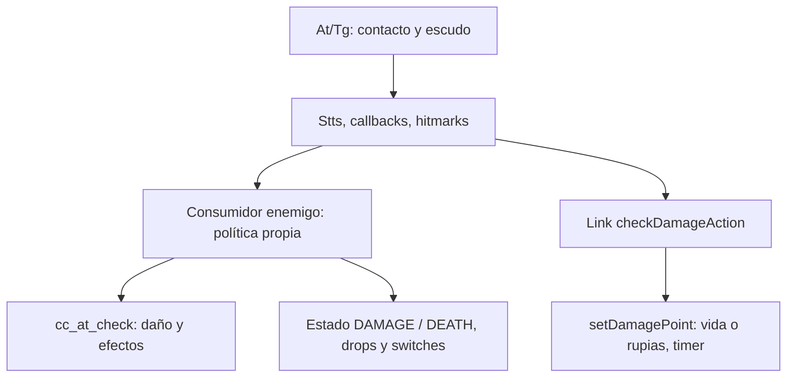

# Combate y daño

Pin: `40457c6adb381928e4b5fef6ed459ed291edd5e2`; destino solicitado: Dusklight 2.0.3, GZ2E01 USA, Windows x64 / DirectX 12. Profundidad: **flujo transversal de colisión, daño enemigo/jugador y contraejemplo de política local**. Esta ficha observa fuente exacta; no ejecuta el juego, no compila ni implementa un mod. Los números originales de campos no se usan como offsets Windows.

## Entrada → decisión → efectos

**PLAYER-014 · STATIC_CROSSCHECKED.** `dCcS::SetAtTgGObjInf` establece datos At/Tg, prueba escudo, acumula daño en Stts si no hay escudo, invoca callbacks de impacto y genera hitmarks con contadores de efectos. Un contacto físico, un callback y una pérdida de HP son fases diferentes. [src/d/d_cc_s.cpp:530-607](https://github.com/TwilitRealm/dusklight/blob/40457c6adb381928e4b5fef6ed459ed291edd5e2/src/d/d_cc_s.cpp#L530-L607).

**PLAYER-015 · STATIC_CROSSCHECKED.** `at_power_check` deriva atacante, tipo de impacto y potencia desde el collider. `cc_at_check` aplica modificadores de arma/tipo/material y settings PC, resta `i_enemy->health`, clampa muerte, emite señales de logros, reproduce collision SE y puede activar hitstop. No es una función pura de cálculo. [src/d/d_cc_uty.cpp:314-369](https://github.com/TwilitRealm/dusklight/blob/40457c6adb381928e4b5fef6ed459ed291edd5e2/src/d/d_cc_uty.cpp#L314-L369); [src/d/d_cc_uty.cpp:372-520](https://github.com/TwilitRealm/dusklight/blob/40457c6adb381928e4b5fef6ed459ed291edd5e2/src/d/d_cc_uty.cpp#L372-L520).

**PLAYER-016 · STATIC_CROSSCHECKED.** El daño del jugador sigue otra ruta: `checkDamageAction` distingue guardia y materiales y llama `setDamagePoint`; este aplica multiplicadores (incluidos settings PC), armadura/rupias o cola de variación de vida, efectos y timer de invulnerabilidad. La salud base de un enemigo no representa automáticamente la vida de Link. [src/d/actor/d_a_alink_damage.inc:148-240](https://github.com/TwilitRealm/dusklight/blob/40457c6adb381928e4b5fef6ed459ed291edd5e2/src/d/actor/d_a_alink_damage.inc#L148-L240); [src/d/actor/d_a_alink_damage.inc:629-750](https://github.com/TwilitRealm/dusklight/blob/40457c6adb381928e4b5fef6ed459ed291edd5e2/src/d/actor/d_a_alink_damage.inc#L629-L750).

**PLAYER-017 · STATIC_CROSSCHECKED.** No todos los enemigos tratan `health` como contador autónomo: Tektite acumula daño en otro campo, reescribe `health=100` o `0` y después llama `cc_at_check`; el resultado elige DAMAGE/DEATH y cooldown. Esto invalida una extrapolación universal de un hook de HP o de la pareja health/campo adyacente. [src/d/actor/d_a_e_tt.cpp:182-248](https://github.com/TwilitRealm/dusklight/blob/40457c6adb381928e4b5fef6ed459ed291edd5e2/src/d/actor/d_a_e_tt.cpp#L182-L248).

**PLAYER-018 · STATIC_CROSSCHECKED.** La muerte del Tektite desactiva su receptor/atención, avanza animación/efectos, crea desaparición, solicita borrado y persiste un switch de sala. Su Delete libera los dos recursos y el objeto de audio. Solicitar borrado genérico no reproduce todos esos efectos narrativos y de recursos. [src/d/actor/d_a_e_tt.cpp:812-893](https://github.com/TwilitRealm/dusklight/blob/40457c6adb381928e4b5fef6ed459ed291edd5e2/src/d/actor/d_a_e_tt.cpp#L812-L893); [src/d/actor/d_a_e_tt.cpp:1174-1191](https://github.com/TwilitRealm/dusklight/blob/40457c6adb381928e4b5fef6ed459ed291edd5e2/src/d/actor/d_a_e_tt.cpp#L1174-L1191).

El enlace enemigo no es universal: PLAYER-017 documenta un acumulador local que cambia el significado de health. La emisión de drops/cierre de flags debe trazarse en cada muerte concreta; no se afirma una política uniforme a partir de este ejemplo.

## Catálogo de integración

| Símbolo / firma | Función concreta | Fuente | Integración |
| --- | --- | --- | --- |
| `void dCcS::SetAtTgGObjInf(bool, bool, cCcD_Obj*, cCcD_Obj*, cCcD_GObjInf*, cCcD_GObjInf*, cCcD_Stts*, cCcD_Stts*, cCcD_GStts*, cCcD_GStts*, cXyz*)` | Publica colisión At/Tg, escudo, daño acumulado, callbacks y hitmarks. | [src/d/d_cc_s.cpp:530-607](https://github.com/TwilitRealm/dusklight/blob/40457c6adb381928e4b5fef6ed459ed291edd5e2/src/d/d_cc_s.cpp#L530-L607) | `POTENTIAL_REQUIRES_VERIFICATION` |
| `fopAc_ac_c* at_power_check(dCcU_AtInfo* i_AtInfo)` | Clasifica atacante/tipo/potencia de un collider existente. | [src/d/d_cc_uty.cpp:314-369](https://github.com/TwilitRealm/dusklight/blob/40457c6adb381928e4b5fef6ed459ed291edd5e2/src/d/d_cc_uty.cpp#L314-L369) | `POTENTIAL_REQUIRES_VERIFICATION` |
| `fopAc_ac_c* cc_at_check(fopAc_ac_c* i_enemy, dCcU_AtInfo* i_AtInfo)` | Aplica daño de enemigo y efectos/audio/pausa/modificadores. | [src/d/d_cc_uty.cpp:372-520](https://github.com/TwilitRealm/dusklight/blob/40457c6adb381928e4b5fef6ed459ed291edd5e2/src/d/d_cc_uty.cpp#L372-L520) | `POTENTIAL_REQUIRES_VERIFICATION` |
| `int daAlink_c::setDamagePoint(int, BOOL, BOOL, int)` | Solicita variación de vida/rupias y efectos/timer de daño de Link. | [src/d/actor/d_a_alink_damage.inc:178-230](https://github.com/TwilitRealm/dusklight/blob/40457c6adb381928e4b5fef6ed459ed291edd5e2/src/d/actor/d_a_alink_damage.inc#L178-L230) | `POTENTIAL_REQUIRES_VERIFICATION` |
| `f32 daAlink_c::damageMagnification(BOOL, int)` | Calcula multiplicador por settings PC, forma y ropa. | [src/d/actor/d_a_alink_damage.inc:148-175](https://github.com/TwilitRealm/dusklight/blob/40457c6adb381928e4b5fef6ed459ed291edd5e2/src/d/actor/d_a_alink_damage.inc#L148-L175) | `POTENTIAL_REQUIRES_VERIFICATION` |
| `void daE_TT_c::damage_check()` | Ejemplo de política de daño propia anterior y posterior al helper común. | [src/d/actor/d_a_e_tt.cpp:182-248](https://github.com/TwilitRealm/dusklight/blob/40457c6adb381928e4b5fef6ed459ed291edd5e2/src/d/actor/d_a_e_tt.cpp#L182-L248) | `POTENTIAL_REQUIRES_VERIFICATION` |

Todos estos puntos continúan como `POTENTIAL_REQUIRES_VERIFICATION`: existencia de implementación y call sites no acredita hook Windows. El SDK de actores cubre registro/creación/ciclo de vida, no convierte estos helpers en un contrato público de daño (véase [matriz SDK](../SDK_AND_SERVICES.md)). Una interceptación futura debe decidir si observa el contacto, la decisión de daño o el resultado definitivo de estado, y documentar si altera sonido, hitstop, logros, escudo y flags además de HP (PLAYER-014/015/016/018).

## Riesgos, rollback y cobertura

No guardar `mpCollider`, `mpActor` o referencias de estado fuera de la vigencia de la colisión/actor. Los callbacks se invocan durante el procesamiento, por lo que borrar actores o reinstalar hooks dentro del callback requiere estudiar reentrada y recorrido antes de recomendarlo (riesgo inferido de PLAYER-014 y del borrado por colas en [actores](actors_ai_npcs.md)). Restaurar un número de HP no deshace una transición de muerte, un switch, un item o el audio ya disparado.

**PENDING**: matriz de todos los consumidores de `cc_at_check`, enemigos que evitan el helper común, bosses con fases, armas/proyectiles, combos humano/lobo, prioridad de colisión simultánea y pruebas reales con varias combinaciones de hooks. Se trazó un ejemplo Tektite para contrastar límites, no para proponer ni implementar un mod. No se declara un máximo de HP universal, offset x64, fórmula común a todos los actores ni compatibilidad de runtime.

Dependencias: [colisión](movement_physics_collision.md), [jugador](player_and_controls.md), [eventos/flags](flags_events_progression.md), [audio/efectos](audio_particles_effects.md), [hooks](../HOOKING_AND_ABI.md).

Cobertura: READ/CROSSCHECKED selectiva según SYSTEM_INDEX y los niveles de cada evidencia; ninguna ruta constituye prueba runtime Windows/DX12.
