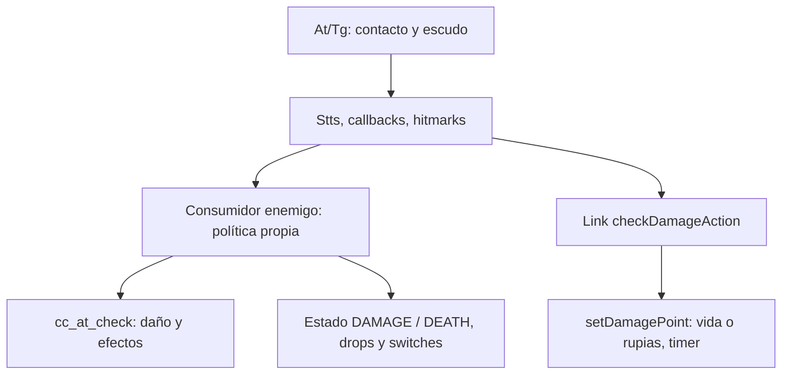

# Combate y daño

Pin: `40457c6adb381928e4b5fef6ed459ed291edd5e2`; destino solicitado: Dusklight 2.0.3, GZ2E01 USA, Windows x64 / DirectX 12. Profundidad: **flujo transversal de colisión, daño enemigo/jugador y contraejemplo de política local**. Esta ficha observa fuente exacta; no ejecuta el juego, no compila ni implementa un mod. Los números originales de campos no se usan como offsets Windows.

## Entrada → decisión → efectos

**PLAYER-014 · STATIC_CROSSCHECKED.** `dCcS::SetAtTgGObjInf` establece datos At/Tg, prueba escudo, acumula daño en Stts si no hay escudo, invoca callbacks de impacto y genera hitmarks con contadores de efectos. Un contacto físico, un callback y una pérdida de HP son fases diferentes. [src/d/d_cc_s.cpp:530-607](https://github.com/TwilitRealm/dusklight/blob/40457c6adb381928e4b5fef6ed459ed291edd5e2/src/d/d_cc_s.cpp#L530-L607).

**PLAYER-015 · STATIC_CROSSCHECKED.** `at_power_check` deriva atacante, tipo de impacto y potencia desde el collider. `cc_at_check` aplica modificadores de arma/tipo/material y settings PC, resta `i_enemy->health`, clampa muerte, emite señales de logros, reproduce collision SE y puede activar hitstop. No es una función pura de cálculo. [src/d/d_cc_uty.cpp:314-369](https://github.com/TwilitRealm/dusklight/blob/40457c6adb381928e4b5fef6ed459ed291edd5e2/src/d/d_cc_uty.cpp#L314-L369); [src/d/d_cc_uty.cpp:372-520](https://github.com/TwilitRealm/dusklight/blob/40457c6adb381928e4b5fef6ed459ed291edd5e2/src/d/d_cc_uty.cpp#L372-L520).

**PLAYER-016 · STATIC_CROSSCHECKED.** El daño del jugador sigue otra ruta: `checkDamageAction` distingue guardia y materiales y llama `setDamagePoint`; este aplica multiplicadores (incluidos settings PC), armadura/rupias o cola de variación de vida, efectos y timer de invulnerabilidad. La salud base de un enemigo no representa automáticamente la vida de Link. [src/d/actor/d_a_alink_damage.inc:148-240](https://github.com/TwilitRealm/dusklight/blob/40457c6adb381928e4b5fef6ed459ed291edd5e2/src/d/actor/d_a_alink_damage.inc#L148-L240); [src/d/actor/d_a_alink_damage.inc:629-750](https://github.com/TwilitRealm/dusklight/blob/40457c6adb381928e4b5fef6ed459ed291edd5e2/src/d/actor/d_a_alink_damage.inc#L629-L750).

**PLAYER-017 · STATIC_CROSSCHECKED.** No todos los enemigos tratan `health` como contador autónomo: Tektite acumula daño en otro campo, reescribe `health=100` o `0` y después llama `cc_at_check`; el resultado elige DAMAGE/DEATH y cooldown. Esto invalida una extrapolación universal de un hook de HP o de la pareja health/campo adyacente. [src/d/actor/d_a_e_tt.cpp:182-248](https://github.com/TwilitRealm/dusklight/blob/40457c6adb381928e4b5fef6ed459ed291edd5e2/src/d/actor/d_a_e_tt.cpp#L182-L248).

**PLAYER-018 · STATIC_CROSSCHECKED.** La muerte del Tektite desactiva su receptor/atención, avanza animación/efectos, crea desaparición, solicita borrado y persiste un switch de sala. Su Delete libera los dos recursos y el objeto de audio. Solicitar borrado genérico no reproduce todos esos efectos narrativos y de recursos. [src/d/actor/d_a_e_tt.cpp:812-893](https://github.com/TwilitRealm/dusklight/blob/40457c6adb381928e4b5fef6ed459ed291edd5e2/src/d/actor/d_a_e_tt.cpp#L812-L893); [src/d/actor/d_a_e_tt.cpp:1174-1191](https://github.com/TwilitRealm/dusklight/blob/40457c6adb381928e4b5fef6ed459ed291edd5e2/src/d/actor/d_a_e_tt.cpp#L1174-L1191).

El enlace enemigo no es universal: PLAYER-017 documenta un acumulador local que cambia el significado de health. La emisión de drops/cierre de flags debe trazarse en cada muerte concreta; no se afirma una política uniforme a partir de este ejemplo.

## Catálogo de integración

| Símbolo / firma | Función concreta | Fuente | Integración |
| --- | --- | --- | --- |
| `void dCcS::SetAtTgGObjInf(bool, bool, cCcD_Obj*, cCcD_Obj*, cCcD_GObjInf*, cCcD_GObjInf*, cCcD_Stts*, cCcD_Stts*, cCcD_GStts*, cCcD_GStts*, cXyz*)` | Publica colisión At/Tg, escudo, daño acumulado, callbacks y hitmarks. | [src/d/d_cc_s.cpp:530-607](https://github.com/TwilitRealm/dusklight/blob/40457c6adb381928e4b5fef6ed459ed291edd5e2/src/d/d_cc_s.cpp#L530-L607) | `POTENTIAL_REQUIRES_VERIFICATION` |
| `fopAc_ac_c* at_power_check(dCcU_AtInfo* i_AtInfo)` | Clasifica atacante/tipo/potencia de un collider existente. | [src/d/d_cc_uty.cpp:314-369](https://github.com/TwilitRealm/dusklight/blob/40457c6adb381928e4b5fef6ed459ed291edd5e2/src/d/d_cc_uty.cpp#L314-L369) | `POTENTIAL_REQUIRES_VERIFICATION` |
| `fopAc_ac_c* cc_at_check(fopAc_ac_c* i_enemy, dCcU_AtInfo* i_AtInfo)` | Aplica daño de enemigo y efectos/audio/pausa/modificadores. | [src/d/d_cc_uty.cpp:372-520](https://github.com/TwilitRealm/dusklight/blob/40457c6adb381928e4b5fef6ed459ed291edd5e2/src/d/d_cc_uty.cpp#L372-L520) | `POTENTIAL_REQUIRES_VERIFICATION` |
| `int daAlink_c::setDamagePoint(int, BOOL, BOOL, int)` | Solicita variación de vida/rupias y efectos/timer de daño de Link. | [src/d/actor/d_a_alink_damage.inc:178-230](https://github.com/TwilitRealm/dusklight/blob/40457c6adb381928e4b5fef6ed459ed291edd5e2/src/d/actor/d_a_alink_damage.inc#L178-L230) | `POTENTIAL_REQUIRES_VERIFICATION` |
| `f32 daAlink_c::damageMagnification(BOOL, int)` | Calcula multiplicador por settings PC, forma y ropa. | [src/d/actor/d_a_alink_damage.inc:148-175](https://github.com/TwilitRealm/dusklight/blob/40457c6adb381928e4b5fef6ed459ed291edd5e2/src/d/actor/d_a_alink_damage.inc#L148-L175) | `POTENTIAL_REQUIRES_VERIFICATION` |
| `void daE_TT_c::damage_check()` | Ejemplo de política de daño propia anterior y posterior al helper común. | [src/d/actor/d_a_e_tt.cpp:182-248](https://github.com/TwilitRealm/dusklight/blob/40457c6adb381928e4b5fef6ed459ed291edd5e2/src/d/actor/d_a_e_tt.cpp#L182-L248) | `POTENTIAL_REQUIRES_VERIFICATION` |

Todos estos puntos continúan como `POTENTIAL_REQUIRES_VERIFICATION`: existencia de implementación y call sites no acredita hook Windows. El SDK de actores cubre registro/creación/ciclo de vida, no convierte estos helpers en un contrato público de daño (véase [matriz SDK](../SDK_AND_SERVICES.md)). Una interceptación futura debe decidir si observa el contacto, la decisión de daño o el resultado definitivo de estado, y documentar si altera sonido, hitstop, logros, escudo y flags además de HP (PLAYER-014/015/016/018).

## Riesgos, rollback y cobertura

No guardar `mpCollider`, `mpActor` o referencias de estado fuera de la vigencia de la colisión/actor. Los callbacks se invocan durante el procesamiento, por lo que borrar actores o reinstalar hooks dentro del callback requiere estudiar reentrada y recorrido antes de recomendarlo (riesgo inferido de PLAYER-014 y del borrado por colas en [actores](actors_ai_npcs.md)). Restaurar un número de HP no deshace una transición de muerte, un switch, un item o el audio ya disparado.

**PENDING**: matriz de todos los consumidores de `cc_at_check`, enemigos que evitan el helper común, bosses con fases, armas/proyectiles, combos humano/lobo, prioridad de colisión simultánea y pruebas reales con varias combinaciones de hooks. Se trazó un ejemplo Tektite para contrastar límites, no para proponer ni implementar un mod. No se declara un máximo de HP universal, offset x64, fórmula común a todos los actores ni compatibilidad de runtime.

Dependencias: [colisión](movement_physics_collision.md), [jugador](player_and_controls.md), [eventos/flags](flags_events_progression.md), [audio/efectos](audio_particles_effects.md), [hooks](../HOOKING_AND_ABI.md).

Cobertura: READ/CROSSCHECKED selectiva según SYSTEM_INDEX y los niveles de cada evidencia; ninguna ruta constituye prueba runtime Windows/DX12.

## CP-R30 — B_DS fase2: vulnerabilidad → daño → demo de derrota → progreso y retiro

PLAYER-052..056 amplían la comparación de políticas enemigas con un boss; no se diseña ninguno ni se cubre su IA completa. d_a_b_ds.cpp local coincide con blob remoto del pin. Se conecta con PLAYER-014/015 (colisión/helper) y WORLD-026 (control de eventos) sin repetirlos.

**Identidad, creación y fase.** daB_DS_c hereda fopEn_enemy_c; profile B_DS current-layer/list4/BOSS/enemy enlaza wrappers reales. Byte bajo del param se asigna a arg0;0xFF normaliza TYPE_BATTLE_1. Otros bytes van a bitSw/2/3,pero no explican por sí mismos los switches fijos de la salida. TYPE_BATTLE_2=2 selecciona mBattle2Action y luego actualiza matrices/colliders; proyectiles y fase1 son ramas distintas. No inferir orden global desde list4.

create usa carga por fases B_DS y solid heap0xFAC0; error de heap retorna ERROR,completitud de carga no demuestra actor ejecutado. HP inicial viene de mP2Health HIO,colliders referencian mCcStts del actor. CreateHeap puede convertir variante1 en2 con zone switches6/7 o debug; selecciona modelo/animación según arg0,retorna0 ante morf/modelo fallido. Se conserva recurso compartido y heap de actor según lifecycle previamente documentado. No se auditan todas las allocations/materiales de esta clase. Ramas nuevas no tienen TARGET_PC salvo integración de reward/helper citada.

**Dos impactos y dos estados.** mBattle2Action llama spinner_damage_check antes de despachar mAction. Ese helper descarta cooldown,HEAD_RETURN,DAMAGE/DEAD y HP<1; otros colliders pueden consumir impacto antes. Head hit de tipo SPINNER emite efectos,configura animación y setActionMode(DAMAGE,0),sin cc_at_check ni resta HP en esa rama. No llamar a todo contacto un daño de vida.

En DAMAGE,tras gates de demo/caída/timer,modo3 reactiva weakSph y modo4 consulta mBattle2_damage_check antes de registrar esfera/avanzar timeout. Este exige HP>=1,cooldown terminado y hit de weakSph; obtiene collider prestado y llama cc_at_check ya contrastado en PLAYER-015. Si HP resultante<=1,detiene dibujo de un emitter si existe,solicita audio/animación,cambia a DEAD0 y retorna true. Caller retorna del método DAMAGE y omite su tramo posterior; el postacción de mBattle2Action aún contiene movimiento/animación. DEAD se despacha en una llamada posterior al switch,no mediante salto recursivo instantáneo. Los timers son decrementos por consultas,no segundos medidos.

Inferencia condicionada: escribir HP=0 externamente no equivale a este impacto letal; helper retornafalse al entrar con HP<1 y no sintetiza transición. No se recomienda esa escritura ni se afirma bloqueo observado. Restore de HP tampoco deshace ACT_B2_DEAD/efectos.

**Solicitud y aceptación del evento.** DEAD0 llama startDemoCheck. Lobo devuelvefalse. Sin INDEMO solicita potential event con flag2,param0xFFFF,prioridad0,onCondition2 y retornafalse: ignora resultado de solicitud y vuelve a esperar en modo0. Wrapper puede rechazar por permiso; prioridad0 se transforma0xFF. order tiene capacidad limitada y guarda pointers de actor,distinto de aceptación. En entry,vida de jugador no cero y potentialCheck permitido llevan a setCommand(INDEMO),modo DEMO,setParam y afterFlagProc. beforeFlagProc tiene su gate para flag4; esta llamada usa2,que emite issueStaff(ALL) después. No se auditan aquí todos los conflictos/órdenes ni el script staff resultante. checkCommandDemoAccrpt compara comando, no ID de solicitud.

Cuando actor ve INDEMO detiene cámara,trim3 y changeOriginalDemo; solo entonces inicia trayectoria. No hay timeout/recovery explícito en ese modo0; wolf o falta de aceptación pueden aplazarlo. Esto no demuestra deadlock ni entrega garantizada de evento. Cámara/player/event son estados externos prestados, no propiedad liberable del boss.

| Tramo DEAD observado | Gate o efecto relevante |
| --- | --- |
| 0→100→1→2→3 | Aceptación de demo,altura1700 y configuración de trayectoria; mDeadMove necesita contador>=80 y altura<=home.y+700. |
| 4→5→6→7→10..15→16 | Timers/contactos ground y saltos de movimiento; no se certifica geometría del stage ni plazo finito. |
| 16→17→20 | Disappear solicitado,wait80 y luego mDead=true; todavía actor vivo con más lógica. |
| 20..24 | Timer,altura/rotación,partículas y isStop de sword antes de ocultarla y wait80. |
| 25 | En timer70 llama createItemForBoss(item0x22),sin comprobar retorno; luego más espera. |
| 26→27 | En timers0 escribe switches0x70 y0x7B mediante home room del actor; no significados narrativos inventados. |
| 28 | Timer0: cámara Start/trim0,event_reset,StageBossEnemy(stage0x13),reward diferido PC,event0x2010 y solicitud de delete. |

El helper createItemForBoss tiene ramas PC de resolución/commit,NONE/ERROR_PROCESS_ID,create y fastCreate; ninguna garantiza concesión al jugador por el solo call site ignorado. No se vuelve a auditar toda ItemService. El reward PC del modo28 es otra operación: item_check_enqueue_deferred solo añade {tag,itemNo NONE,resolveAtDispatch=true} a cola. No contiene entrega inmediata. No se prueban resolución posterior,claim/recompensa visible ni reinicio. StageBossEnemy(0x13) usa tabla de stage19 y actualiza también memory si es la actual; event0x2010 escribe memoria de progreso. No confundir parámetro stage con número de bit ni save struct en RAM con flush CARD. Guardado duradero sigue WORLD-010..013.

Tras solicitar delete el método todavía puede ejecutar dKy_custom_colset y camera.Set al final de la misma llamada; no hay return inmediato allí. Efectos de progreso/reward no son transacción con borrado. No se ha provocado fallo de queue ni doble ejecución.

**Cleanup y recarga.** IsDelete devuelve1; _delete llama resDelete(B_DS),restaura hio_set si mHIOInit y deleteObject del audio si heap!=NULL. No contiene restauración de cámara,reset evento,flags ni entrega: borrar actor por otra causa no reproduce victoria ni garantiza restaurar una demo interrumpida. Cola/destructor/heap están separados por framework ya contrastado (PLAYER-021/PRES-077). Model userArea guarda this y joint callbacks lo recuperan; no extender vigencia de ese puntero al liberar actor. No se localiza aquí retirada explícita individual de todos los callbacks/emitters/actores-trap; su cierre completo y último consumidor de recurso compartido quedan NOT_VERIFIED, sin crash afirmado.

create incluye rama arg0==TYPE_BATTLE_1&&StageBossEnemy que prepara estado ambiental/zone y posible life item y retorna ERROR. Esa prueba aparece antes de decodificar arg0 desde params: se registra orden sin inferir comportamiento de todas las variantes al reload ni un defecto runtime. No afirmar que el final de fase2 impide cualquier respawn por una única condición.

**Frontera .dusk y alcance.** ActorService/StageService/ItemService cubren sus contratos; ninguno es BossService ni ejecuta automáticamente esta política de daño/demo/flags. Flow/Message no sustituyen la máquina C++ de derrota. Símbolos nuevos POTENTIAL_REQUIRES_VERIFICATION,sin target/ABI/hook Windows. Rollback de registros no revierte item,progreso,cámara o evento ya mutados. El conocimiento transferible es la separación contacto→ventana vulnerable→HP→acción→permiso demo→efectos→cleanup; no regla universal para todos los bosses. Q-12 conserva READ parcial y esta cadena condicionada a gates/recursos/escena reales.

**PLAYER-052** — [include/d/actor/d_a_b_ds.h:21–49](https://github.com/TwilitRealm/dusklight/blob/40457c6adb381928e4b5fef6ed459ed291edd5e2/include/d/actor/d_a_b_ds.h#L21-L49); [include/d/actor/d_a_b_ds.h:155–178](https://github.com/TwilitRealm/dusklight/blob/40457c6adb381928e4b5fef6ed459ed291edd5e2/include/d/actor/d_a_b_ds.h#L155-L178); [src/d/actor/d_a_b_ds.cpp:5134–5144](https://github.com/TwilitRealm/dusklight/blob/40457c6adb381928e4b5fef6ed459ed291edd5e2/src/d/actor/d_a_b_ds.cpp#L5134-L5144); [src/d/actor/d_a_b_ds.cpp:5438–5469](https://github.com/TwilitRealm/dusklight/blob/40457c6adb381928e4b5fef6ed459ed291edd5e2/src/d/actor/d_a_b_ds.cpp#L5438-L5469); [src/d/actor/d_a_b_ds.cpp:5508–5540](https://github.com/TwilitRealm/dusklight/blob/40457c6adb381928e4b5fef6ed459ed291edd5e2/src/d/actor/d_a_b_ds.cpp#L5508-L5540); [src/d/actor/d_a_b_ds.cpp:5287–5333](https://github.com/TwilitRealm/dusklight/blob/40457c6adb381928e4b5fef6ed459ed291edd5e2/src/d/actor/d_a_b_ds.cpp#L5287-L5333); [src/d/actor/d_a_b_ds.cpp:5660–5683](https://github.com/TwilitRealm/dusklight/blob/40457c6adb381928e4b5fef6ed459ed291edd5e2/src/d/actor/d_a_b_ds.cpp#L5660-L5683); [src/d/actor/d_a_b_ds.cpp:5692–5713](https://github.com/TwilitRealm/dusklight/blob/40457c6adb381928e4b5fef6ed459ed291edd5e2/src/d/actor/d_a_b_ds.cpp#L5692-L5713)

**PLAYER-053** — [src/d/actor/d_a_b_ds.cpp:4764–4786](https://github.com/TwilitRealm/dusklight/blob/40457c6adb381928e4b5fef6ed459ed291edd5e2/src/d/actor/d_a_b_ds.cpp#L4764-L4786); [src/d/actor/d_a_b_ds.cpp:4802–4817](https://github.com/TwilitRealm/dusklight/blob/40457c6adb381928e4b5fef6ed459ed291edd5e2/src/d/actor/d_a_b_ds.cpp#L4802-L4817); [src/d/actor/d_a_b_ds.cpp:4820–4878](https://github.com/TwilitRealm/dusklight/blob/40457c6adb381928e4b5fef6ed459ed291edd5e2/src/d/actor/d_a_b_ds.cpp#L4820-L4878); [src/d/actor/d_a_b_ds.cpp:4880–4921](https://github.com/TwilitRealm/dusklight/blob/40457c6adb381928e4b5fef6ed459ed291edd5e2/src/d/actor/d_a_b_ds.cpp#L4880-L4921); [src/d/actor/d_a_b_ds.cpp:3420–3466](https://github.com/TwilitRealm/dusklight/blob/40457c6adb381928e4b5fef6ed459ed291edd5e2/src/d/actor/d_a_b_ds.cpp#L3420-L3466); [src/d/actor/d_a_b_ds.cpp:415–418](https://github.com/TwilitRealm/dusklight/blob/40457c6adb381928e4b5fef6ed459ed291edd5e2/src/d/actor/d_a_b_ds.cpp#L415-L418)

**PLAYER-054** — [src/d/actor/d_a_b_ds.cpp:1122–1141](https://github.com/TwilitRealm/dusklight/blob/40457c6adb381928e4b5fef6ed459ed291edd5e2/src/d/actor/d_a_b_ds.cpp#L1122-L1141); [src/d/actor/d_a_b_ds.cpp:3646–3657](https://github.com/TwilitRealm/dusklight/blob/40457c6adb381928e4b5fef6ed459ed291edd5e2/src/d/actor/d_a_b_ds.cpp#L3646-L3657); [include/f_op/f_op_actor.h:208–216](https://github.com/TwilitRealm/dusklight/blob/40457c6adb381928e4b5fef6ed459ed291edd5e2/include/f_op/f_op_actor.h#L208-L216); [src/f_op/f_op_actor_mng.cpp:1329–1342](https://github.com/TwilitRealm/dusklight/blob/40457c6adb381928e4b5fef6ed459ed291edd5e2/src/f_op/f_op_actor_mng.cpp#L1329-L1342); [src/d/d_event.cpp:65–76](https://github.com/TwilitRealm/dusklight/blob/40457c6adb381928e4b5fef6ed459ed291edd5e2/src/d/d_event.cpp#L65-L76); [src/d/d_event.cpp:98–112](https://github.com/TwilitRealm/dusklight/blob/40457c6adb381928e4b5fef6ed459ed291edd5e2/src/d/d_event.cpp#L98-L112); [src/d/d_event.cpp:200–218](https://github.com/TwilitRealm/dusklight/blob/40457c6adb381928e4b5fef6ed459ed291edd5e2/src/d/d_event.cpp#L200-L218); [src/d/d_event.cpp:460–478](https://github.com/TwilitRealm/dusklight/blob/40457c6adb381928e4b5fef6ed459ed291edd5e2/src/d/d_event.cpp#L460-L478); [src/d/d_event.cpp:615–619](https://github.com/TwilitRealm/dusklight/blob/40457c6adb381928e4b5fef6ed459ed291edd5e2/src/d/d_event.cpp#L615-L619); [src/d/d_event.cpp:656–660](https://github.com/TwilitRealm/dusklight/blob/40457c6adb381928e4b5fef6ed459ed291edd5e2/src/d/d_event.cpp#L656-L660)

**PLAYER-055** — [src/d/actor/d_a_b_ds.cpp:3658–3770](https://github.com/TwilitRealm/dusklight/blob/40457c6adb381928e4b5fef6ed459ed291edd5e2/src/d/actor/d_a_b_ds.cpp#L3658-L3770); [src/d/actor/d_a_b_ds.cpp:3812–3918](https://github.com/TwilitRealm/dusklight/blob/40457c6adb381928e4b5fef6ed459ed291edd5e2/src/d/actor/d_a_b_ds.cpp#L3812-L3918); [src/d/actor/d_a_b_ds.cpp:3953–3986](https://github.com/TwilitRealm/dusklight/blob/40457c6adb381928e4b5fef6ed459ed291edd5e2/src/d/actor/d_a_b_ds.cpp#L3953-L3986); [src/d/actor/d_a_b_ds.cpp:3987–4035](https://github.com/TwilitRealm/dusklight/blob/40457c6adb381928e4b5fef6ed459ed291edd5e2/src/d/actor/d_a_b_ds.cpp#L3987-L4035); [src/d/actor/d_a_b_ds.cpp:4037–4099](https://github.com/TwilitRealm/dusklight/blob/40457c6adb381928e4b5fef6ed459ed291edd5e2/src/d/actor/d_a_b_ds.cpp#L4037-L4099); [src/d/actor/d_a_b_ds.cpp:4122–4129](https://github.com/TwilitRealm/dusklight/blob/40457c6adb381928e4b5fef6ed459ed291edd5e2/src/d/actor/d_a_b_ds.cpp#L4122-L4129); [src/d/actor/d_a_b_ds.cpp:3538–3544](https://github.com/TwilitRealm/dusklight/blob/40457c6adb381928e4b5fef6ed459ed291edd5e2/src/d/actor/d_a_b_ds.cpp#L3538-L3544); [src/d/actor/d_a_b_ds.cpp:3573–3605](https://github.com/TwilitRealm/dusklight/blob/40457c6adb381928e4b5fef6ed459ed291edd5e2/src/d/actor/d_a_b_ds.cpp#L3573-L3605); [src/d/actor/d_a_b_ds.cpp:3616–3626](https://github.com/TwilitRealm/dusklight/blob/40457c6adb381928e4b5fef6ed459ed291edd5e2/src/d/actor/d_a_b_ds.cpp#L3616-L3626); [include/f_op/f_op_actor_mng.h:448–450](https://github.com/TwilitRealm/dusklight/blob/40457c6adb381928e4b5fef6ed459ed291edd5e2/include/f_op/f_op_actor_mng.h#L448-L450); [src/d/d_com_inf_game.cpp:1646–1652](https://github.com/TwilitRealm/dusklight/blob/40457c6adb381928e4b5fef6ed459ed291edd5e2/src/d/d_com_inf_game.cpp#L1646-L1652); [src/d/d_com_inf_game.cpp:3722–3724](https://github.com/TwilitRealm/dusklight/blob/40457c6adb381928e4b5fef6ed459ed291edd5e2/src/d/d_com_inf_game.cpp#L3722-L3724); [src/dusk/mods/item_gives.cpp:286–292](https://github.com/TwilitRealm/dusklight/blob/40457c6adb381928e4b5fef6ed459ed291edd5e2/src/dusk/mods/item_gives.cpp#L286-L292); [src/f_op/f_op_actor_mng.cpp:1591–1638](https://github.com/TwilitRealm/dusklight/blob/40457c6adb381928e4b5fef6ed459ed291edd5e2/src/f_op/f_op_actor_mng.cpp#L1591-L1638)

**PLAYER-056** — [src/d/actor/d_a_b_ds.cpp:5261–5285](https://github.com/TwilitRealm/dusklight/blob/40457c6adb381928e4b5fef6ed459ed291edd5e2/src/d/actor/d_a_b_ds.cpp#L5261-L5285); [src/d/actor/d_a_b_ds.cpp:5327–5333](https://github.com/TwilitRealm/dusklight/blob/40457c6adb381928e4b5fef6ed459ed291edd5e2/src/d/actor/d_a_b_ds.cpp#L5327-L5333); [src/d/actor/d_a_b_ds.cpp:264–273](https://github.com/TwilitRealm/dusklight/blob/40457c6adb381928e4b5fef6ed459ed291edd5e2/src/d/actor/d_a_b_ds.cpp#L264-L273); [src/d/actor/d_a_b_ds.cpp:5438–5469](https://github.com/TwilitRealm/dusklight/blob/40457c6adb381928e4b5fef6ed459ed291edd5e2/src/d/actor/d_a_b_ds.cpp#L5438-L5469)

## CP-R48 — Flecha del jugador: contacto → adhesión joint → retirada

**Contrato/alcance comprobado.** PLAYER-069..072 añaden UNA variante de `daArrow_c`,tipo extraído0,que se adhiere a un actor con joint válido; no el proyectil enemigo `e_arrow_class`. El enum del header aún comenta tipo0 como “Needs verification”: aquí se usa el valor numérico y sus ramas, no una homologación de todos los assets. Link crea mediante `makeArrow` si tiene munición; pasa tipo<<8 y room. `create` conserva tipo de bits8..15,se queda con byte bajo para estados y registra el callback de cápsula. Modelo procede del ARC de Link; `createHeap` rechaza modeloNULL y create rechaza fallo del solid heap. `setShoot`/`setChargeShoot` escriben1/2 y `procWait` pasa a movimiento; profile ARROW no es tipo de munición. No se infiere éxito solo por un ID de request: este caller concreto usa fastCreate y comprueba punteroNULL.

**Comportamiento observado.** `setArrowAt` limita el segmento contra BG y registra cápsula/masa. PLAYER-014 conserva dispatcher y acumulación de daño; PLAYER-070 añade su consumidor específico: callback At descarta `ChkTgArrowThrough` de selección ordinaria (E_PZ tiene efecto especial excluido del caso),acepta actor válido y conserva el candidato con distancia estrictamente menor desde `current.pos`. Guarda ID; para tipo1 toma posición bomba,para escudo marca93e,en otro caso consulta joint. TARGET_PC puede emitir `arrow_hit_100m` si grupo enemigo/distancia>10000: señal interna no prueba entrega de logro. No se garantiza que `GetAtHitAc` sea el mismo candidato de menor distancia en colisiones múltiples: el actor usa su propio `mHitAcID`.

`ChkAtHit` consulta ObjAt; `ChkTgHit` consulta ObjTg y ambos validan actor salvo flag NoActor. En `procMove`,primero se integra posición y procesa BG/agua; después el hit Tg/material2 o BG hielo marca943,material3 inicia retorno y sale **antes** de clasificar At. Para nuestro caso sin esas prioridades,sin escudo,con ID y joint vigente,índice≥0 produce iVar3=4. Valores -1/-2/-3 tienen otras consecuencias y no equivalen a adhesión. `getArrowOffsetPosAndAngle` devuelve -3 si no hay dato/tipo0,-1 tipo2,-2 tipo3; otro tipo calcula inversa de matriz joint y devuelve su número. iVar3=4 preserva datos cercanos,renueva blur,escribe param3,cambia `mProcFunc`,pone speedF0 y actualiza matriz. El efecto demostrado es pose/estado de la flecha; no decremento de HP del objetivo ni recompensa.

**Duración y limpieza.** `setStopActorMatrix` reconsulta ID y joint cada vez; transforma los offsets guardados con matriz actual del objetivo. No posee ese modelo ni guarda su puntero como ownership. En `procActorStop`,actorNULL/jointNULL o flag944 activa93f; fuera de grupo4 permite reget: CoHit solicita +1 contador,item de demo y sonido,sin comprobar creación del item. Al estar el test93f antes de `mProcFunc`,un flag activado dentro de proc se consume en otra ejecución efectiva; draw ya evita pintar si93f. Esa ejecución solicita delete, no ejecuta el destructor allí. El wrapper Delete llama destructor,que elimina objeto de sonido y limpia efecto light; después rige cleanup genérico PLAYER-021. Blur se desvanece por `decAlphaBlur`,pero no se demuestra que todos los emisores/sonidos externos estén drenados al devolver1. No ARC propio descargado explícitamente por esta clase.

**Inferencia condicionada / pendiente.** Una geometría o matriz joint modificada sin mantener coherencia del índice/offset puede invalidar la adhesión; no es fallo observado. Falta seguimiento de objetivos/assets reales,colisiones simultáneas,resto de materiales,agua,explosión/luz/slingshot y cleanup interno de partículas. Ninguna ejecución,daño humano observado ni ABI/export Windows. ActorService sigue oficial para profiles propios; no expone este callback como slot público de combate. Los tres localizadores nuevos quedan `POTENTIAL_REQUIRES_VERIFICATION`; restaurar una matriz no revierte efectos/flags de colisión ni garantiza lifetime del objetivo. Comparación: extiende PLAYER-014/021 con consumidor de proyectil, no repite política Tektite/B_DS.

**PLAYER-069** — [src/d/actor/d_a_alink_bow.inc:110–126](https://github.com/TwilitRealm/dusklight/blob/40457c6adb381928e4b5fef6ed459ed291edd5e2/src/d/actor/d_a_alink_bow.inc#L110-L126); [src/d/actor/d_a_alink_bow.inc:309–325](https://github.com/TwilitRealm/dusklight/blob/40457c6adb381928e4b5fef6ed459ed291edd5e2/src/d/actor/d_a_alink_bow.inc#L309-L325); [include/d/actor/d_a_arrow.h:71–86](https://github.com/TwilitRealm/dusklight/blob/40457c6adb381928e4b5fef6ed459ed291edd5e2/include/d/actor/d_a_arrow.h#L71-L86); [src/d/actor/d_a_arrow.cpp:24–51](https://github.com/TwilitRealm/dusklight/blob/40457c6adb381928e4b5fef6ed459ed291edd5e2/src/d/actor/d_a_arrow.cpp#L24-L51); [src/d/actor/d_a_arrow.cpp:1143–1186](https://github.com/TwilitRealm/dusklight/blob/40457c6adb381928e4b5fef6ed459ed291edd5e2/src/d/actor/d_a_arrow.cpp#L1143-L1186); [src/d/actor/d_a_arrow.cpp:479–506](https://github.com/TwilitRealm/dusklight/blob/40457c6adb381928e4b5fef6ed459ed291edd5e2/src/d/actor/d_a_arrow.cpp#L479-L506)

**PLAYER-070** — [src/d/actor/d_a_arrow.cpp:254–264](https://github.com/TwilitRealm/dusklight/blob/40457c6adb381928e4b5fef6ed459ed291edd5e2/src/d/actor/d_a_arrow.cpp#L254-L264); [src/d/actor/d_a_arrow.cpp:86–120](https://github.com/TwilitRealm/dusklight/blob/40457c6adb381928e4b5fef6ed459ed291edd5e2/src/d/actor/d_a_arrow.cpp#L86-L120); [src/d/d_cc_s.cpp:585–598](https://github.com/TwilitRealm/dusklight/blob/40457c6adb381928e4b5fef6ed459ed291edd5e2/src/d/d_cc_s.cpp#L585-L598); [include/SSystem/SComponent/c_cc_d.h:382–386](https://github.com/TwilitRealm/dusklight/blob/40457c6adb381928e4b5fef6ed459ed291edd5e2/include/SSystem/SComponent/c_cc_d.h#L382-L386); [src/d/d_cc_d.cpp:172–180](https://github.com/TwilitRealm/dusklight/blob/40457c6adb381928e4b5fef6ed459ed291edd5e2/src/d/d_cc_d.cpp#L172-L180); [src/d/d_cc_d.cpp:221–229](https://github.com/TwilitRealm/dusklight/blob/40457c6adb381928e4b5fef6ed459ed291edd5e2/src/d/d_cc_d.cpp#L221-L229); [src/d/actor/d_a_arrow.cpp:359–363](https://github.com/TwilitRealm/dusklight/blob/40457c6adb381928e4b5fef6ed459ed291edd5e2/src/d/actor/d_a_arrow.cpp#L359-L363)

**PLAYER-071** — [src/d/actor/d_a_arrow.cpp:600–625](https://github.com/TwilitRealm/dusklight/blob/40457c6adb381928e4b5fef6ed459ed291edd5e2/src/d/actor/d_a_arrow.cpp#L600-L625); [src/d/actor/d_a_arrow.cpp:629–713](https://github.com/TwilitRealm/dusklight/blob/40457c6adb381928e4b5fef6ed459ed291edd5e2/src/d/actor/d_a_arrow.cpp#L629-L713); [src/d/d_jnt_col.cpp:482–507](https://github.com/TwilitRealm/dusklight/blob/40457c6adb381928e4b5fef6ed459ed291edd5e2/src/d/d_jnt_col.cpp#L482-L507); [src/d/d_jnt_col.cpp:547–555](https://github.com/TwilitRealm/dusklight/blob/40457c6adb381928e4b5fef6ed459ed291edd5e2/src/d/d_jnt_col.cpp#L547-L555); [src/d/actor/d_a_arrow.cpp:425–443](https://github.com/TwilitRealm/dusklight/blob/40457c6adb381928e4b5fef6ed459ed291edd5e2/src/d/actor/d_a_arrow.cpp#L425-L443); [src/d/actor/d_a_arrow.cpp:952–965](https://github.com/TwilitRealm/dusklight/blob/40457c6adb381928e4b5fef6ed459ed291edd5e2/src/d/actor/d_a_arrow.cpp#L952-L965)

**PLAYER-072** — [src/d/actor/d_a_arrow.cpp:952–965](https://github.com/TwilitRealm/dusklight/blob/40457c6adb381928e4b5fef6ed459ed291edd5e2/src/d/actor/d_a_arrow.cpp#L952-L965); [src/d/actor/d_a_arrow.cpp:465–477](https://github.com/TwilitRealm/dusklight/blob/40457c6adb381928e4b5fef6ed459ed291edd5e2/src/d/actor/d_a_arrow.cpp#L465-L477); [src/d/actor/d_a_arrow.cpp:1015–1037](https://github.com/TwilitRealm/dusklight/blob/40457c6adb381928e4b5fef6ed459ed291edd5e2/src/d/actor/d_a_arrow.cpp#L1015-L1037); [src/d/actor/d_a_arrow.cpp:1073–1078](https://github.com/TwilitRealm/dusklight/blob/40457c6adb381928e4b5fef6ed459ed291edd5e2/src/d/actor/d_a_arrow.cpp#L1073-L1078); [src/d/actor/d_a_arrow.cpp:1209–1217](https://github.com/TwilitRealm/dusklight/blob/40457c6adb381928e4b5fef6ed459ed291edd5e2/src/d/actor/d_a_arrow.cpp#L1209-L1217); [src/d/actor/d_a_arrow.cpp:1223–1246](https://github.com/TwilitRealm/dusklight/blob/40457c6adb381928e4b5fef6ed459ed291edd5e2/src/d/actor/d_a_arrow.cpp#L1223-L1246)
