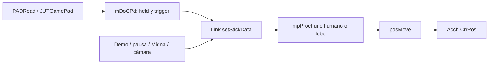

# Jugador y controles

Pin: `40457c6adb381928e4b5fef6ed459ed291edd5e2`; destino solicitado: Dusklight 2.0.3, GZ2E01 USA, Windows x64 / DirectX 12. Profundidad: **trazado selectivo de creación, controles, máquina de estados y actualización**. Esta ficha observa fuente exacta; no ejecuta el juego, no compila ni implementa un mod. Los números originales de campos no se usan como offsets Windows.

## Límites y flujo observado

**PLAYER-001 · STATIC_CROSSCHECKED.** `daAlink_c` contiene el despacho común del jugador humano y lobo: `m_procInitTable` liga procedimientos a modos; `commonProcInit` ejecuta cleanup del estado anterior y actualiza conjuntamente `mpProcFunc`, `mProcID` y `mModeFlg`. Escribir solamente el ID no reproduce esta transición. [src/d/actor/d_a_alink.cpp:1028-1042](https://github.com/TwilitRealm/dusklight/blob/40457c6adb381928e4b5fef6ed459ed291edd5e2/src/d/actor/d_a_alink.cpp#L1028-L1042); [src/d/actor/d_a_alink.cpp:15041-15161](https://github.com/TwilitRealm/dusklight/blob/40457c6adb381928e4b5fef6ed459ed291edd5e2/src/d/actor/d_a_alink.cpp#L15041-L15161).

**PLAYER-002 · STATIC_CROSSCHECKED.** La cadena de controles observada es `mDoCPd_c::read` → `JUTGamePad::read` → `PADRead`; en PC también actualiza los action bindings. La conversión escribe flags held/trigger, sticks y analógicos; el port suprime botones consumidos por el puntero de menús. [src/m_Do/m_Do_controller_pad.cpp:82-154](https://github.com/TwilitRealm/dusklight/blob/40457c6adb381928e4b5fef6ed459ed291edd5e2/src/m_Do/m_Do_controller_pad.cpp#L82-L154); [libs/JSystem/src/JUtility/JUTGamePad.cpp:90-103](https://github.com/TwilitRealm/dusklight/blob/40457c6adb381928e4b5fef6ed459ed291edd5e2/libs/JSystem/src/JUtility/JUTGamePad.cpp#L90-L103).

**PLAYER-003 · STATIC_CROSSCHECKED.** `daAlink_c::setStickData` reinicia botones/trigger y distingue demos/eventos, muerte/pausa, bloqueo de Midna y entrada normal. La dirección normal combina stick y yaw de cámara; la caña puede suministrar un stick distinto. No es una copia universal del dispositivo. [src/d/actor/d_a_alink.cpp:9399-9472](https://github.com/TwilitRealm/dusklight/blob/40457c6adb381928e4b5fef6ed459ed291edd5e2/src/d/actor/d_a_alink.cpp#L9399-L9472); [src/d/actor/d_a_alink.cpp:9494-9525](https://github.com/TwilitRealm/dusklight/blob/40457c6adb381928e4b5fef6ed459ed291edd5e2/src/d/actor/d_a_alink.cpp#L9494-L9525).

**PLAYER-004 · STATIC_CROSSCHECKED.** El mapa adicional `dusk::getActionBinds` enumera seis acciones (cámara subjetiva, Midna, mapa, minimapa, menú y turbo). `updateActionBindings` consulta teclado/ratón/controlador y filtra documentos visibles; este mapa no constituye por sí solo un remapeador SDK de todas las acciones de Link. [src/dusk/action_bindings.cpp:19-29](https://github.com/TwilitRealm/dusklight/blob/40457c6adb381928e4b5fef6ed459ed291edd5e2/src/dusk/action_bindings.cpp#L19-L29); [src/dusk/action_bindings.cpp:54-108](https://github.com/TwilitRealm/dusklight/blob/40457c6adb381928e4b5fef6ed459ed291edd5e2/src/dusk/action_bindings.cpp#L54-L108).

**PLAYER-005 · STATIC_CROSSCHECKED.** En `daAlink_c::execute`, se actualizan referencias a actores y atención/demo antes de `setStickData`; luego el procedimiento actual corre antes de `posMove`, y después se aplica `mLinkAcch.CrrPos`. El humano actualiza objetos/combos/escudo mientras el lobo usa rutas específicas de combo y mordida. [src/d/actor/d_a_alink.cpp:17981-18020](https://github.com/TwilitRealm/dusklight/blob/40457c6adb381928e4b5fef6ed459ed291edd5e2/src/d/actor/d_a_alink.cpp#L17981-L18020); [src/d/actor/d_a_alink.cpp:18236-18330](https://github.com/TwilitRealm/dusklight/blob/40457c6adb381928e4b5fef6ed459ed291edd5e2/src/d/actor/d_a_alink.cpp#L18236-L18330).

**PLAYER-006 · STATIC_CROSSCHECKED.** Los estados WAIT/MOVE humanos y WOLF_WAIT/WOLF_MOVE comparten `commonProcInit`, pero usan comprobadores de siguiente acción y mezclas de animación diferentes. El lobo tiene además un estado DASH con timers y límites propios. No se deduce simetría de parámetros entre formas. [src/d/actor/d_a_alink.cpp:15630-15696](https://github.com/TwilitRealm/dusklight/blob/40457c6adb381928e4b5fef6ed459ed291edd5e2/src/d/actor/d_a_alink.cpp#L15630-L15696); [src/d/actor/d_a_alink_wolf.inc:2550-2654](https://github.com/TwilitRealm/dusklight/blob/40457c6adb381928e4b5fef6ed459ed291edd5e2/src/d/actor/d_a_alink_wolf.inc#L2550-L2654).

El diagrama expresa dependencias estáticas de PLAYER-002/003/005, no una medida temporal de GPU.

## Vida útil, dependencias y estado

**PLAYER-007 · STATIC_CROSSCHECKED.** La creación publica los globals de jugador antes de esperar al event manager y las cargas de archivos/modelos. Un global no nulo no acredita que el modelo o la colisión estén listos. El destructor libera archivos/heaps y borra ambos globals; la función Delete puede demorar el destructor por cambios de ropa/escudo. [src/d/actor/d_a_alink.cpp:4937-5008](https://github.com/TwilitRealm/dusklight/blob/40457c6adb381928e4b5fef6ed459ed291edd5e2/src/d/actor/d_a_alink.cpp#L4937-L5008); [src/d/actor/d_a_alink.cpp:19867-19919](https://github.com/TwilitRealm/dusklight/blob/40457c6adb381928e4b5fef6ed459ed291edd5e2/src/d/actor/d_a_alink.cpp#L19867-L19919).

**PLAYER-008 · STATIC_CROSSCHECKED.** Los fragmentos de herramientas, natación, montura, daño, demos y lobo son `.inc` incluidos por `d_a_alink.cpp`; no son unidades de compilación independientes. Para alias de símbolo por translation unit hay que contrastar la unidad emitida y su manifest, no deducir un alias desde el nombre del `.inc`. [src/d/actor/d_a_alink.cpp:1923-1975](https://github.com/TwilitRealm/dusklight/blob/40457c6adb381928e4b5fef6ed459ed291edd5e2/src/d/actor/d_a_alink.cpp#L1923-L1975); [docs/modding.md:1380-1410](https://github.com/TwilitRealm/dusklight/blob/40457c6adb381928e4b5fef6ed459ed291edd5e2/docs/modding.md#L1380-L1410).

**PLAYER-009 · STATIC_CROSSCHECKED.** `GameService` 2.0 modela la época ABI del código del juego. `fopAc_ac_c` conserva comentarios de layout original pero añade campos TARGET_PC, y `STATIC_ASSERT` se vacía fuera de MWERKS. Ni `/* 0x562 */ health` ni `Size: 0x568` certifican offsets/tamaño en Windows x64. [sdk/include/mods/svc/game.h:10-25](https://github.com/TwilitRealm/dusklight/blob/40457c6adb381928e4b5fef6ed459ed291edd5e2/sdk/include/mods/svc/game.h#L10-L25); [include/f_op/f_op_actor.h:278-343](https://github.com/TwilitRealm/dusklight/blob/40457c6adb381928e4b5fef6ed459ed291edd5e2/include/f_op/f_op_actor.h#L278-L343); [include/global.h:62-73](https://github.com/TwilitRealm/dusklight/blob/40457c6adb381928e4b5fef6ed459ed291edd5e2/include/global.h#L62-L73).

Proveedores: controlador, cámara/event manager, archivos/modelos y actores acompañantes. Consumidores: procedimientos de Link, equipamiento, combate, colisión y HUD de botones. Los resets, demos y enlaces de actor se modifican dentro del tick; cualquier futuro observador debe elegir explícitamente si necesita la entrada física o la entrada efectiva. Esta recomendación se deduce de PLAYER-003/005.

## Símbolos y rutas .dusk

**PLAYER-034 · STATIC_CROSSCHECKED.** La documentación presenta explícitamente hooks tipados de `daAlink_c::posMove` y `execute`, con FEATURES game; `hook.hpp` también lo exige. Eso acredita una ruta de contrato y tipos, no la resolución de esos símbolos ni la convivencia de hooks en nuestro ejecutable Windows. [docs/modding.md:1315-1345](https://github.com/TwilitRealm/dusklight/blob/40457c6adb381928e4b5fef6ed459ed291edd5e2/docs/modding.md#L1315-L1345); [sdk/include/mods/svc/hook.hpp:1-5](https://github.com/TwilitRealm/dusklight/blob/40457c6adb381928e4b5fef6ed459ed291edd5e2/sdk/include/mods/svc/hook.hpp#L1-L5); [src/d/actor/d_a_alink.cpp:13013-13022](https://github.com/TwilitRealm/dusklight/blob/40457c6adb381928e4b5fef6ed459ed291edd5e2/src/d/actor/d_a_alink.cpp#L13013-L13022); [src/d/actor/d_a_alink.cpp:17814-17819](https://github.com/TwilitRealm/dusklight/blob/40457c6adb381928e4b5fef6ed459ed291edd5e2/src/d/actor/d_a_alink.cpp#L17814-L17819).

| Símbolo / firma | Función concreta | Fuente | Integración |
| --- | --- | --- | --- |
| `int daAlink_c::execute()` | Coordina input, procedimientos, equipamiento, movimiento y colisión de Link. | [src/d/actor/d_a_alink.cpp:17814-18338](https://github.com/TwilitRealm/dusklight/blob/40457c6adb381928e4b5fef6ed459ed291edd5e2/src/d/actor/d_a_alink.cpp#L17814-L18338) | `TYPED_HOOK` |
| `void daAlink_c::setStickData()` | Deriva entrada efectiva de controles, demos, pausa, cámara y herramientas. | [src/d/actor/d_a_alink.cpp:9399-9525](https://github.com/TwilitRealm/dusklight/blob/40457c6adb381928e4b5fef6ed459ed291edd5e2/src/d/actor/d_a_alink.cpp#L9399-L9525) | `POTENTIAL_REQUIRES_VERIFICATION` |
| `void daAlink_c::commonProcInit(daAlink_PROC i_procID)` | Limpia estado anterior y cambia función/ID/modo del procedimiento. | [src/d/actor/d_a_alink.cpp:15041-15161](https://github.com/TwilitRealm/dusklight/blob/40457c6adb381928e4b5fef6ed459ed291edd5e2/src/d/actor/d_a_alink.cpp#L15041-L15161) | `POTENTIAL_REQUIRES_VERIFICATION` |
| `int daAlink_c::procMove()` | Estado de movimiento humano con transición/animación y límite de demo. | [src/d/actor/d_a_alink.cpp:15679-15696](https://github.com/TwilitRealm/dusklight/blob/40457c6adb381928e4b5fef6ed459ed291edd5e2/src/d/actor/d_a_alink.cpp#L15679-L15696) | `POTENTIAL_REQUIRES_VERIFICATION` |
| `int daAlink_c::procWolfMove()` | Estado de movimiento lobo con transición y animación específicas. | [src/d/actor/d_a_alink_wolf.inc:2606-2619](https://github.com/TwilitRealm/dusklight/blob/40457c6adb381928e4b5fef6ed459ed291edd5e2/src/d/actor/d_a_alink_wolf.inc#L2606-L2619) | `POTENTIAL_REQUIRES_VERIFICATION` |
| `void mDoCPd_c::read()` | Lee gamepads y aplica supresión PC de botones de menús. | [src/m_Do/m_Do_controller_pad.cpp:82-134](https://github.com/TwilitRealm/dusklight/blob/40457c6adb381928e4b5fef6ed459ed291edd5e2/src/m_Do/m_Do_controller_pad.cpp#L82-L134) | `POTENTIAL_REQUIRES_VERIFICATION` |
| `void dusk::updateActionBindings()` | Muestrea las seis acciones adicionales, estados previos y visibilidad de UI. | [src/dusk/action_bindings.cpp:54-108](https://github.com/TwilitRealm/dusklight/blob/40457c6adb381928e4b5fef6ed459ed291edd5e2/src/dusk/action_bindings.cpp#L54-L108) | `POTENTIAL_REQUIRES_VERIFICATION` |

`TYPED_HOOK` identifica el contrato documentado de declaración, no un certificado de resolución Windows. Para el resto se mantiene `POTENTIAL_REQUIRES_VERIFICATION`: comprobar firma, manifest de símbolos, adquisición del jugador listo y convivencia. Registrar la huella del hook y retirar callbacks antes de descargar el código; si hubo mutaciones de estado de Link, retirar el hook por sí solo no reconstruye el procedimiento anterior (PLAYER-001/005/007). Véase [HOOKING_AND_ABI](../HOOKING_AND_ABI.md).

## Cobertura y siguiente paso mínimo

Examinados el despacho humano/lobo, lectura de input, creación/destrucción y orden de física. **PENDING**: listado semántico completo de procedimientos, todas las herramientas/habilidades, transformación completa humano↔lobo, configuraciones regionales y pruebas de interrupción de cutscenes. Los `.inc` de herramientas se localizaron por sus inclusiones; no se declaran íntegramente comprendidos. Falta resolver los targets en el ejecutable GZ2E01 Windows y verificar estados de menú/carga/pause/reentrada. Esta campaña no reutiliza informes de un actor previo como prueba de todos esos estados.

Dependencias: [movimiento](movement_physics_collision.md), [combate](combat_damage.md), [actores](actors_ai_npcs.md), [otros sistemas](other_systems.md), [eventos](flags_events_progression.md), [cámaras](cameras_rendering.md).

Cobertura: READ/CROSSCHECKED selectiva según SYSTEM_INDEX y los niveles de cada evidencia; ninguna ruta constituye prueba runtime Windows/DX12.
