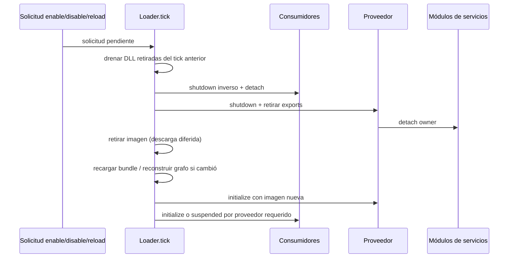
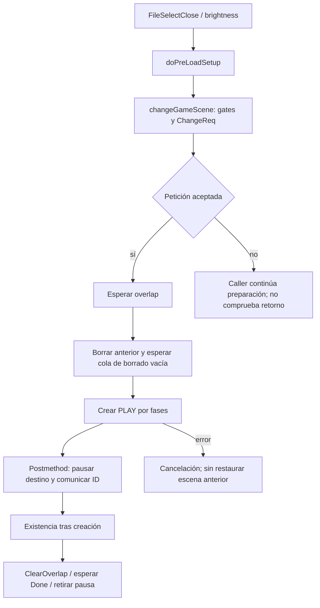

# Runtime y ciclo de vida del port y de los mods

Estado: `STATIC_CROSSCHECKED` en el commit fijado. Se estudian carga/activación/update/retirada, dependencias y frontera con el loop del juego. El bootstrap completo, menú, slots y escenas quedan fuera del alcance de esta ficha; no se presume una partida ya cargada en `mod_initialize`. Cobertura: **CROSSCHECKED** de las rutas citadas de loader/hooks; otras rutas siguen pendientes.

## Carga, estado y propietarios

RES_DIR, OVERLAY_DIR y TEXTURES_DIR se copian explícitamente al stage; mod.json y lib/plataforma se empaquetan como ZIP .dusk. No se generan paquetes en esta campaña.

**HOOK-023 · SOURCE_OBSERVED** — [cmake/ModSDK.cmake:305–375](https://github.com/TwilitRealm/dusklight/blob/40457c6adb381928e4b5fef6ed459ed291edd5e2/cmake/ModSDK.cmake#L305-L375); [cmake/ModSDK.cmake:401–415](https://github.com/TwilitRealm/dusklight/blob/40457c6adb381928e4b5fef6ed459ed291edd5e2/cmake/ModSDK.cmake#L401-L415)

Un mod puede ser asset-only, native o delegado a runtime @major.minor; runtime y código nativo juntos son conflicto y el host valida activate/update/deactivate del proveedor.

**HOOK-024 · STATIC_CROSSCHECKED** — [src/dusk/mods/loader/manifest.cpp:77–112](https://github.com/TwilitRealm/dusklight/blob/40457c6adb381928e4b5fef6ed459ed291edd5e2/src/dusk/mods/loader/manifest.cpp#L77-L112); [src/dusk/mods/loader/natives.cpp:532–551](https://github.com/TwilitRealm/dusklight/blob/40457c6adb381928e4b5fef6ed459ed291edd5e2/src/dusk/mods/loader/natives.cpp#L532-L551); [src/dusk/mods/loader/loader.cpp:213–216](https://github.com/TwilitRealm/dusklight/blob/40457c6adb381928e4b5fef6ed459ed291edd5e2/src/dusk/mods/loader/loader.cpp#L213-L216); [src/dusk/mods/loader/loader.cpp:237–271](https://github.com/TwilitRealm/dusklight/blob/40457c6adb381928e4b5fef6ed459ed291edd5e2/src/dusk/mods/loader/loader.cpp#L237-L271); [sdk/include/mods/runtime.h:5–15](https://github.com/TwilitRealm/dusklight/blob/40457c6adb381928e4b5fef6ed459ed291edd5e2/sdk/include/mods/runtime.h#L5-L15)

Un .dusk nativo Windows MSVC x64 busca lib/windows-amd64/mod.dll y carga con LoadLibraryExW SEARCH_DLL_LOAD_DIR|DEFAULT_DIRS; otros recursos de la plataforma se extraen en directorio por generación.

**HOOK-013 · STATIC_CROSSCHECKED** — [src/dusk/mods/loader/natives.cpp:25–35](https://github.com/TwilitRealm/dusklight/blob/40457c6adb381928e4b5fef6ed459ed291edd5e2/src/dusk/mods/loader/natives.cpp#L25-L35); [src/dusk/mods/loader/natives.cpp:386–403](https://github.com/TwilitRealm/dusklight/blob/40457c6adb381928e4b5fef6ed459ed291edd5e2/src/dusk/mods/loader/natives.cpp#L386-L403); [src/dusk/mods/loader/natives.cpp:429–485](https://github.com/TwilitRealm/dusklight/blob/40457c6adb381928e4b5fef6ed459ed291edd5e2/src/dusk/mods/loader/natives.cpp#L429-L485); [src/dusk/mods/loader/native_module.cpp:10–19](https://github.com/TwilitRealm/dusklight/blob/40457c6adb381928e4b5fef6ed459ed291edd5e2/src/dusk/mods/loader/native_module.cpp#L10-L19)

load_native exige cinco exports mod_meta/mod_ctx/mod_initialize/mod_update/mod_shutdown y valida metadatos antes de aceptar la biblioteca.

**HOOK-014 · SOURCE_OBSERVED** — [src/dusk/mods/loader/natives.cpp:488–528](https://github.com/TwilitRealm/dusklight/blob/40457c6adb381928e4b5fef6ed459ed291edd5e2/src/dusk/mods/loader/natives.cpp#L488-L528)

Imports obligatorios y opcionales forman grafo proveedor->consumidor; los ciclos requeridos fallan, los ciclos opcionales pierden una arista de orden y conservan resolución.

**HOOK-015 · STATIC_CROSSCHECKED** — [src/dusk/mods/loader/depgraph.cpp:21–80](https://github.com/TwilitRealm/dusklight/blob/40457c6adb381928e4b5fef6ed459ed291edd5e2/src/dusk/mods/loader/depgraph.cpp#L21-L80); [src/dusk/mods/loader/depgraph.cpp:110–204](https://github.com/TwilitRealm/dusklight/blob/40457c6adb381928e4b5fef6ed459ed291edd5e2/src/dusk/mods/loader/depgraph.cpp#L110-L204); [src/dusk/mods/loader/loader.cpp:396–438](https://github.com/TwilitRealm/dusklight/blob/40457c6adb381928e4b5fef6ed459ed291edd5e2/src/dusk/mods/loader/loader.cpp#L396-L438)

activate_mod registra exports, resuelve imports y hooks y llama initialize; solo éxito fija initialized. Un fallo de initialize inicia el cleanup de servicios pero no entra a mod_shutdown; el rollback de estado externo de init debe ser propio.

**HOOK-016 · STATIC_CROSSCHECKED** — [src/dusk/mods/loader/loader.cpp:209–294](https://github.com/TwilitRealm/dusklight/blob/40457c6adb381928e4b5fef6ed459ed291edd5e2/src/dusk/mods/loader/loader.cpp#L209-L294); [src/dusk/mods/loader/loader.cpp:296–334](https://github.com/TwilitRealm/dusklight/blob/40457c6adb381928e4b5fef6ed459ed291edd5e2/src/dusk/mods/loader/loader.cpp#L296-L334)

El host distingue `active`, `initialized`, `loadFailed`, `servicesRegistered`, `enabledApplied` y `suspendedByProvider`; no son sinónimos. Por ejemplo, `active` se establece antes de entrar a initialize; solo su éxito fija `initialized`. En init fallida, una mutación game-side o hilo ya arrancado no queda revertido por un shutdown que no se invocará. Diseñar initialize como transacción propia, con liberación al fallar cada paso (inferencia de HOOK-016).

El contexto identifica al dueño/consumidor de una llamada de servicio. Un proveedor recibe el contexto del mod llamante, no necesariamente el suyo; los punteros de servicio no sustituyen propiedad de handles. Ver [api.h:69–105](https://github.com/TwilitRealm/dusklight/blob/40457c6adb381928e4b5fef6ed459ed291edd5e2/sdk/include/mods/api.h#L69-L105).

## Tick y relación con actores

tick empieza con frameBegin y cambios pendientes, recorre updates de mods activos y acaba frameEnd. fapGm_Execute llama duskExecute/tick antes de fpcM_Management; no garantiza correspondencia uno a uno con cada frame presentado.

**HOOK-018 · STATIC_CROSSCHECKED** — [src/dusk/mods/loader/loader.cpp:1237–1266](https://github.com/TwilitRealm/dusklight/blob/40457c6adb381928e4b5fef6ed459ed291edd5e2/src/dusk/mods/loader/loader.cpp#L1237-L1266); [src/f_ap/f_ap_game.cpp:748–751](https://github.com/TwilitRealm/dusklight/blob/40457c6adb381928e4b5fef6ed459ed291edd5e2/src/f_ap/f_ap_game.cpp#L748-L751); [src/f_ap/f_ap_game.cpp:807–843](https://github.com/TwilitRealm/dusklight/blob/40457c6adb381928e4b5fef6ed459ed291edd5e2/src/f_ap/f_ap_game.cpp#L807-L843)

fail_mod marca inactivo, retira exports y encola disable sin teardown inmediato; bibliotecas retiradas se descargan realmente al siguiente apply_pending_requests.

**HOOK-019 · STATIC_CROSSCHECKED** — [src/dusk/mods/loader/context.cpp:21–37](https://github.com/TwilitRealm/dusklight/blob/40457c6adb381928e4b5fef6ed459ed291edd5e2/src/dusk/mods/loader/context.cpp#L21-L37); [src/dusk/mods/loader/loader.cpp:537–548](https://github.com/TwilitRealm/dusklight/blob/40457c6adb381928e4b5fef6ed459ed291edd5e2/src/dusk/mods/loader/loader.cpp#L537-L548); [src/dusk/mods/loader/loader.cpp:1100–1108](https://github.com/TwilitRealm/dusklight/blob/40457c6adb381928e4b5fef6ed459ed291edd5e2/src/dusk/mods/loader/loader.cpp#L1100-L1108); [src/dusk/mods/loader/natives.cpp:563–583](https://github.com/TwilitRealm/dusklight/blob/40457c6adb381928e4b5fef6ed459ed291edd5e2/src/dusk/mods/loader/natives.cpp#L563-L583)

Flujo observado de `fapGm_Execute`: `duskExecute` (incluye `updateAutoSave` y tick de mods) → `fpcM_Management` → contador → partículas de menú → GameMode `invokeOnTickFunction` → achievements. Por ello `mod_update` no demuestra que un actor concreto vaya a ejecutar ese tick ni que tenga recursos listos; el gestor de procesos aún aplica su propia programación. Pausa, carga y escena deben consultarse mediante el servicio o estado apropiado. No se equipara este tick al framerate DX12 de presentación.

## Desactivación y reload

deactivate_mod invoca módulos deactivating, shutdown si inicializado, elimina exports, invoca módulos detached y retira nativo. Excepciones/errores de shutdown se registran y continúa teardown.

**HOOK-017 · SOURCE_OBSERVED** — [src/dusk/mods/loader/loader.cpp:296–338](https://github.com/TwilitRealm/dusklight/blob/40457c6adb381928e4b5fef6ed459ed291edd5e2/src/dusk/mods/loader/loader.cpp#L296-L338); [src/dusk/mods/svc/registry.cpp:210–224](https://github.com/TwilitRealm/dusklight/blob/40457c6adb381928e4b5fef6ed459ed291edd5e2/src/dusk/mods/svc/registry.cpp#L210-L224)

Disable/reload recolecta dependientes y apaga en orden inverso, recarga manifiesto e imagen, reconstruye grafo si cambia y reactiva proveedores antes de consumidores; required ausente suspende consumidor.

**HOOK-020 · SOURCE_OBSERVED** — [src/dusk/mods/loader/loader.cpp:581–607](https://github.com/TwilitRealm/dusklight/blob/40457c6adb381928e4b5fef6ed459ed291edd5e2/src/dusk/mods/loader/loader.cpp#L581-L607); [src/dusk/mods/loader/loader.cpp:610–663](https://github.com/TwilitRealm/dusklight/blob/40457c6adb381928e4b5fef6ed459ed291edd5e2/src/dusk/mods/loader/loader.cpp#L610-L663); [src/dusk/mods/loader/loader.cpp:666–755](https://github.com/TwilitRealm/dusklight/blob/40457c6adb381928e4b5fef6ed459ed291edd5e2/src/dusk/mods/loader/loader.cpp#L666-L755)

Reload fallido deja target fallido; no hay restauración automática de la imagen vieja. mod ID cambiado devuelve CONFLICT; nativeInPlace rechaza reload sin paquete de reemplazo.

**HOOK-021 · SOURCE_OBSERVED** — [src/dusk/mods/loader/loader.cpp:610–629](https://github.com/TwilitRealm/dusklight/blob/40457c6adb381928e4b5fef6ed459ed291edd5e2/src/dusk/mods/loader/loader.cpp#L610-L629); [src/dusk/mods/loader/loader.cpp:738–755](https://github.com/TwilitRealm/dusklight/blob/40457c6adb381928e4b5fef6ed459ed291edd5e2/src/dusk/mods/loader/loader.cpp#L738-L755); [src/dusk/mods/loader/loader.cpp:900–909](https://github.com/TwilitRealm/dusklight/blob/40457c6adb381928e4b5fef6ed459ed291edd5e2/src/dusk/mods/loader/loader.cpp#L900-L909)

El contrato prohíbe hooks cuya función permanece en stack toda sesión, porque el cambio lifecycle entre frames no garantiza su descarga segura.

**HOOK-022 · DOC_CONTRACT** — [docs/modding.md:1469–1491](https://github.com/TwilitRealm/dusklight/blob/40457c6adb381928e4b5fef6ed459ed291edd5e2/docs/modding.md#L1469-L1491)

Este diagrama resume HOOK-017/019/020. Reload no es rollback transaccional a la biblioteca anterior. El bundle anterior puede seguir vivo mediante `shared_ptr` de lectores, pero eso no equivale a que el mod siga activo ni que se puedan reutilizar sus callbacks/punteros de código. Cada generación nativa tiene nuevo directorio; el host retira directorios al descargar imágenes retiradas.

## Contratos para consumidores y próximos pasos

Preferir imports declarados para dependencias: dan orden init/shutdown y reinicio en cascada. Un lookup dinámico `HostService::get_service` ve lo publicado en ese momento y no agrega esa garantía al grafo (DOC_CONTRACT [api.h:96–105](https://github.com/TwilitRealm/dusklight/blob/40457c6adb381928e4b5fef6ed459ed291edd5e2/sdk/include/mods/api.h#L96-L105)). Una dependencia opcional puede resolver NULL y puede perder su orden por ciclo; el consumidor debe tolerarlo.

OFFICIAL_SERVICE: usar lifecycle y ownership de los servicios oficiales para registros. TYPED_HOOK/SYMBOL_HOOK: solo para puntos concretos que no cubre servicio, previa validación descrita en [hooks](../HOOKING_AND_ABI.md). POTENTIAL_REQUIRES_VERIFICATION: cualquier garantía de convivencia real, scene transition, callback concurrente, exception cross-DLL y rendimiento.

Pendiente: bootstrap completo de recursos/heaps e hilos Aurora/Borealis (gitlinks no incluidos); inspección del reloj fijo frente a presentación, pausas y fast-forward; runtime Windows real de reload con dos consumidores y fallos intermedios. Evidencia histórica CP20/CP21 se registra por separado en SOURCE_PIN; no convierte esta lectura estática en runtime observado.

## Segundo contraste: cleanup anterior al shutdown y sus límites

ActorService intenta retirar perfiles propios antes de shutdown; si unregister_actor no completa borrado devuelve UNAVAILABLE y conserva perfil. actor_remove_mod sólo registra el fallo y ModLoader continúa teardown/unload; no se debe declarar garantizada la seguridad del unload con actores propios vivos.

**HOOK-029 · STATIC_CROSSCHECKED** — [src/dusk/mods/svc/actor.cpp:193–218](https://github.com/TwilitRealm/dusklight/blob/40457c6adb381928e4b5fef6ed459ed291edd5e2/src/dusk/mods/svc/actor.cpp#L193-L218); [src/dusk/mods/svc/actor.cpp:359–372](https://github.com/TwilitRealm/dusklight/blob/40457c6adb381928e4b5fef6ed459ed291edd5e2/src/dusk/mods/svc/actor.cpp#L359-L372); [src/dusk/mods/svc/actor.cpp:395–401](https://github.com/TwilitRealm/dusklight/blob/40457c6adb381928e4b5fef6ed459ed291edd5e2/src/dusk/mods/svc/actor.cpp#L395-L401); [src/dusk/mods/loader/loader.cpp:296–338](https://github.com/TwilitRealm/dusklight/blob/40457c6adb381928e4b5fef6ed459ed291edd5e2/src/dusk/mods/loader/loader.cpp#L296-L338)

GfxService retira tipos draw/encoder task del propietario y llama aurora::gfx::synchronize antes de mod_shutdown mediante modDeactivating; el detalle de sincronización reside en dependencia externa.

**HOOK-030 · STATIC_CROSSCHECKED** — [src/dusk/mods/svc/gfx.cpp:166–187](https://github.com/TwilitRealm/dusklight/blob/40457c6adb381928e4b5fef6ed459ed291edd5e2/src/dusk/mods/svc/gfx.cpp#L166-L187); [src/dusk/mods/svc/gfx.cpp:1460–1470](https://github.com/TwilitRealm/dusklight/blob/40457c6adb381928e4b5fef6ed459ed291edd5e2/src/dusk/mods/svc/gfx.cpp#L1460-L1470); [src/dusk/mods/loader/loader.cpp:296–308](https://github.com/TwilitRealm/dusklight/blob/40457c6adb381928e4b5fef6ed459ed291edd5e2/src/dusk/mods/loader/loader.cpp#L296-L308)

Los módulos deactivating se ejecutan antes del shutdown del mod. Por ello un proveedor de actores propios no debe esperar hasta shutdown para empezar un cleanup que necesite varios ticks: el host ya intentó su retirada sincrónica. En el camino de fallo conservado puede quedar un perfil con callbacks del mod mientras la DLL se retira para descarga posterior: **STATIC_INFERRED**, riesgo de vigencia, sin crash observado. No se propone modificar host/SDK; una futura integración debe demostrar destrucción sincrónica y definir política de rechazo o reinicio si no puede garantizarla.

La sincronización explícita de Gfx evita extrapolar el retraso de un tick como única protección para todos los workers. No se deduce que un hilo propio del mod o de una DLL adicional quede detenido por esa barrera: sigue siendo responsabilidad de su dueño según el contrato de runtime libraries.

## CP-R10 — transición concreta file-select → PLAY

Cadena contrastada estáticamente en el pin, sin ejecutar el juego. Se elige `dScnName_c`, no se mezclan logo/direct-load ni retorno a opening. Contrato público de transición de escena no localizado en los 25 servicios registrados; los encabezados f_op describen APIs internas, no una garantía SDK.

**Caller y aceptación — ARCH-002/003.** `isSelectEnd()==1` pasa a cierre. En PC `hideTvSettingsScreen` decide si se recorre brightness o se llama directamente a `doPreLoadSetup`; este selecciona ChangeGameScene antes del gate PC de rupee cutscenes. `execute` conserva gates de reset. `changeGameScene` exige !reset y !IsPeek, llama gameStart y solicita PLAY con fade=0,peek=5 (ruta ordinaria no DEBUG). Después deshabilita next-stage, configura stage inicial si archivo nuevo, limpia estado ambiental/restart y habilita autosave PC. **Ignora el retorno**: esos efectos no prueban aceptación ni se revierten aquí. No se atribuye número de segundos a peek5.

`fopScnM_ChangeReq` llama Request tipo2 con data NULL y devuelve 0/1; guarda internamente request_id. Ese ID pertenece a la solicitud, distinto de creating_id del destino. ChangeNode rechaza target ya solicitado/en creación; asignación puede fallar. La solicitud se encola antes de pedir overlap; si este falla se retira y devuelve ERROR. Fade 0 sigue la ruta con overlap porque solo 0x7FFF lo omite.

**Cleanup — ARCH-004.** La secuencia real es IsDeleteTiming→Delete→IsDeleted→Create→IsCreated. IsDeleted consulta la cola GLOBAL de borrado, no únicamente el objeto antiguo. Delete puede esperar; el borrado del nodo cancela solicitudes del layer y recorre hijos antes de retirarlo. No demuestra que esta escena tenga un conjunto particular de actores vivos. `dScnName_Delete` invoca destructor: elimina dFs_c y mBrightCheck, llama deleteObjectResMain("fileSel"), destruye mHeap, normaliza botellas, pone windowNum=0 y vista=NULL. La escena había creado heap y UI usando fileSel. fopScn retira scene_tag tras delete exitoso; fpcBs_Delete libera el proceso. **Demostrado:** UI/heap/objeto destruidos y vista limpiada. **Condicionado:** punteros prestados a esas asignaciones caducan; no afirmar descarga física de todo archive compartido ni invalidación de todos los actores del juego.

**Creación y ejecución — ARCH-005/006.** Create solicita creación estándar: cargar perfil→crear proceso→SubCreate→esperar creación de hijos→postmethod. fpcNd instala layer/submétodos; fopScn enlaza perfil de escena. g_profile_PLAY_SCENE apunta a dScnPly_Create, con su propia máquina de fases. Por ejemplo espera Stg_00, solicita Event/CamParam y espera comandos de partículas/mensajes. Se localiza esta entrada y sus gates representativos; no se audita todo el bootstrap PLAY ni todos sus fallos. COMPLEATE intenta encolar ejecución y retira request de creación; IsCreated exige que ya no esté creando y exista. Existir NO equivale a que execute se haya llamado: este exige init_state==2 y ausencia de pausa bit1, además de gates de ARCH-001.

El postmethod pausa destino bits1/2 y comunica ID al overlap. La máquina de escena espera IsDoing/IsDone, ejecuta cambio, solicita ClearOverlap, espera IsDone y llama Done; Done intenta retirar pausa respetando estado del padre. Overlap mantiene su propia solicitud/tarea y handshake de fade/peek. No se presume timing de presentación ni audibilidad. En el camino normal fapGm_After, callback posterior a execute/draw de ARCH-001, gestiona escena antes que overlap; creación/borrado avanzan por sus colas. No garantiza ticks/framerate ni progreso bajo error/captura.

**Fallo, cancelación y reintento — ARCH-007.** Error/UNK3 del nodo pasa por Cancel: si cancelar overlap falla, el handler devuelve 0 y la petición no se libera por ese camino. Si completa, se retira la petición. La creación estándar intenta borrar proceso parcial al cancelar. ReRequest busca request tipo2 y solo sustituye name/data mientras creating_id==-2; no es retry después de creación ni restaura menú/UI destruidos. El caller permanece en su estado y no usa ReRequest ni procesa explícitamente fallo. La liberación del flag de exclusión de overlap aparece en Done; no certificar recuperación global tras todos los errores de overlap sin más estudio.

**Frontera .dusk.** Estado de transición pertenece al framework; UI/heap al dueño dScnName. StageService sirve para ediciones de registros de actores y no ofrece una transición genérica (WORLD-001..005); Host lifecycle no constituye notificación de escena lista. Los símbolos nuevos son POTENTIAL_REQUIRES_VERIFICATION: firma/fase y resolución Windows deben probarse antes de cualquier hook. Un rollback de registros propios no reconstruye file-select ni restaura mutaciones del caller. Para futuras integraciones generales, revalidar contexto/ID y vigencia de punteros por fase; este informe no propone implementación de mod.

Referencias exactas y límites por afirmación: ARCH-002..007 en el ledger. Las dudas restantes de Q-09 incluyen recuperación de errores, logo/direct-load, reset/opening y todos los gates de captura/presentación.

**ARCH-002** — [src/d/d_s_name.cpp:311–351](https://github.com/TwilitRealm/dusklight/blob/40457c6adb381928e4b5fef6ed459ed291edd5e2/src/d/d_s_name.cpp#L311-L351); [src/d/d_s_name.cpp:372–429](https://github.com/TwilitRealm/dusklight/blob/40457c6adb381928e4b5fef6ed459ed291edd5e2/src/d/d_s_name.cpp#L372-L429); [src/d/d_s_name.cpp:226–245](https://github.com/TwilitRealm/dusklight/blob/40457c6adb381928e4b5fef6ed459ed291edd5e2/src/d/d_s_name.cpp#L226-L245)

**ARCH-003** — [src/f_op/f_op_scene_mng.cpp:17–46](https://github.com/TwilitRealm/dusklight/blob/40457c6adb381928e4b5fef6ed459ed291edd5e2/src/f_op/f_op_scene_mng.cpp#L17-L46); [include/f_op/f_op_scene_mng.h:10–16](https://github.com/TwilitRealm/dusklight/blob/40457c6adb381928e4b5fef6ed459ed291edd5e2/include/f_op/f_op_scene_mng.h#L10-L16); [src/f_op/f_op_scene_req.cpp:98–151](https://github.com/TwilitRealm/dusklight/blob/40457c6adb381928e4b5fef6ed459ed291edd5e2/src/f_op/f_op_scene_req.cpp#L98-L151); [src/f_pc/f_pc_node_req.cpp:183–198](https://github.com/TwilitRealm/dusklight/blob/40457c6adb381928e4b5fef6ed459ed291edd5e2/src/f_pc/f_pc_node_req.cpp#L183-L198); [src/f_pc/f_pc_node_req.cpp:239–260](https://github.com/TwilitRealm/dusklight/blob/40457c6adb381928e4b5fef6ed459ed291edd5e2/src/f_pc/f_pc_node_req.cpp#L239-L260); [src/f_pc/f_pc_node_req.cpp:313–337](https://github.com/TwilitRealm/dusklight/blob/40457c6adb381928e4b5fef6ed459ed291edd5e2/src/f_pc/f_pc_node_req.cpp#L313-L337)

**ARCH-004** — [src/f_pc/f_pc_node_req.cpp:32–94](https://github.com/TwilitRealm/dusklight/blob/40457c6adb381928e4b5fef6ed459ed291edd5e2/src/f_pc/f_pc_node_req.cpp#L32-L94); [src/f_pc/f_pc_node_req.cpp:239–245](https://github.com/TwilitRealm/dusklight/blob/40457c6adb381928e4b5fef6ed459ed291edd5e2/src/f_pc/f_pc_node_req.cpp#L239-L245); [src/f_pc/f_pc_deletor.cpp:63–104](https://github.com/TwilitRealm/dusklight/blob/40457c6adb381928e4b5fef6ed459ed291edd5e2/src/f_pc/f_pc_deletor.cpp#L63-L104); [src/f_pc/f_pc_node.cpp:84–104](https://github.com/TwilitRealm/dusklight/blob/40457c6adb381928e4b5fef6ed459ed291edd5e2/src/f_pc/f_pc_node.cpp#L84-L104); [src/d/d_s_name.cpp:81–101](https://github.com/TwilitRealm/dusklight/blob/40457c6adb381928e4b5fef6ed459ed291edd5e2/src/d/d_s_name.cpp#L81-L101); [src/d/d_s_name.cpp:269–291](https://github.com/TwilitRealm/dusklight/blob/40457c6adb381928e4b5fef6ed459ed291edd5e2/src/d/d_s_name.cpp#L269-L291); [src/d/d_s_name.cpp:439–457](https://github.com/TwilitRealm/dusklight/blob/40457c6adb381928e4b5fef6ed459ed291edd5e2/src/d/d_s_name.cpp#L439-L457); [src/f_op/f_op_scene.cpp:30–65](https://github.com/TwilitRealm/dusklight/blob/40457c6adb381928e4b5fef6ed459ed291edd5e2/src/f_op/f_op_scene.cpp#L30-L65); [src/f_pc/f_pc_base.cpp:102–110](https://github.com/TwilitRealm/dusklight/blob/40457c6adb381928e4b5fef6ed459ed291edd5e2/src/f_pc/f_pc_base.cpp#L102-L110)

**ARCH-005** — [src/f_pc/f_pc_stdcreate_req.cpp:34–126](https://github.com/TwilitRealm/dusklight/blob/40457c6adb381928e4b5fef6ed459ed291edd5e2/src/f_pc/f_pc_stdcreate_req.cpp#L34-L126); [src/f_pc/f_pc_stdcreate_req.cpp:140–178](https://github.com/TwilitRealm/dusklight/blob/40457c6adb381928e4b5fef6ed459ed291edd5e2/src/f_pc/f_pc_stdcreate_req.cpp#L140-L178); [src/f_pc/f_pc_create_req.cpp:84–118](https://github.com/TwilitRealm/dusklight/blob/40457c6adb381928e4b5fef6ed459ed291edd5e2/src/f_pc/f_pc_create_req.cpp#L84-L118); [src/f_pc/f_pc_node.cpp:107–124](https://github.com/TwilitRealm/dusklight/blob/40457c6adb381928e4b5fef6ed459ed291edd5e2/src/f_pc/f_pc_node.cpp#L107-L124); [src/f_op/f_op_scene.cpp:44–65](https://github.com/TwilitRealm/dusklight/blob/40457c6adb381928e4b5fef6ed459ed291edd5e2/src/f_op/f_op_scene.cpp#L44-L65); [src/d/d_s_play.cpp:1370–1425](https://github.com/TwilitRealm/dusklight/blob/40457c6adb381928e4b5fef6ed459ed291edd5e2/src/d/d_s_play.cpp#L1370-L1425); [src/d/d_s_play.cpp:1635–1681](https://github.com/TwilitRealm/dusklight/blob/40457c6adb381928e4b5fef6ed459ed291edd5e2/src/d/d_s_play.cpp#L1635-L1681); [src/f_pc/f_pc_executor.cpp:24–36](https://github.com/TwilitRealm/dusklight/blob/40457c6adb381928e4b5fef6ed459ed291edd5e2/src/f_pc/f_pc_executor.cpp#L24-L36); [src/f_pc/f_pc_executor.cpp:75–82](https://github.com/TwilitRealm/dusklight/blob/40457c6adb381928e4b5fef6ed459ed291edd5e2/src/f_pc/f_pc_executor.cpp#L75-L82)

**ARCH-006** — [src/f_op/f_op_scene_req.cpp:17–52](https://github.com/TwilitRealm/dusklight/blob/40457c6adb381928e4b5fef6ed459ed291edd5e2/src/f_op/f_op_scene_req.cpp#L17-L52); [src/f_op/f_op_scene_req.cpp:69–95](https://github.com/TwilitRealm/dusklight/blob/40457c6adb381928e4b5fef6ed459ed291edd5e2/src/f_op/f_op_scene_req.cpp#L69-L95); [src/f_op/f_op_scene_req.cpp:118–126](https://github.com/TwilitRealm/dusklight/blob/40457c6adb381928e4b5fef6ed459ed291edd5e2/src/f_op/f_op_scene_req.cpp#L118-L126); [src/f_op/f_op_scene_pause.cpp:10–41](https://github.com/TwilitRealm/dusklight/blob/40457c6adb381928e4b5fef6ed459ed291edd5e2/src/f_op/f_op_scene_pause.cpp#L10-L41); [src/f_op/f_op_overlap_mng.cpp:44–117](https://github.com/TwilitRealm/dusklight/blob/40457c6adb381928e4b5fef6ed459ed291edd5e2/src/f_op/f_op_overlap_mng.cpp#L44-L117); [src/f_op/f_op_overlap_req.cpp:41–108](https://github.com/TwilitRealm/dusklight/blob/40457c6adb381928e4b5fef6ed459ed291edd5e2/src/f_op/f_op_overlap_req.cpp#L41-L108); [src/f_ap/f_ap_game.cpp:730–744](https://github.com/TwilitRealm/dusklight/blob/40457c6adb381928e4b5fef6ed459ed291edd5e2/src/f_ap/f_ap_game.cpp#L730-L744); [src/f_ap/f_ap_game.cpp:824–832](https://github.com/TwilitRealm/dusklight/blob/40457c6adb381928e4b5fef6ed459ed291edd5e2/src/f_ap/f_ap_game.cpp#L824-L832); [src/f_pc/f_pc_manager.cpp:99–115](https://github.com/TwilitRealm/dusklight/blob/40457c6adb381928e4b5fef6ed459ed291edd5e2/src/f_pc/f_pc_manager.cpp#L99-L115)

**ARCH-007** — [src/f_pc/f_pc_node_req.cpp:104–139](https://github.com/TwilitRealm/dusklight/blob/40457c6adb381928e4b5fef6ed459ed291edd5e2/src/f_pc/f_pc_node_req.cpp#L104-L139); [src/f_pc/f_pc_node_req.cpp:159–180](https://github.com/TwilitRealm/dusklight/blob/40457c6adb381928e4b5fef6ed459ed291edd5e2/src/f_pc/f_pc_node_req.cpp#L159-L180); [src/f_pc/f_pc_node_req.cpp:340–362](https://github.com/TwilitRealm/dusklight/blob/40457c6adb381928e4b5fef6ed459ed291edd5e2/src/f_pc/f_pc_node_req.cpp#L340-L362); [src/f_op/f_op_scene_req.cpp:77–82](https://github.com/TwilitRealm/dusklight/blob/40457c6adb381928e4b5fef6ed459ed291edd5e2/src/f_op/f_op_scene_req.cpp#L77-L82); [src/f_pc/f_pc_create_req.cpp:61–74](https://github.com/TwilitRealm/dusklight/blob/40457c6adb381928e4b5fef6ed459ed291edd5e2/src/f_pc/f_pc_create_req.cpp#L61-L74); [src/f_op/f_op_scene_mng.cpp:40–46](https://github.com/TwilitRealm/dusklight/blob/40457c6adb381928e4b5fef6ed459ed291edd5e2/src/f_op/f_op_scene_mng.cpp#L40-L46)

## CP-R24 — Fallo de overlap frente a fallo del destino

Amplía ARCH-007 con la propagación exacta de error y flags; no repite file-select→PLAY nominal. Las APIs f_op/f_pc siguen siendo internas: no se localizó servicio SDK genérico de transición/cancelación de escena. ARCH-008..011 contrastan un consumidor del port y dos rutas de fallo posibles; no provocadas en juego.

**Consumidor elegido: logo con stage solicitado (ARCH-008).** nextSceneChange requiere !reset y !isOpeningCut. En TARGET_PC, si StageRequested.set y SaveRequested==0, la rama inicial omite opening; después inicializa estado de save en memoria, solicita PLAY con overlap0/peek30, pone SaveRequested=0xff, escribe next/start stage y limpia StageRequested.set. Se ignora ChangeReq: el caller consume su petición aun si fue rechazada. No se ejecutó carga ni se abrió save. La rama SaveRequested1..3 con LoadSync es otra ruta y queda excluida de esta cadena, al igual que menú DEBUG/opening. Estos efectos previos no son rollback ni confirmación de ejecución de PLAY.

**Fallo A: el task de overlap no llega a existir.** scene Request configura tabla fade y acepta una estructura de overlap; todavía no ha creado el proceso del efecto. El handler overlap solicita ese proceso, espera IsCreating y luego SearchByID. Si ya no está creando y no existe, devuelve ERROR. El manager de overlap recibe ese resultado y pone su punteroNULL; no llama a su phase_Done en esa rama. Scene no consume ese error como resultado: sus waits consultan booleanos IsDoing/IsDone que con punteroNULL devuelven false, traduciéndolo a INIT. La primera espera IsDone precede al Execute del nodo de cambio; en este supuesto no se alcanzó el borrado de la escena anterior por esta petición. No equivale al fallo de creación de PLAY después de borrar logo.

fapGm_After gestiona scene antes de overlap: se ve cómo el primero puede quedar esperando un resultado que el segundo ha descartado. **Inferencia condicionada ARCH-011:** si ocurre ese fallo y no interviene otra ruta, el request scene puede seguir esperando: estos waits no incluyen timeout ni propagan ERROR. No se demuestra bloqueo real ni que el sistema completo carezca de reset/terminación alternativos. El fallo puede originarse en la solicitud/creación del proceso del efecto; no se asigna una frecuencia ni se inventa un asset roto.

**Fallo B: destino falla cuando overlap ya permitió cambiar nodo.** El nodo puede devolver UNK3 al no aceptar creación estándar o al terminar sin proceso existente. El handler intenta Cancel; si este devuelve0, retorna sin liberar esa petición. fopScnRq_Cancel llama al cancel del overlap, que intenta phase_Done. phase_Done llama fpcM_Delete(task): es aceptación de borrado, no espera a liberar el proceso. Solo cuando retorna1 anula task y flags del overlap; el manager anula su puntero y el nodo retira request. Si no se acepta borrado, Cancel devuelve0 y conserva estado para otro intento del handler. No atribuir a ese bool liberación de todos los recursos ni restauración de UI/heap de escena anterior.

**Dos estados de exclusión distintos.** El manager mantiene un puntero a request estático; el módulo scene mantiene l_fopScnRq_IsUsingOfOverlap. Este último solo se poneTRUE al aceptar FadeRequest yFALSE en phase_Done de scene. El Cancel descrito no lo limpia. Por ello, tras cancelación tardía exitosa puede quedar managerNULL pero exclusión sceneTRUE, y FadeRequest posterior no llega a pedir un nuevo overlap. Esa consecuencia es **STATIC_INFERRED**, no reproducción Windows. No se llama «permanente»: una petición sin fade usa tabla noFade que también llega a Done y puede limpiarlo, y otras rutas del programa no se certifican aquí. Resetear una de estas estructuras no equivale a reconciliar ambas ni a reconstruir la escena previa.

| Fase de fallo | Qué se conserva o retira | Qué no acredita |
| --- | --- | --- |
| Rechazo inicial de Request/fade | Node request se retira antes de empezar su cambio | Caller logo ya puede consumir flags sin comprobar aceptación. |
| Task overlap ausente tras creación | Manager poneNULL; scene aún puede esperar primer IsDone | No rollback automático ni borrado previo por esta petición. |
| Destino falla tras Delete/IsDeleted | Cancel condicionado al retiro del task; request sale si éxito | No recreación de escena previa ni limpieza del flag scene por Cancel. |
| Delete task aceptado | phase_Done limpia datos propios y manager | No destrucción completada ni callbacks drenados. |

**PC/estado auxiliar y límites.** El handler overlap pone pausa IGT al crear task cuando speedrun/runStarted están activos y la retira en phase_Done; la rama de error manager no ejecuta ese cleanup. Se registra solo el orden estático de esas escrituras, sin certificar contador ni red. No se repite la campaña LiveSplit. Recursos efectivos del task y recuperación por reset/opening permanecen pendientes; no se auditan aquí todos los fades ni cada error de bootstrap PLAY.

**Frontera .dusk.** StageService no reintenta ni revierte transición de escenas. Host lifecycle no confirma que un destino esté ejecutando. Los símbolos indexados son localizadores POTENTIAL_REQUIRES_VERIFICATION, sin export/firma binaria/instalación de hook medida. Cualquier análisis futuro debe separar request scene, request overlap, task, destino y estado del caller; retirar registro de mod no repara esos estados automáticamente. No se propone modificar host ni implementar recuperación. Q-09 sigue PARCIAL con estos fallos acotados y rutas opening/reset pendientes.

**ARCH-008** — [src/d/d_s_logo.cpp:785–791](https://github.com/TwilitRealm/dusklight/blob/40457c6adb381928e4b5fef6ed459ed291edd5e2/src/d/d_s_logo.cpp#L785-L791); [src/d/d_s_logo.cpp:828–864](https://github.com/TwilitRealm/dusklight/blob/40457c6adb381928e4b5fef6ed459ed291edd5e2/src/d/d_s_logo.cpp#L828-L864); [src/f_op/f_op_scene_mng.cpp:17–38](https://github.com/TwilitRealm/dusklight/blob/40457c6adb381928e4b5fef6ed459ed291edd5e2/src/f_op/f_op_scene_mng.cpp#L17-L38); [src/f_op/f_op_scene_req.cpp:129–151](https://github.com/TwilitRealm/dusklight/blob/40457c6adb381928e4b5fef6ed459ed291edd5e2/src/f_op/f_op_scene_req.cpp#L129-L151)

**ARCH-009** — [src/f_op/f_op_overlap_req.cpp:82–108](https://github.com/TwilitRealm/dusklight/blob/40457c6adb381928e4b5fef6ed459ed291edd5e2/src/f_op/f_op_overlap_req.cpp#L82-L108); [src/f_op/f_op_overlap_req.cpp:111–156](https://github.com/TwilitRealm/dusklight/blob/40457c6adb381928e4b5fef6ed459ed291edd5e2/src/f_op/f_op_overlap_req.cpp#L111-L156); [src/f_op/f_op_overlap_mng.cpp:57–68](https://github.com/TwilitRealm/dusklight/blob/40457c6adb381928e4b5fef6ed459ed291edd5e2/src/f_op/f_op_overlap_mng.cpp#L57-L68); [src/f_op/f_op_overlap_mng.cpp:89–99](https://github.com/TwilitRealm/dusklight/blob/40457c6adb381928e4b5fef6ed459ed291edd5e2/src/f_op/f_op_overlap_mng.cpp#L89-L99); [src/f_op/f_op_scene_req.cpp:31–38](https://github.com/TwilitRealm/dusklight/blob/40457c6adb381928e4b5fef6ed459ed291edd5e2/src/f_op/f_op_scene_req.cpp#L31-L38); [src/f_op/f_op_scene_req.cpp:118–126](https://github.com/TwilitRealm/dusklight/blob/40457c6adb381928e4b5fef6ed459ed291edd5e2/src/f_op/f_op_scene_req.cpp#L118-L126); [src/f_ap/f_ap_game.cpp:730–744](https://github.com/TwilitRealm/dusklight/blob/40457c6adb381928e4b5fef6ed459ed291edd5e2/src/f_ap/f_ap_game.cpp#L730-L744)

**ARCH-010** — [src/f_pc/f_pc_node_req.cpp:32–62](https://github.com/TwilitRealm/dusklight/blob/40457c6adb381928e4b5fef6ed459ed291edd5e2/src/f_pc/f_pc_node_req.cpp#L32-L62); [src/f_pc/f_pc_node_req.cpp:120–139](https://github.com/TwilitRealm/dusklight/blob/40457c6adb381928e4b5fef6ed459ed291edd5e2/src/f_pc/f_pc_node_req.cpp#L120-L139); [src/f_pc/f_pc_node_req.cpp:159–178](https://github.com/TwilitRealm/dusklight/blob/40457c6adb381928e4b5fef6ed459ed291edd5e2/src/f_pc/f_pc_node_req.cpp#L159-L178); [src/f_pc/f_pc_node_req.cpp:239–245](https://github.com/TwilitRealm/dusklight/blob/40457c6adb381928e4b5fef6ed459ed291edd5e2/src/f_pc/f_pc_node_req.cpp#L239-L245); [src/f_op/f_op_scene_req.cpp:41–52](https://github.com/TwilitRealm/dusklight/blob/40457c6adb381928e4b5fef6ed459ed291edd5e2/src/f_op/f_op_scene_req.cpp#L41-L52); [src/f_op/f_op_scene_req.cpp:77–95](https://github.com/TwilitRealm/dusklight/blob/40457c6adb381928e4b5fef6ed459ed291edd5e2/src/f_op/f_op_scene_req.cpp#L77-L95); [src/f_op/f_op_overlap_mng.cpp:101–118](https://github.com/TwilitRealm/dusklight/blob/40457c6adb381928e4b5fef6ed459ed291edd5e2/src/f_op/f_op_overlap_mng.cpp#L101-L118); [src/f_op/f_op_overlap_req.cpp:17–38](https://github.com/TwilitRealm/dusklight/blob/40457c6adb381928e4b5fef6ed459ed291edd5e2/src/f_op/f_op_overlap_req.cpp#L17-L38); [src/f_op/f_op_overlap_req.cpp:159–164](https://github.com/TwilitRealm/dusklight/blob/40457c6adb381928e4b5fef6ed459ed291edd5e2/src/f_op/f_op_overlap_req.cpp#L159-L164); [src/f_pc/f_pc_manager.cpp:44–46](https://github.com/TwilitRealm/dusklight/blob/40457c6adb381928e4b5fef6ed459ed291edd5e2/src/f_pc/f_pc_manager.cpp#L44-L46); [src/f_pc/f_pc_deletor.cpp:107–135](https://github.com/TwilitRealm/dusklight/blob/40457c6adb381928e4b5fef6ed459ed291edd5e2/src/f_pc/f_pc_deletor.cpp#L107-L135)

**ARCH-011** — [src/f_op/f_op_scene_req.cpp:16–52](https://github.com/TwilitRealm/dusklight/blob/40457c6adb381928e4b5fef6ed459ed291edd5e2/src/f_op/f_op_scene_req.cpp#L16-L52); [src/f_op/f_op_scene_req.cpp:77–95](https://github.com/TwilitRealm/dusklight/blob/40457c6adb381928e4b5fef6ed459ed291edd5e2/src/f_op/f_op_scene_req.cpp#L77-L95); [src/f_op/f_op_scene_req.cpp:107–126](https://github.com/TwilitRealm/dusklight/blob/40457c6adb381928e4b5fef6ed459ed291edd5e2/src/f_op/f_op_scene_req.cpp#L107-L126); [src/f_op/f_op_overlap_req.cpp:82–94](https://github.com/TwilitRealm/dusklight/blob/40457c6adb381928e4b5fef6ed459ed291edd5e2/src/f_op/f_op_overlap_req.cpp#L82-L94); [src/f_op/f_op_overlap_mng.cpp:57–68](https://github.com/TwilitRealm/dusklight/blob/40457c6adb381928e4b5fef6ed459ed291edd5e2/src/f_op/f_op_overlap_mng.cpp#L57-L68); [src/f_op/f_op_overlap_mng.cpp:89–118](https://github.com/TwilitRealm/dusklight/blob/40457c6adb381928e4b5fef6ed459ed291edd5e2/src/f_op/f_op_overlap_mng.cpp#L89-L118); [src/f_pc/f_pc_node_req.cpp:239–245](https://github.com/TwilitRealm/dusklight/blob/40457c6adb381928e4b5fef6ed459ed291edd5e2/src/f_pc/f_pc_node_req.cpp#L239-L245)

## CP-R31 — reset durante PLAY → preparación OPENING → petición y consumo

ARCH-012..016 amplían Q-09 con callers,gates,preparación y consumidor nuevos. ARCH-002..007 conserva fases nominales; ARCH-008..011 conserva fallos de overlap/destino,que no se reauditan. Solo fuente pinned; cuatro archivos principales locales contrastados con blobs remotos. Sin juego,save real ni request ejecutado.

**Entrada y plataformas (ARCH-012).** En dScnPly_Draw,después de Move de colisión y ClrMoveFlag,la condición !IsPeek&&!resetToOpening decide entrar al cambio nominal de stage. Peek corto-circuita el helper. Retorno1 de reset solo omite esa rama,no todo el draw. En TARGET_PC Execute,después del gate de pauseTimer,el mismo helper participa en condición de autosave: requiere !event_runCheck y !peek antes de evaluarlo; si retorna1 omite triggerAutoSave. No es una función pura de consulta ni un único caller por tick.

resetToOpening rechaza returnToMenu,!isReset o fader status2; PLATFORM_WII o VERSION_SHIELD_DEBUG añade isShutdown. Para interpretación PC/GZ2E01 se conserva rama no Wii/Shield-debug y bloque TARGET_PC de tarjeta; DEBUG de timers/autoselect/wipe no debe confundirse con esa puerta. No se certifican defines de un binario Windows ni semántica de fader deducida solo del número.

mDoRst::onReset escribe mReset=1; offReset limpia también mResetPrepare. resetCallBack es un escritor real: distingue reset ya puesto,3-button y estado DVD,puede poner returnToMenu y acaba onReset. Sus ramas DVD/PLATFORM_GCN y port prelaunch no se convierten en prueba de dispositivos Windows. Otros escritores localizados no se auditan todos. Los helpers de solicitud no limpian ese flag al devolvertrue.

**Tarjeta y SaveSync (ARCH-013).** PC devuelve0 mientras mCardCommand!=COMM_NONE; no encola OPENING ni llama BGM/resetProcess en ese intento. Puede evaluarse después si reset persiste y vuelven a cumplirse gates; no hay garantía de plazo. isCardCommNone compara comando,sin demostrar flush de backend. Worker termina operación y bajo mutex deja NONE o un attach pendiente. A continuación SaveSync se llama SIN comprobar resultado. Si flag interno de finalización es0 devuelve0; si no logra OSTryLockMutex también0. Con lock:WRITE→READY y1;READY0;otroestado2. Es consulta/consumo de estado,no inicia save,no espera worker,no barrera de sidecar ni fsync. No se reabre WORLD-034..037 de CP-R16: éxito vanilla y durabilidad sidecar siguen separados.

**Preparación antes de aceptación (ARCH-014).** Orden observado:
1. offEnableNextStage.
2. setNextStage(F_SP102,point100,room0,layer10).
3. setSceneName de audio con esos valores y restartRoomParam0.
4. Si fader status1,cambiar fadeColor a negro.
5. ChangeReq(OPENING,fade0,peek30),ReRequest(OPENING,data0),sin comprobar ambos retornos.
6. resetToOpening solicita bgmStop30 y resetProcess; retorna1.

Matiz frente a la pista inicial del encargo: apagar next-stage NO es su estado final. dStage_nextStage_c::set ve enabled0,lo pone true y escribe datos/wipe; por tanto quedan datos next habilitados antes de aceptar cola. El wrapper de cuatro argumentos usa el extendido,que además puede guardar last-stay si existe Link/datos,normaliza layer,escribe estado auxiliar de keys y lastScene/startPoint; no reducirlo a una string local. F_SP102 no es la string especial OPENING de dStage_nextStage_c::set. Si cola falla no hay restauración local de ninguno de esos efectos. No afirmar que el posterior camino nominal se ejecute necesariamente: reset true lo sigue gateando.

Audio wrappers setSceneName/bgmStop pueden ser omitidos por DUSK_AUDIO_SKIP; resetProcess con resetFlag ya puesto no repite llamada al manager. Ninguna prueba de sonido. Su reset flag y mDoRst::mReset son estados distintos. El booleano de ambos helpers significa que se tomó ruta de preparación/reset,NO request aceptado,destino existente/ejecutando ni save persistido.

**Qué ID usa ReRequest (ARCH-015, inferencia condicionada).** l_scnRqID empieza ERROR_PROCESS_ID,solo ChangeReq aceptado lo reemplaza; Init vacío y búsqueda de todas sus referencias no muestran limpieza al terminar/cancelar. Es ID de REQUEST,numérico,no puntero de escena ni creating_id. Fallo nuevo conserva valor anterior. ReRequest con ERROR retorna0; con otro valor busca la cola actual de nodos. Solo tipo2 con ID igual y creating_id==−2 permite sustituir name/data; si empezó creación,desapareció o no coincide retorna0. No rehace fade/peek ni cambia el nodo previo ni constituye retry de carga fallida.

Caso sustentado: una petición A aceptada para la misma escena aún en cola y sin crear destino hace rechazar otro ChangeReq por target ya solicitado. Si l_scnRqID todavía identifica A,el ReRequest inmediato puede redirigir A a OPENING. El nuevo ChangeReq falló,pero puede existir retarget de petición viva; no llamarlo uso de objeto liberado. Si ID corresponde a otro request tipo2 vivo,el lookup no valida que sea de i_scene; esa es otra condición explícita,no ocurrencia probada. Si A ya fue retirada,lookup falla sin revivirla. Wrap/reutilización numérica a muy largo plazo no estudiado. Ambos fallos siguen retornando1 en helper superior y no revierten next/audio/restart.

| Gate/resultado | Efecto local comprobado | No acredita |
| --- | --- | --- |
| ReturnToMenu/reset ausente/fader2/card ocupado | resetToOpening0,antes de preparación | Reintento garantizado o progreso de cola. |
| ChangeReq aceptado | Actualiza ID del manager | OPENING creada/ejecutando. |
| ChangeReq rechazado y request anterior elegible | ReRequest puede cambiar nombre/data de ese request vivo | Reconstrucción de escena o corrección del overlap. |
| ReRequest0 | Preparación/audio previos permanecen; helper1 | Transición exitosa ni rollback. |
| Creación OPENING diferida | phase00 puede seguir INIT | Ejecución del destino o reset ya limpiado. |

**Consumidor OPENING (ARCH-016).** No hay un d_s_opening.cpp separado: g_profile_OPENING_SCENE tiene sizeof(dScnPly_c) y l_dScnPly_Method. Su Create inicia phase00→phase1→resto de fases ya localizadas. resetGame para nombre OPENING apaga autosave PC; espera resetArchiveBank0 y resetRecover. Este último retornafalse mientras audio resetFlag y !hasReset; al recuperarse llama resetRecover y limpia flag de audio. No se audita interior backend/tiempo. Solo después marca field1d4 si mDoRst reset,sin limpiar aún flag global; restablece brillo/fade/wipe al salir de resetGame.

phase1 copia nextStartStage a startStage. En fase4,al ser OPENING solicita actor TITLE y después dComIfGs_init/opciones/life12/equipamiento/event0x0601 en RAM. No confundirlo con carga o guardado de archivo del usuario; creación de TITLE solicitada tampoco prueba instancia lista. Al entrar Execute,offReset solo limpia reset/resetPrepare y rearma callback si field1d4!=0&&!peek. Si nunca se alcanza esa ejecución/gate,este consumidor no certifica limpieza. No se repite todo bootstrap ni teardown PLAY,que conserva evidencia anterior; punteros de scene/actores/archives prestados deben revalidarse tras sus fases de borrado/creación.

**Integración general y límites.** No aparece servicio oficial genérico de transición/reset en la auditoría SDK; StageService no ofrece rollback de escenas y SaveService no convierte SaveSync interno en ACK. Localizadores nuevos POTENTIAL_REQUIRES_VERIFICATION,ninguno hook Windows operativo. Una integración futura tendría que distinguir flags globales de reset/audio,next/start,ID de request,cola viva y lifetimes del destino; retirar registro propio no restaura esos estados ni bytes ya liberados. No se propone implementación. Q-09 permanece PARCIAL para direct-load,recovery global y captura/presentación; reset/opening es esta ruta seleccionada.

**ARCH-012** — [src/d/d_s_play.cpp:557–575](https://github.com/TwilitRealm/dusklight/blob/40457c6adb381928e4b5fef6ed459ed291edd5e2/src/d/d_s_play.cpp#L557-L575); [src/d/d_s_play.cpp:746–765](https://github.com/TwilitRealm/dusklight/blob/40457c6adb381928e4b5fef6ed459ed291edd5e2/src/d/d_s_play.cpp#L746-L765); [src/d/d_com_inf_game.cpp:1238–1263](https://github.com/TwilitRealm/dusklight/blob/40457c6adb381928e4b5fef6ed459ed291edd5e2/src/d/d_com_inf_game.cpp#L1238-L1263); [include/m_Do/m_Do_Reset.h:28–55](https://github.com/TwilitRealm/dusklight/blob/40457c6adb381928e4b5fef6ed459ed291edd5e2/include/m_Do/m_Do_Reset.h#L28-L55); [src/m_Do/m_Do_Reset.cpp:120–157](https://github.com/TwilitRealm/dusklight/blob/40457c6adb381928e4b5fef6ed459ed291edd5e2/src/m_Do/m_Do_Reset.cpp#L120-L157)

**ARCH-013** — [include/m_Do/m_Do_MemCard.h:101–102](https://github.com/TwilitRealm/dusklight/blob/40457c6adb381928e4b5fef6ed459ed291edd5e2/include/m_Do/m_Do_MemCard.h#L101-L102); [include/m_Do/m_Do_MemCard.h:144–148](https://github.com/TwilitRealm/dusklight/blob/40457c6adb381928e4b5fef6ed459ed291edd5e2/include/m_Do/m_Do_MemCard.h#L144-L148); [src/m_Do/m_Do_MemCard.cpp:180–193](https://github.com/TwilitRealm/dusklight/blob/40457c6adb381928e4b5fef6ed459ed291edd5e2/src/m_Do/m_Do_MemCard.cpp#L180-L193); [src/m_Do/m_Do_MemCard.cpp:365–386](https://github.com/TwilitRealm/dusklight/blob/40457c6adb381928e4b5fef6ed459ed291edd5e2/src/m_Do/m_Do_MemCard.cpp#L365-L386); [src/d/d_com_inf_game.cpp:1249–1258](https://github.com/TwilitRealm/dusklight/blob/40457c6adb381928e4b5fef6ed459ed291edd5e2/src/d/d_com_inf_game.cpp#L1249-L1258)

**ARCH-014** — [src/d/d_com_inf_game.cpp:1219–1234](https://github.com/TwilitRealm/dusklight/blob/40457c6adb381928e4b5fef6ed459ed291edd5e2/src/d/d_com_inf_game.cpp#L1219-L1234); [src/d/d_com_inf_game.cpp:1436–1460](https://github.com/TwilitRealm/dusklight/blob/40457c6adb381928e4b5fef6ed459ed291edd5e2/src/d/d_com_inf_game.cpp#L1436-L1460); [src/d/d_com_inf_game.cpp:1489–1498](https://github.com/TwilitRealm/dusklight/blob/40457c6adb381928e4b5fef6ed459ed291edd5e2/src/d/d_com_inf_game.cpp#L1489-L1498); [include/d/d_com_inf_game.h:466–476](https://github.com/TwilitRealm/dusklight/blob/40457c6adb381928e4b5fef6ed459ed291edd5e2/include/d/d_com_inf_game.h#L466-L476); [src/d/d_stage.cpp:34–50](https://github.com/TwilitRealm/dusklight/blob/40457c6adb381928e4b5fef6ed459ed291edd5e2/src/d/d_stage.cpp#L34-L50); [src/m_Do/m_Do_audio.cpp:213–216](https://github.com/TwilitRealm/dusklight/blob/40457c6adb381928e4b5fef6ed459ed291edd5e2/src/m_Do/m_Do_audio.cpp#L213-L216); [src/m_Do/m_Do_audio.cpp:234–250](https://github.com/TwilitRealm/dusklight/blob/40457c6adb381928e4b5fef6ed459ed291edd5e2/src/m_Do/m_Do_audio.cpp#L234-L250); [include/m_Do/m_Do_audio.h:177–182](https://github.com/TwilitRealm/dusklight/blob/40457c6adb381928e4b5fef6ed459ed291edd5e2/include/m_Do/m_Do_audio.h#L177-L182); [src/d/d_com_inf_game.cpp:1256–1263](https://github.com/TwilitRealm/dusklight/blob/40457c6adb381928e4b5fef6ed459ed291edd5e2/src/d/d_com_inf_game.cpp#L1256-L1263)

**ARCH-015** — [src/f_op/f_op_scene_mng.cpp:17–27](https://github.com/TwilitRealm/dusklight/blob/40457c6adb381928e4b5fef6ed459ed291edd5e2/src/f_op/f_op_scene_mng.cpp#L17-L27); [src/f_op/f_op_scene_mng.cpp:40–46](https://github.com/TwilitRealm/dusklight/blob/40457c6adb381928e4b5fef6ed459ed291edd5e2/src/f_op/f_op_scene_mng.cpp#L40-L46); [src/f_op/f_op_scene_mng.cpp:59–59](https://github.com/TwilitRealm/dusklight/blob/40457c6adb381928e4b5fef6ed459ed291edd5e2/src/f_op/f_op_scene_mng.cpp#L59-L59); [src/f_op/f_op_scene_req.cpp:132–155](https://github.com/TwilitRealm/dusklight/blob/40457c6adb381928e4b5fef6ed459ed291edd5e2/src/f_op/f_op_scene_req.cpp#L132-L155); [src/f_pc/f_pc_node_req.cpp:183–198](https://github.com/TwilitRealm/dusklight/blob/40457c6adb381928e4b5fef6ed459ed291edd5e2/src/f_pc/f_pc_node_req.cpp#L183-L198); [src/f_pc/f_pc_node_req.cpp:239–260](https://github.com/TwilitRealm/dusklight/blob/40457c6adb381928e4b5fef6ed459ed291edd5e2/src/f_pc/f_pc_node_req.cpp#L239-L260); [src/f_pc/f_pc_node_req.cpp:340–362](https://github.com/TwilitRealm/dusklight/blob/40457c6adb381928e4b5fef6ed459ed291edd5e2/src/f_pc/f_pc_node_req.cpp#L340-L362); [src/d/d_com_inf_game.cpp:1230–1233](https://github.com/TwilitRealm/dusklight/blob/40457c6adb381928e4b5fef6ed459ed291edd5e2/src/d/d_com_inf_game.cpp#L1230-L1233)

**ARCH-016** — [src/d/d_s_play.cpp:1050–1067](https://github.com/TwilitRealm/dusklight/blob/40457c6adb381928e4b5fef6ed459ed291edd5e2/src/d/d_s_play.cpp#L1050-L1067); [src/d/d_s_play.cpp:1081–1102](https://github.com/TwilitRealm/dusklight/blob/40457c6adb381928e4b5fef6ed459ed291edd5e2/src/d/d_s_play.cpp#L1081-L1102); [src/d/d_s_play.cpp:1161–1164](https://github.com/TwilitRealm/dusklight/blob/40457c6adb381928e4b5fef6ed459ed291edd5e2/src/d/d_s_play.cpp#L1161-L1164); [src/d/d_s_play.cpp:1502–1514](https://github.com/TwilitRealm/dusklight/blob/40457c6adb381928e4b5fef6ed459ed291edd5e2/src/d/d_s_play.cpp#L1502-L1514); [src/d/d_s_play.cpp:716–721](https://github.com/TwilitRealm/dusklight/blob/40457c6adb381928e4b5fef6ed459ed291edd5e2/src/d/d_s_play.cpp#L716-L721); [src/d/d_s_play.cpp:1639–1655](https://github.com/TwilitRealm/dusklight/blob/40457c6adb381928e4b5fef6ed459ed291edd5e2/src/d/d_s_play.cpp#L1639-L1655); [src/d/d_s_play.cpp:1683–1694](https://github.com/TwilitRealm/dusklight/blob/40457c6adb381928e4b5fef6ed459ed291edd5e2/src/d/d_s_play.cpp#L1683-L1694); [src/m_Do/m_Do_audio.cpp:242–250](https://github.com/TwilitRealm/dusklight/blob/40457c6adb381928e4b5fef6ed459ed291edd5e2/src/m_Do/m_Do_audio.cpp#L242-L250)

## CP-R43 — Frontera específica de procesos msg

ROOT-011..013 contrastan Create/Execute/IsDelete/Delete de fopMsg con consumidor Timer. Drawtag retirado no implica heap/proceso destruido; cleanup de Timer es explícito y difiere de fopAc_Delete previo. Gate isPause de escena precede al gate de menú/talk. Detalle y referencias en [memoria/ownership](memory_ownership.md). No extender semántica de ActorService/MessageService a perfiles msg originales.

## CP-R53 — Modo del port: selección diferida y retirada con reset solicitado

CALLBACK-035/036 y PORT-022 STATIC_CROSSCHECKED extienden SDK-008,que ya validó contrato/IDs/save_name. No se repite tick ordinario ni transición file-select→PLAY de CP-R10;la nueva cadena termina en entrada de nombre y diferencia éxito de callback de estado seleccionado. GameModeService es público;manager/file-select son internos. No se registra modo ni se abre save real.

**Contrato y estado propietario.** on_new_save_select recibe user_data y GameModeNewSaveState*;SDK permite conservar este último hasta completar selección. No es snapshot local de callback como Http,pero tampoco storage del mod ni permiso para usarlo tras destruir file-select. Campo TARGET_PC mGameModeNewSaveState nace PENDING y buildflagtrue en dFile_select_c. Wrapper captura LoadedMod por referencia y fn/userdata crudos,exige active antes y MOD_OK&&active después;excepciones C++ llaman fail_mod. No mantiene por sí solo DLL cargada ni captura universal de fallos.

**Resultado consumido.** GameMode::invokeOnNewSaveSelectFunction ponePENDING antes de llamar;si wrapper devuelvefalse imponeRETURN aunque el callback escribieraPROCEED. Sin callback ponePROCEED. Con MOD_OK/active,puede quedarsePENDING. selectDataNameMove,en ramaPC,espera gates header/fileScale/modoru;invoca solo si buildflagtrue y lo ponefalse al volver,descartando bool directo. Consume state:RETURN llama backToDataSelectMove y rearma build/PENDING;otro valor noPROCEED espera y retorna,sin callback por frame. PROCEED permite nameMove;al terminar sus gates rearma estado/build y cambia procedimiento a NAME_INPUT_WAIT. No implica slot guardado,durabilidad,save-loaded ni PLAY ejecutando. Estado/referencia deben retirarse al completar/cancelar selección y al terminar vida de objeto;cleanup arbitrario de UI del mod no queda probado por ese cambio de enum.

**Retirada/fallback concreto.** modDeactivating recorre IDs de modos del mod y unregisterGameMode. Si modoactivo,manager marca returnToPrelaunchOnReset y sResetSwitchPushing,selecciona vanilla y luego borra modo/refresca botones. Solicita reset antes de quitar callbacks,pero no espera en esa función a OPENING ni confirma que no haya selección en curso. En setCurrentGameMode,ID igual retornatrue sin callbacks;ID desconocido retornafalse. Para cambio válido llama desactivación anterior y descarta su bool,actualiza ID y filename,después activación. Si activaciónfalla,eligevanilla/restablecefilename,llama activaciónvanilla y configura/save de último modoantes de false. Éste es fallback explícito de identidad/configuración,no rollback de efectos del callback fallido ni ACK de configuración/disco. No se reabre SaveService/sidecar;se conservan sus límites previos.

**Inferencia condicionada / integración.** Puntero state conservado por UI necesita que selección siga viva;un unregister no acredita que se haya invalidado/drenado cada closure o terminado reset antes de retornar. No se declara UAF,reentrada segura ni compatibilidad Windows. Reentrada que borre un GameMode mientras su método corre requiere análisis propio;no se prueba por std::function. Slot register_game_mode existente sigue OFFICIAL_SERVICE,los3 localizadores nuevos POTENTIAL_REQUIRES_VERIFICATION. Preguntas restantes:teardown de selección bajo cambio de modo/reload,identidad duplicada,fases de reset y otrascallbacks. Cobertura selectiva,sin mod/build/runtime.

**CALLBACK-035** — [sdk/include/mods/svc/game_mode.h:10–22](https://github.com/TwilitRealm/dusklight/blob/40457c6adb381928e4b5fef6ed459ed291edd5e2/sdk/include/mods/svc/game_mode.h#L10-L22); [sdk/include/mods/svc/game_mode.h:25–37](https://github.com/TwilitRealm/dusklight/blob/40457c6adb381928e4b5fef6ed459ed291edd5e2/sdk/include/mods/svc/game_mode.h#L25-L37); [src/dusk/mods/svc/game_mode.cpp:31–71](https://github.com/TwilitRealm/dusklight/blob/40457c6adb381928e4b5fef6ed459ed291edd5e2/src/dusk/mods/svc/game_mode.cpp#L31-L71); [src/dusk/mods/svc/game_mode.cpp:160–163](https://github.com/TwilitRealm/dusklight/blob/40457c6adb381928e4b5fef6ed459ed291edd5e2/src/dusk/mods/svc/game_mode.cpp#L160-L163); [src/dusk/game_mode.hpp:70–81](https://github.com/TwilitRealm/dusklight/blob/40457c6adb381928e4b5fef6ed459ed291edd5e2/src/dusk/game_mode.hpp#L70-L81)

**CALLBACK-036** — [include/d/d_file_select.h:722–727](https://github.com/TwilitRealm/dusklight/blob/40457c6adb381928e4b5fef6ed459ed291edd5e2/include/d/d_file_select.h#L722-L727); [src/d/d_file_select.cpp:1364–1405](https://github.com/TwilitRealm/dusklight/blob/40457c6adb381928e4b5fef6ed459ed291edd5e2/src/d/d_file_select.cpp#L1364-L1405)

**PORT-022** — [src/dusk/game_mode.cpp:52–98](https://github.com/TwilitRealm/dusklight/blob/40457c6adb381928e4b5fef6ed459ed291edd5e2/src/dusk/game_mode.cpp#L52-L98); [src/dusk/mods/svc/game_mode.cpp:99–108](https://github.com/TwilitRealm/dusklight/blob/40457c6adb381928e4b5fef6ed459ed291edd5e2/src/dusk/mods/svc/game_mode.cpp#L99-L108); [src/dusk/mods/svc/game_mode.cpp:178–188](https://github.com/TwilitRealm/dusklight/blob/40457c6adb381928e4b5fef6ed459ed291edd5e2/src/dusk/mods/svc/game_mode.cpp#L178-L188); [src/dusk/mods/svc/game_mode.cpp:210–216](https://github.com/TwilitRealm/dusklight/blob/40457c6adb381928e4b5fef6ed459ed291edd5e2/src/dusk/mods/svc/game_mode.cpp#L210-L216); [include/m_Do/m_Do_MemCard.h:244–247](https://github.com/TwilitRealm/dusklight/blob/40457c6adb381928e4b5fef6ed459ed291edd5e2/include/m_Do/m_Do_MemCard.h#L244-L247); [src/dusk/game_mode.hpp:25–29](https://github.com/TwilitRealm/dusklight/blob/40457c6adb381928e4b5fef6ed459ed291edd5e2/src/dusk/game_mode.hpp#L25-L29)

## CP-R56 — Carga directa de save: resultadoCARD → RAM → peticiónPLAY

ARCH-017..019 STATIC_CROSSCHECKED;ARCH-020 STATIC_INFERRED. Diferencia respecto a ARCH-008:allí StageRequested con SaveRequested0 creaba estadoenblanco;ahora ruta1..3 restaura slot o cae a init. No repite file-selectnormal,reset ni overlap. Solo fuente,no CLI ejecutada,save real ni backend CARD invocado.

**Entrada/gates.** Opciónload-save se acepta como uint8_t1..3 y asigna globalSaveRequested,que nace0. Si forcePrelaunchUI o DVDpath vacío,main limpia peticiónyabreprelaunch;si peticiónválida y esa puerta permite,skips UI. Logo nextSceneChange exige !isReset y !isOpeningCut,en brazoTARGET_PC. Selecciona slotbase0=SaveRequested−1 y bufferlocalpara3savedata. Llama Loadvoid y repite LoadSync hasta statusno0.

**Resultado vs progreso.** load usa TryLock:si no lo consigue no registra comando ni expone error al caller. Restore disponible en fuente usa filenameactual,CARD_OPEN/Restore y publica flag1fc8 al terminar;errores cambian cardstate. LoadSync retorna0 si flag0 o no logra mutex,1 solo si cardstateREAD (copia mData y cambiaREADY),2 en otroestado. No confundir Loadvoid con requestaceptada,LoadSync1 con sceneREADY,ni READ con durabilidad/sidecars. La ramaPLATFORM_SHIELD tiene implementaciónNAND distinta;no se adopta comoWindows. BackendAurora CARD ausente limita progreso e IOreal.

**Consumo y fallback.** Status1 copia slot a memoria y luego notifica save_slot_loaded y GameModeSaveLoaded,sin comprobar retorno de éste. Se reutiliza WORLD-010 para normalización de vida/inventario:no es copia semánticamenteneutra y wrappervoid descarta retornointerno. Status≠1,no0 al salirloop,llama initRAM y omite esasnotificaciones. Ambos caminos fijan NoFile(request1..3)/DataNum(slot0..2) y gameStart. gameStart deshabilitanextstage y preparasiguiente desde returnplace del estadoRAMvigente;no “save cargado” universal.

Luego pide PLAY(overlap0,peek30) sin comprobar aceptación,limpia ambient/dungeon/restartroom,loggeaLoadedSave y poneff. Ramaff no repite la solicitud;StageRequested,si existe,se procesa apartey puede sobrescribir destino como yaARCH008. Preparaciones/ff y log no prueban aceptación,creación o ejecución dePLAY ni validacióndelosbytes. El caller no muestra rollback alrechazo.

**Error condicionado.** Si LoadSync permanececero,no hay timeout,yield explícito ni rama de cancelación dentro de estedo-while;no se prueba queelbackendllegueaeseestado ni bloqueo runtime. Status2 produceinicializaciónRAMyelmismo logLoadedSave,sin acreditar cargaexitosa. Si ChangeReqrechaza,ffseconsumeyeste brazo no reintenta localmente;otrasrutaspuedenalterarestado,no se declara bloqueo permanente. Ésta es inferencia de combinación de retornos/gates,no simulaciónWindows.

**Integración/lifetime.** SaveService sigue oficial para datospropios/observación;save_slot_loaded eshelperinterno,no ranuraCdelSDK. Doslocalizadoresnuevos POTENTIAL_REQUIRES_VERIFICATION. Bufferlocal seconsumeantesdelretorno,globalSaveRequested no es tokenconowner;retirarcallback no restauraRAMnormalizada ni requestprevio. Q-09parcial para otrasrecuperaciones,backend/binario/exportyABIpendientes. Sinmod,build,juego o partidaobservada.

**ARCH-017** — [src/m_Do/m_Do_main.cpp:568–569](https://github.com/TwilitRealm/dusklight/blob/40457c6adb381928e4b5fef6ed459ed291edd5e2/src/m_Do/m_Do_main.cpp#L568-L569); [src/m_Do/m_Do_main.cpp:621–626](https://github.com/TwilitRealm/dusklight/blob/40457c6adb381928e4b5fef6ed459ed291edd5e2/src/m_Do/m_Do_main.cpp#L621-L626); [src/m_Do/m_Do_main.cpp:822–834](https://github.com/TwilitRealm/dusklight/blob/40457c6adb381928e4b5fef6ed459ed291edd5e2/src/m_Do/m_Do_main.cpp#L822-L834); [src/dusk/globals.cpp:11–11](https://github.com/TwilitRealm/dusklight/blob/40457c6adb381928e4b5fef6ed459ed291edd5e2/src/dusk/globals.cpp#L11-L11); [src/d/d_s_logo.cpp:785–809](https://github.com/TwilitRealm/dusklight/blob/40457c6adb381928e4b5fef6ed459ed291edd5e2/src/d/d_s_logo.cpp#L785-L809)

**ARCH-018** — [src/m_Do/m_Do_MemCard.cpp:224–231](https://github.com/TwilitRealm/dusklight/blob/40457c6adb381928e4b5fef6ed459ed291edd5e2/src/m_Do/m_Do_MemCard.cpp#L224-L231); [src/m_Do/m_Do_MemCard.cpp:234–264](https://github.com/TwilitRealm/dusklight/blob/40457c6adb381928e4b5fef6ed459ed291edd5e2/src/m_Do/m_Do_MemCard.cpp#L234-L264); [src/m_Do/m_Do_MemCard.cpp:267–289](https://github.com/TwilitRealm/dusklight/blob/40457c6adb381928e4b5fef6ed459ed291edd5e2/src/m_Do/m_Do_MemCard.cpp#L267-L289); [src/d/d_s_logo.cpp:791–816](https://github.com/TwilitRealm/dusklight/blob/40457c6adb381928e4b5fef6ed459ed291edd5e2/src/d/d_s_logo.cpp#L791-L816); [src/d/d_com_inf_game.cpp:4170–4172](https://github.com/TwilitRealm/dusklight/blob/40457c6adb381928e4b5fef6ed459ed291edd5e2/src/d/d_com_inf_game.cpp#L4170-L4172)

**ARCH-019** — [src/d/d_s_logo.cpp:800–852](https://github.com/TwilitRealm/dusklight/blob/40457c6adb381928e4b5fef6ed459ed291edd5e2/src/d/d_s_logo.cpp#L800-L852); [src/d/d_com_inf_game.cpp:2327–2336](https://github.com/TwilitRealm/dusklight/blob/40457c6adb381928e4b5fef6ed459ed291edd5e2/src/d/d_com_inf_game.cpp#L2327-L2336); [src/f_op/f_op_scene_mng.cpp:17–27](https://github.com/TwilitRealm/dusklight/blob/40457c6adb381928e4b5fef6ed459ed291edd5e2/src/f_op/f_op_scene_mng.cpp#L17-L27)

**ARCH-020** — [src/d/d_s_logo.cpp:791–829](https://github.com/TwilitRealm/dusklight/blob/40457c6adb381928e4b5fef6ed459ed291edd5e2/src/d/d_s_logo.cpp#L791-L829); [src/m_Do/m_Do_MemCard.cpp:224–231](https://github.com/TwilitRealm/dusklight/blob/40457c6adb381928e4b5fef6ed459ed291edd5e2/src/m_Do/m_Do_MemCard.cpp#L224-L231); [src/m_Do/m_Do_MemCard.cpp:267–289](https://github.com/TwilitRealm/dusklight/blob/40457c6adb381928e4b5fef6ed459ed291edd5e2/src/m_Do/m_Do_MemCard.cpp#L267-L289)

## CP-R59 — Reactivación: arbitraje del lote y estado consumido por UI

PORT-023..025 STATIC_CROSSCHECKED. No se repite HOOK-017/019 (fail_mod/deactivate/unload);la pregunta nueva es cómo solicitudes competidoras y notificaciones difieren del resultadoactual. Rutas de instalación/red quedan fuera:solo RetryActivation de paquete local en fuente,sin UIejecutada ni DLLcargada.

**Petición/ownership.** request_reactivate crea shared ModOperation Pending y encola id/action/ptr,devuelve shared_ptr<constModOperation> para consumidor. InternoC++delhost,no slotSDKHostService. tick llama modules_frame_begin ydespués apply_pending_requests;este drena nativesretiradosprevios y,si haycola,hace exchange a lote. Solicitudes que aparezcan después no entran automáticamente en ese lote;no se promete número de frames ni threadseguroarbitrario.

**Conflicto/resultado.** SoloLifecycleRequests se agrupan por modId;si repiteID,se marca operaciónanterior Failed con “Superseded by a newer lifecycle request” y se sustituye payload. Orden entreIDs conserva primera posición,**no** orden global de últimapetición. No se extiende a Install/Reload/Uninstall,procesadosporotrasramas. Unaoperaciónsupersedida no significa que intentaraactivar yfallara,ni cancela efectos deaccionesyaaplicadasenotro lote. PeticiónconmodyaausentecompletaFailed. Reactivate limpia flagsfallo/mensaje/suspensión,poneenabledtrue si hacía falta,aplicalifecycleexistente y completaSucceeded salvo loadFailed o enabledsinactiveporproviderfaltante. Erroresde dependenciaystatus son estados delhost,no pruebaruntimeWindows.

**Consumidor real.** ModBrowser RetryActivation conservaoperación. MientrasPending muestraproceso y deshabilitabotón;cuando noPending reseteaptr y consultalocalmod/activation_failed/active para elegir RetryActivation/Installed. No usa mensajeterminal deesaoperación como única fuente del estadoactual. Sharedoperation conserva valor/mensaje,no una garantía deque bibliotecapermanezca cargada ni callbackenstackdrenado. Se reutiliza teardown deHOOK017/019,ningúnhookinstalado.

**Notificaciónseparada.** notify_mod_failure guarda nombre solo si primerfallo,y fuera de startup encolaDisable. flush_toasts toma/consume nombres conexchange;si ModsWindowvisible retorna sinmostrar,nolosreencola. En otrocaso emitetexto de fallo/deshabilitado sinrevalidar estadoactualdelmod. Toast no confirma que Disableya seaplicó ni que Reactivateposteriornofuncionó. Mensajehistórico,listapendiente,operación y estadovigentesonunidadesdistintas. No sefuerzaunfallo ni seenvíanotificaciónreal.

**Límites/integración.** Doslocalizadores POTENTIAL_REQUIRES_VERIFICATION,sin export/ABI/hookWindows. ContratosSDKHostyaexistentes permanecen separados deestestructdeUI. Reentrada/operacionesmúltiplespuedencambiarorden;seprueba arbitrajelocal yownershipcompartido,nocoexistenciauniversal. Q-13/Q-14conservanprofundidadselectiva;sin producción,código de mod,build o runtime.

**PORT-023** — [src/dusk/mod_loader.hpp:88–99](https://github.com/TwilitRealm/dusklight/blob/40457c6adb381928e4b5fef6ed459ed291edd5e2/src/dusk/mod_loader.hpp#L88-L99); [src/dusk/mod_loader.hpp:305–310](https://github.com/TwilitRealm/dusklight/blob/40457c6adb381928e4b5fef6ed459ed291edd5e2/src/dusk/mod_loader.hpp#L305-L310); [src/dusk/mods/loader/loader.cpp:47–54](https://github.com/TwilitRealm/dusklight/blob/40457c6adb381928e4b5fef6ed459ed291edd5e2/src/dusk/mods/loader/loader.cpp#L47-L54); [src/dusk/mods/loader/loader.cpp:515–523](https://github.com/TwilitRealm/dusklight/blob/40457c6adb381928e4b5fef6ed459ed291edd5e2/src/dusk/mods/loader/loader.cpp#L515-L523); [src/dusk/mods/loader/loader.cpp:1100–1109](https://github.com/TwilitRealm/dusklight/blob/40457c6adb381928e4b5fef6ed459ed291edd5e2/src/dusk/mods/loader/loader.cpp#L1100-L1109); [src/dusk/mods/loader/loader.cpp:1183–1193](https://github.com/TwilitRealm/dusklight/blob/40457c6adb381928e4b5fef6ed459ed291edd5e2/src/dusk/mods/loader/loader.cpp#L1183-L1193); [src/dusk/mods/loader/loader.cpp:1237–1243](https://github.com/TwilitRealm/dusklight/blob/40457c6adb381928e4b5fef6ed459ed291edd5e2/src/dusk/mods/loader/loader.cpp#L1237-L1243)

**PORT-024** — [src/dusk/mods/loader/loader.cpp:1195–1228](https://github.com/TwilitRealm/dusklight/blob/40457c6adb381928e4b5fef6ed459ed291edd5e2/src/dusk/mods/loader/loader.cpp#L1195-L1228); [src/dusk/ui/mod_browser.cpp:435–443](https://github.com/TwilitRealm/dusklight/blob/40457c6adb381928e4b5fef6ed459ed291edd5e2/src/dusk/ui/mod_browser.cpp#L435-L443); [src/dusk/ui/mod_browser.cpp:514–542](https://github.com/TwilitRealm/dusklight/blob/40457c6adb381928e4b5fef6ed459ed291edd5e2/src/dusk/ui/mod_browser.cpp#L514-L542); [src/dusk/ui/mod_browser.cpp:666–668](https://github.com/TwilitRealm/dusklight/blob/40457c6adb381928e4b5fef6ed459ed291edd5e2/src/dusk/ui/mod_browser.cpp#L666-L668); [src/dusk/mods/loader/loader.cpp:706–725](https://github.com/TwilitRealm/dusklight/blob/40457c6adb381928e4b5fef6ed459ed291edd5e2/src/dusk/mods/loader/loader.cpp#L706-L725); [src/dusk/mods/loader/loader.cpp:755–758](https://github.com/TwilitRealm/dusklight/blob/40457c6adb381928e4b5fef6ed459ed291edd5e2/src/dusk/mods/loader/loader.cpp#L755-L758)

**PORT-025** — [src/dusk/mods/loader/loader.cpp:537–549](https://github.com/TwilitRealm/dusklight/blob/40457c6adb381928e4b5fef6ed459ed291edd5e2/src/dusk/mods/loader/loader.cpp#L537-L549); [src/dusk/mods/loader/loader.cpp:551–579](https://github.com/TwilitRealm/dusklight/blob/40457c6adb381928e4b5fef6ed459ed291edd5e2/src/dusk/mods/loader/loader.cpp#L551-L579); [src/dusk/mods/loader/context.cpp:21–36](https://github.com/TwilitRealm/dusklight/blob/40457c6adb381928e4b5fef6ed459ed291edd5e2/src/dusk/mods/loader/context.cpp#L21-L36)

## CP-R68 — KYTAG04 tipo4: orden de evento → contador → SCLS

**CERRADO SELECTIVO** para solicitud y consumo de estado;ARCH-023 es inferencia de rechazo condicionada. Selección corregida por fuente:KYTAG04 no es aquí otro controlador de weather;esta variante es un portal/evento. No repite reset/opening ni file→PLAY. Tampoco reutiliza BRK para contar otra animación:lo nuevo es orden/gates de evento y dos fases con contadores diferentes.

**Estado inicial/identidad.** Create obtiene tipo=(params>>8)&7,exit=params&FF,switch de byte16..23,stage/playerselector de angleZ;header tipa campos,los offsets no sonABIWindows. Perfil KYTAG04 currentlayer/list7. Se espera Kytag04 ARC,modelo5,BTK14 y BRK8 en solidheap0x1150;fallosheap/init devuelvenERROR. Para tipo4:si switchválido yaON en stayroom durantecreate,fija5d1=1,blend999,drawtimer20 y frames alfinal;no inicia5d0. Así carga inicialabierta difiere de activación posterior. ExcepciónF_SP110 room0 layer8 fuerza switchFF,deshabilitando esta puerta. Resto de variantes no cubierto.

**Switch→orden.** Execute tipo4 requiere5d1==0,switch!=FF,switchON en stayroom y5d0==0. ExigeisOrderOK;helper orderOtherEvent con flag1/priority0 vuelve a comprobar permiso,resuelve nombreWITHWARP_OPEN a eventIdx;idxnegativo retorna0. Usa prioridad de recurso(0→FF),encola OTHER y devuelve resultado. dEvt_control::order rechaza capacidadllena8;éxito escribe registro/actores/ID/prioridad/enlace e incrementa mNum. Retorno1 demuestra encolado,no que ganó arbitraje,eventoactivo o fin de cut. isOrderOK admite status0/2;DEBUG añade !mDebugStb,sin ramaTARGET_PC específica del actor.

Solo tras helperno0 pone5d1=1,5d0=1,5cc=1 y solicita sonido. Mismo Execute entra al bloque5d0 y lo incrementa si<80. Si eventoausente,gatecerrado o colallena,no pone esosflags y puede volver a intentar si se mantienen precondiciones. Tras latching no vuelve a pedir evento por este gate,ni lo deshace automáticamente al apagar switch. No se ejecutó ni oyó audio.

**Efecto intermedio/gates.** Con5d0==10 parte de posiciónactor y busca registroPLAYER de stayroom por mStageNo si mNeedDropNumFF,o por mNeedDropNum enotrocaso. Helper recorre entradas hasta angle.zbytebajo coincidente:copia pos/angle yretorna1;sinmatchretorna0dejando posinicial. Callerignoraresultado y usa yawdelactor,no sp28. Punteros/tablas de sala se presuponen válidos. Invoca setPlayerPosAndAngle(&pos,yaw,0);el setter real solo escribe si checkEventRun() o mMode!=0(param2es0). La orden encolada por sísola no acredita ese gate. Después caller cambia demo original/modo4. No confundir llamada con teleport observado ni inferir que todoestado de Link se restaure alfallo.

**Salida por SCLS.** A5d0>=80,solo si stageF_SP104 pide salida3 de SCLS de stayroom;fuera delstage también termina contador. dStage_changeScene obtiene tabla,retorna0siNULL,assertíndice ysi existe extrae stage/start/room/layer/wipe/time. Puede preparar nexthour y llama setNextStage(estadoRAM/restart/startpoint),retorna1. Esto reutiliza WORLD-008 y ARCH-012..016 para frontera inferior,no prueba requestsceneaceptada. ConsumidorPLAY requiere no peekoverlap,no resetopening y nextstageenabled(DEBUGautoselectpuedegatear);después llama ChangeReq. No se sigue otra vez creación dePLAY.

Caller no revisa return y pone5d0=0 siempre. ARCH-023:si SCLSNULL uotra condición que impida efecto con5d1conservado,el gateinicial no reintenta por sísolo;no equivale a softlockreal ni rollback. No se conoce assetSCLS/eventcut/colocación. Índice3 válido se presuponeporassert,no validado con disco. Aceptación de evento,contador,posicióndejugador,nextstage,requestyescenacargada siguen hitosdistintos.

**Draw es otro productor de estado.** Para tipo4:requiere switchON y5d1==1;tipo5usa saveswitch de mStageNo(ruta alterna,no mezclada con transiciónelegida). Draw sube/baja blend según gate,puede pedir emisores;incrementa5cc hasta20 y al15creaemisoresadicionales. Instala BTK/BRK,tras5cc>=15llamaplay y modelUpdateDL si blend>0. No es un contador de Execute ni tiempo real:captura/gates/presentación pueden separar visitas. Contador5d0 no espera5cc ni framefinalBRK. Se documenta fuente,no backend/render.

**Cleanup/rollback.** Delete primero resDeleteARC;cada uno de3emisores si noNULL recibe deleteAllParticle,becomeInvalidEmitter,quitImmortalEmitter,setEmitterCallBackPtr(NULL),y se nulifica. No demuestra drenajeGPU o fininmediato deJPA;no se retienevectoractor aquí como tracePRES-118. Delete no restablece explícitamente flagsdeevento,demo/posición/switch ni nextstage. No significa que otrocleanupglobalnoactúe;ese orden no se contrastó. Heap/cola finales siguenPLAYER-021,ARCH-001 y memoria previa. Tipo4Createconfalloparcial/recarga completa y cancelacióndeeventoenasset pendientes.

**Frontera .dusk.** StageService/ActorService oficiales previos cubren contratos de edición/perfiles;Flow/Message no sustituyen este controlador de eventos. Los localizadores y dStage_changeScene quedan POTENTIAL_REQUIRES_VERIFICATION;en este último se amplía evidencia a caller real,sin duplicar símbolo. No hook,mod ni codec/eventasset generado. Q-09/Q-12siguenparciales;Q-11no se eleva por nombreKYTAG. Sin ABI,exports,DX12,ejecución o audio acreditados.

**ARCH-021** — [src/d/actor/d_a_kytag04.cpp:108–129](https://github.com/TwilitRealm/dusklight/blob/40457c6adb381928e4b5fef6ed459ed291edd5e2/src/d/actor/d_a_kytag04.cpp#L108-L129); [src/d/actor/d_a_kytag04.cpp:261–287](https://github.com/TwilitRealm/dusklight/blob/40457c6adb381928e4b5fef6ed459ed291edd5e2/src/d/actor/d_a_kytag04.cpp#L261-L287); [src/d/actor/d_a_kytag04.cpp:317–343](https://github.com/TwilitRealm/dusklight/blob/40457c6adb381928e4b5fef6ed459ed291edd5e2/src/d/actor/d_a_kytag04.cpp#L317-L343); [include/d/d_event.h:138–143](https://github.com/TwilitRealm/dusklight/blob/40457c6adb381928e4b5fef6ed459ed291edd5e2/include/d/d_event.h#L138-L143); [include/d/d_event.h:163–166](https://github.com/TwilitRealm/dusklight/blob/40457c6adb381928e4b5fef6ed459ed291edd5e2/include/d/d_event.h#L163-L166); [src/f_op/f_op_actor_mng.cpp:1189–1213](https://github.com/TwilitRealm/dusklight/blob/40457c6adb381928e4b5fef6ed459ed291edd5e2/src/f_op/f_op_actor_mng.cpp#L1189-L1213); [include/d/d_com_inf_game.h:3618–3622](https://github.com/TwilitRealm/dusklight/blob/40457c6adb381928e4b5fef6ed459ed291edd5e2/include/d/d_com_inf_game.h#L3618-L3622); [src/d/d_event.cpp:98–145](https://github.com/TwilitRealm/dusklight/blob/40457c6adb381928e4b5fef6ed459ed291edd5e2/src/d/d_event.cpp#L98-L145); [src/d/d_event.cpp:154–155](https://github.com/TwilitRealm/dusklight/blob/40457c6adb381928e4b5fef6ed459ed291edd5e2/src/d/d_event.cpp#L154-L155)

**ARCH-022** — [src/d/actor/d_a_kytag04.cpp:132–159](https://github.com/TwilitRealm/dusklight/blob/40457c6adb381928e4b5fef6ed459ed291edd5e2/src/d/actor/d_a_kytag04.cpp#L132-L159); [src/d/actor/d_a_kytag04.cpp:36–102](https://github.com/TwilitRealm/dusklight/blob/40457c6adb381928e4b5fef6ed459ed291edd5e2/src/d/actor/d_a_kytag04.cpp#L36-L102); [src/d/actor/d_a_npc4.cpp:1873–1889](https://github.com/TwilitRealm/dusklight/blob/40457c6adb381928e4b5fef6ed459ed291edd5e2/src/d/actor/d_a_npc4.cpp#L1873-L1889); [src/d/actor/d_a_alink.cpp:9261–9276](https://github.com/TwilitRealm/dusklight/blob/40457c6adb381928e4b5fef6ed459ed291edd5e2/src/d/actor/d_a_alink.cpp#L9261-L9276)

**ARCH-023** — [src/d/actor/d_a_kytag04.cpp:115–125](https://github.com/TwilitRealm/dusklight/blob/40457c6adb381928e4b5fef6ed459ed291edd5e2/src/d/actor/d_a_kytag04.cpp#L115-L125); [src/d/actor/d_a_kytag04.cpp:150–160](https://github.com/TwilitRealm/dusklight/blob/40457c6adb381928e4b5fef6ed459ed291edd5e2/src/d/actor/d_a_kytag04.cpp#L150-L160); [src/d/d_stage.cpp:2976–3013](https://github.com/TwilitRealm/dusklight/blob/40457c6adb381928e4b5fef6ed459ed291edd5e2/src/d/d_stage.cpp#L2976-L3013)

**ARCH-024** — [src/d/actor/d_a_kytag04.cpp:201–254](https://github.com/TwilitRealm/dusklight/blob/40457c6adb381928e4b5fef6ed459ed291edd5e2/src/d/actor/d_a_kytag04.cpp#L201-L254); [src/d/actor/d_a_kytag04.cpp:335–378](https://github.com/TwilitRealm/dusklight/blob/40457c6adb381928e4b5fef6ed459ed291edd5e2/src/d/actor/d_a_kytag04.cpp#L335-L378); [src/d/d_com_inf_game.cpp:1489–1493](https://github.com/TwilitRealm/dusklight/blob/40457c6adb381928e4b5fef6ed459ed291edd5e2/src/d/d_com_inf_game.cpp#L1489-L1493); [src/d/d_s_play.cpp:560–575](https://github.com/TwilitRealm/dusklight/blob/40457c6adb381928e4b5fef6ed459ed291edd5e2/src/d/d_s_play.cpp#L560-L575)

Precisión CP-R70 / ARCH-024: el heap de KYTAG04 comprueba retornos de BTK/BRK,pero un check==0 no demuestra que los inicializadores válidos retornen0 en esta revisión. InitPlay retorna1;fallos de allocations/heap y efectos de argumentos inválidos son fronteras separadas. Ver precisión en [modelos](models_animations_materials.md).
