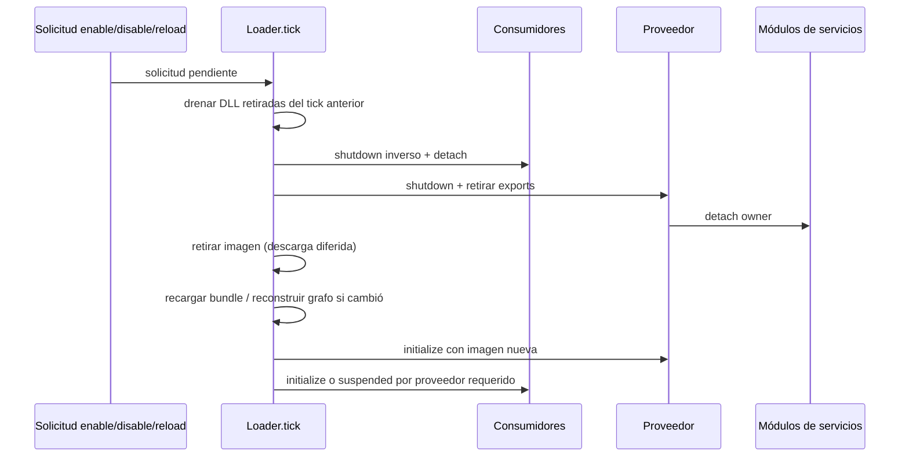
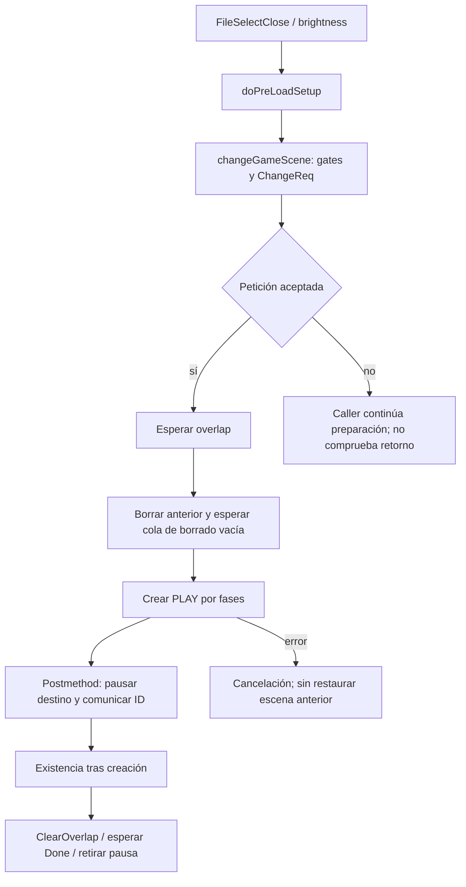

# Runtime y ciclo de vida del port y de los mods

Estado: `STATIC_CROSSCHECKED` en el commit fijado. Se estudian carga/activación/update/retirada, dependencias y frontera con el loop del juego. El bootstrap completo, menú, slots y escenas quedan fuera del alcance de esta ficha; no se presume una partida ya cargada en `mod_initialize`. Cobertura: **CROSSCHECKED** de las rutas citadas de loader/hooks; otras rutas siguen pendientes.

## Carga, estado y propietarios

RES_DIR, OVERLAY_DIR y TEXTURES_DIR se copian explícitamente al stage; mod.json y lib/plataforma se empaquetan como ZIP .dusk. No se generan paquetes en esta campaña.

**HOOK-023 · SOURCE_OBSERVED** — [cmake/ModSDK.cmake:305–375](https://github.com/TwilitRealm/dusklight/blob/40457c6adb381928e4b5fef6ed459ed291edd5e2/cmake/ModSDK.cmake#L305-L375); [cmake/ModSDK.cmake:401–415](https://github.com/TwilitRealm/dusklight/blob/40457c6adb381928e4b5fef6ed459ed291edd5e2/cmake/ModSDK.cmake#L401-L415)

Un mod puede ser asset-only, native o delegado a runtime @major.minor; runtime y código nativo juntos son conflicto y el host valida activate/update/deactivate del proveedor.

**HOOK-024 · STATIC_CROSSCHECKED** — [src/dusk/mods/loader/manifest.cpp:77–112](https://github.com/TwilitRealm/dusklight/blob/40457c6adb381928e4b5fef6ed459ed291edd5e2/src/dusk/mods/loader/manifest.cpp#L77-L112); [src/dusk/mods/loader/natives.cpp:532–551](https://github.com/TwilitRealm/dusklight/blob/40457c6adb381928e4b5fef6ed459ed291edd5e2/src/dusk/mods/loader/natives.cpp#L532-L551); [src/dusk/mods/loader/loader.cpp:213–216](https://github.com/TwilitRealm/dusklight/blob/40457c6adb381928e4b5fef6ed459ed291edd5e2/src/dusk/mods/loader/loader.cpp#L213-L216); [src/dusk/mods/loader/loader.cpp:237–271](https://github.com/TwilitRealm/dusklight/blob/40457c6adb381928e4b5fef6ed459ed291edd5e2/src/dusk/mods/loader/loader.cpp#L237-L271); [sdk/include/mods/runtime.h:5–15](https://github.com/TwilitRealm/dusklight/blob/40457c6adb381928e4b5fef6ed459ed291edd5e2/sdk/include/mods/runtime.h#L5-L15)

Un .dusk nativo Windows MSVC x64 busca lib/windows-amd64/mod.dll y carga con LoadLibraryExW SEARCH_DLL_LOAD_DIR|DEFAULT_DIRS; otros recursos de la plataforma se extraen en directorio por generación.

**HOOK-013 · STATIC_CROSSCHECKED** — [src/dusk/mods/loader/natives.cpp:25–35](https://github.com/TwilitRealm/dusklight/blob/40457c6adb381928e4b5fef6ed459ed291edd5e2/src/dusk/mods/loader/natives.cpp#L25-L35); [src/dusk/mods/loader/natives.cpp:386–403](https://github.com/TwilitRealm/dusklight/blob/40457c6adb381928e4b5fef6ed459ed291edd5e2/src/dusk/mods/loader/natives.cpp#L386-L403); [src/dusk/mods/loader/natives.cpp:429–485](https://github.com/TwilitRealm/dusklight/blob/40457c6adb381928e4b5fef6ed459ed291edd5e2/src/dusk/mods/loader/natives.cpp#L429-L485); [src/dusk/mods/loader/native_module.cpp:10–19](https://github.com/TwilitRealm/dusklight/blob/40457c6adb381928e4b5fef6ed459ed291edd5e2/src/dusk/mods/loader/native_module.cpp#L10-L19)

load_native exige cinco exports mod_meta/mod_ctx/mod_initialize/mod_update/mod_shutdown y valida metadatos antes de aceptar la biblioteca.

**HOOK-014 · SOURCE_OBSERVED** — [src/dusk/mods/loader/natives.cpp:488–528](https://github.com/TwilitRealm/dusklight/blob/40457c6adb381928e4b5fef6ed459ed291edd5e2/src/dusk/mods/loader/natives.cpp#L488-L528)

Imports obligatorios y opcionales forman grafo proveedor->consumidor; los ciclos requeridos fallan, los ciclos opcionales pierden una arista de orden y conservan resolución.

**HOOK-015 · STATIC_CROSSCHECKED** — [src/dusk/mods/loader/depgraph.cpp:21–80](https://github.com/TwilitRealm/dusklight/blob/40457c6adb381928e4b5fef6ed459ed291edd5e2/src/dusk/mods/loader/depgraph.cpp#L21-L80); [src/dusk/mods/loader/depgraph.cpp:110–204](https://github.com/TwilitRealm/dusklight/blob/40457c6adb381928e4b5fef6ed459ed291edd5e2/src/dusk/mods/loader/depgraph.cpp#L110-L204); [src/dusk/mods/loader/loader.cpp:396–438](https://github.com/TwilitRealm/dusklight/blob/40457c6adb381928e4b5fef6ed459ed291edd5e2/src/dusk/mods/loader/loader.cpp#L396-L438)

activate_mod registra exports, resuelve imports y hooks y llama initialize; solo éxito fija initialized. Un fallo de initialize inicia el cleanup de servicios pero no entra a mod_shutdown; el rollback de estado externo de init debe ser propio.

**HOOK-016 · STATIC_CROSSCHECKED** — [src/dusk/mods/loader/loader.cpp:209–294](https://github.com/TwilitRealm/dusklight/blob/40457c6adb381928e4b5fef6ed459ed291edd5e2/src/dusk/mods/loader/loader.cpp#L209-L294); [src/dusk/mods/loader/loader.cpp:296–334](https://github.com/TwilitRealm/dusklight/blob/40457c6adb381928e4b5fef6ed459ed291edd5e2/src/dusk/mods/loader/loader.cpp#L296-L334)

El host distingue `active`, `initialized`, `loadFailed`, `servicesRegistered`, `enabledApplied` y `suspendedByProvider`; no son sinónimos. Por ejemplo, `active` se establece antes de entrar a initialize; solo su éxito fija `initialized`. En init fallida, una mutación game-side o hilo ya arrancado no queda revertido por un shutdown que no se invocará. Diseñar initialize como transacción propia, con liberación al fallar cada paso (inferencia de HOOK-016).

El contexto identifica al dueño/consumidor de una llamada de servicio. Un proveedor recibe el contexto del mod llamante, no necesariamente el suyo; los punteros de servicio no sustituyen propiedad de handles. Ver [api.h:69–105](https://github.com/TwilitRealm/dusklight/blob/40457c6adb381928e4b5fef6ed459ed291edd5e2/sdk/include/mods/api.h#L69-L105).

## Tick y relación con actores

tick empieza con frameBegin y cambios pendientes, recorre updates de mods activos y acaba frameEnd. fapGm_Execute llama duskExecute/tick antes de fpcM_Management; no garantiza correspondencia uno a uno con cada frame presentado.

**HOOK-018 · STATIC_CROSSCHECKED** — [src/dusk/mods/loader/loader.cpp:1237–1266](https://github.com/TwilitRealm/dusklight/blob/40457c6adb381928e4b5fef6ed459ed291edd5e2/src/dusk/mods/loader/loader.cpp#L1237-L1266); [src/f_ap/f_ap_game.cpp:748–751](https://github.com/TwilitRealm/dusklight/blob/40457c6adb381928e4b5fef6ed459ed291edd5e2/src/f_ap/f_ap_game.cpp#L748-L751); [src/f_ap/f_ap_game.cpp:807–843](https://github.com/TwilitRealm/dusklight/blob/40457c6adb381928e4b5fef6ed459ed291edd5e2/src/f_ap/f_ap_game.cpp#L807-L843)

fail_mod marca inactivo, retira exports y encola disable sin teardown inmediato; bibliotecas retiradas se descargan realmente al siguiente apply_pending_requests.

**HOOK-019 · STATIC_CROSSCHECKED** — [src/dusk/mods/loader/context.cpp:21–37](https://github.com/TwilitRealm/dusklight/blob/40457c6adb381928e4b5fef6ed459ed291edd5e2/src/dusk/mods/loader/context.cpp#L21-L37); [src/dusk/mods/loader/loader.cpp:537–548](https://github.com/TwilitRealm/dusklight/blob/40457c6adb381928e4b5fef6ed459ed291edd5e2/src/dusk/mods/loader/loader.cpp#L537-L548); [src/dusk/mods/loader/loader.cpp:1100–1108](https://github.com/TwilitRealm/dusklight/blob/40457c6adb381928e4b5fef6ed459ed291edd5e2/src/dusk/mods/loader/loader.cpp#L1100-L1108); [src/dusk/mods/loader/natives.cpp:563–583](https://github.com/TwilitRealm/dusklight/blob/40457c6adb381928e4b5fef6ed459ed291edd5e2/src/dusk/mods/loader/natives.cpp#L563-L583)

Flujo observado de `fapGm_Execute`: `duskExecute` (incluye `updateAutoSave` y tick de mods) → `fpcM_Management` → contador → partículas de menú → GameMode `invokeOnTickFunction` → achievements. Por ello `mod_update` no demuestra que un actor concreto vaya a ejecutar ese tick ni que tenga recursos listos; el gestor de procesos aún aplica su propia programación. Pausa, carga y escena deben consultarse mediante el servicio o estado apropiado. No se equipara este tick al framerate DX12 de presentación.

## Desactivación y reload

deactivate_mod invoca módulos deactivating, shutdown si inicializado, elimina exports, invoca módulos detached y retira nativo. Excepciones/errores de shutdown se registran y continúa teardown.

**HOOK-017 · SOURCE_OBSERVED** — [src/dusk/mods/loader/loader.cpp:296–338](https://github.com/TwilitRealm/dusklight/blob/40457c6adb381928e4b5fef6ed459ed291edd5e2/src/dusk/mods/loader/loader.cpp#L296-L338); [src/dusk/mods/svc/registry.cpp:210–224](https://github.com/TwilitRealm/dusklight/blob/40457c6adb381928e4b5fef6ed459ed291edd5e2/src/dusk/mods/svc/registry.cpp#L210-L224)

Disable/reload recolecta dependientes y apaga en orden inverso, recarga manifiesto e imagen, reconstruye grafo si cambia y reactiva proveedores antes de consumidores; required ausente suspende consumidor.

**HOOK-020 · SOURCE_OBSERVED** — [src/dusk/mods/loader/loader.cpp:581–607](https://github.com/TwilitRealm/dusklight/blob/40457c6adb381928e4b5fef6ed459ed291edd5e2/src/dusk/mods/loader/loader.cpp#L581-L607); [src/dusk/mods/loader/loader.cpp:610–663](https://github.com/TwilitRealm/dusklight/blob/40457c6adb381928e4b5fef6ed459ed291edd5e2/src/dusk/mods/loader/loader.cpp#L610-L663); [src/dusk/mods/loader/loader.cpp:666–755](https://github.com/TwilitRealm/dusklight/blob/40457c6adb381928e4b5fef6ed459ed291edd5e2/src/dusk/mods/loader/loader.cpp#L666-L755)

Reload fallido deja target fallido; no hay restauración automática de la imagen vieja. mod ID cambiado devuelve CONFLICT; nativeInPlace rechaza reload sin paquete de reemplazo.

**HOOK-021 · SOURCE_OBSERVED** — [src/dusk/mods/loader/loader.cpp:610–629](https://github.com/TwilitRealm/dusklight/blob/40457c6adb381928e4b5fef6ed459ed291edd5e2/src/dusk/mods/loader/loader.cpp#L610-L629); [src/dusk/mods/loader/loader.cpp:738–755](https://github.com/TwilitRealm/dusklight/blob/40457c6adb381928e4b5fef6ed459ed291edd5e2/src/dusk/mods/loader/loader.cpp#L738-L755); [src/dusk/mods/loader/loader.cpp:900–909](https://github.com/TwilitRealm/dusklight/blob/40457c6adb381928e4b5fef6ed459ed291edd5e2/src/dusk/mods/loader/loader.cpp#L900-L909)

El contrato prohíbe hooks cuya función permanece en stack toda sesión, porque el cambio lifecycle entre frames no garantiza su descarga segura.

**HOOK-022 · DOC_CONTRACT** — [docs/modding.md:1469–1491](https://github.com/TwilitRealm/dusklight/blob/40457c6adb381928e4b5fef6ed459ed291edd5e2/docs/modding.md#L1469-L1491)

Este diagrama resume HOOK-017/019/020. Reload no es rollback transaccional a la biblioteca anterior. El bundle anterior puede seguir vivo mediante `shared_ptr` de lectores, pero eso no equivale a que el mod siga activo ni que se puedan reutilizar sus callbacks/punteros de código. Cada generación nativa tiene nuevo directorio; el host retira directorios al descargar imágenes retiradas.

## Contratos para consumidores y próximos pasos

Preferir imports declarados para dependencias: dan orden init/shutdown y reinicio en cascada. Un lookup dinámico `HostService::get_service` ve lo publicado en ese momento y no agrega esa garantía al grafo (DOC_CONTRACT [api.h:96–105](https://github.com/TwilitRealm/dusklight/blob/40457c6adb381928e4b5fef6ed459ed291edd5e2/sdk/include/mods/api.h#L96-L105)). Una dependencia opcional puede resolver NULL y puede perder su orden por ciclo; el consumidor debe tolerarlo.

OFFICIAL_SERVICE: usar lifecycle y ownership de los servicios oficiales para registros. TYPED_HOOK/SYMBOL_HOOK: solo para puntos concretos que no cubre servicio, previa validación descrita en [hooks](../HOOKING_AND_ABI.md). POTENTIAL_REQUIRES_VERIFICATION: cualquier garantía de convivencia real, scene transition, callback concurrente, exception cross-DLL y rendimiento.

Pendiente: bootstrap completo de recursos/heaps e hilos Aurora/Borealis (gitlinks no incluidos); inspección del reloj fijo frente a presentación, pausas y fast-forward; runtime Windows real de reload con dos consumidores y fallos intermedios. Evidencia histórica CP20/CP21 se registra por separado en SOURCE_PIN; no convierte esta lectura estática en runtime observado.

## Segundo contraste: cleanup anterior al shutdown y sus límites

ActorService intenta retirar perfiles propios antes de shutdown; si unregister_actor no completa borrado devuelve UNAVAILABLE y conserva perfil. actor_remove_mod sólo registra el fallo y ModLoader continúa teardown/unload; no se debe declarar garantizada la seguridad del unload con actores propios vivos.

**HOOK-029 · STATIC_CROSSCHECKED** — [src/dusk/mods/svc/actor.cpp:193–218](https://github.com/TwilitRealm/dusklight/blob/40457c6adb381928e4b5fef6ed459ed291edd5e2/src/dusk/mods/svc/actor.cpp#L193-L218); [src/dusk/mods/svc/actor.cpp:359–372](https://github.com/TwilitRealm/dusklight/blob/40457c6adb381928e4b5fef6ed459ed291edd5e2/src/dusk/mods/svc/actor.cpp#L359-L372); [src/dusk/mods/svc/actor.cpp:395–401](https://github.com/TwilitRealm/dusklight/blob/40457c6adb381928e4b5fef6ed459ed291edd5e2/src/dusk/mods/svc/actor.cpp#L395-L401); [src/dusk/mods/loader/loader.cpp:296–338](https://github.com/TwilitRealm/dusklight/blob/40457c6adb381928e4b5fef6ed459ed291edd5e2/src/dusk/mods/loader/loader.cpp#L296-L338)

GfxService retira tipos draw/encoder task del propietario y llama aurora::gfx::synchronize antes de mod_shutdown mediante modDeactivating; el detalle de sincronización reside en dependencia externa.

**HOOK-030 · STATIC_CROSSCHECKED** — [src/dusk/mods/svc/gfx.cpp:166–187](https://github.com/TwilitRealm/dusklight/blob/40457c6adb381928e4b5fef6ed459ed291edd5e2/src/dusk/mods/svc/gfx.cpp#L166-L187); [src/dusk/mods/svc/gfx.cpp:1460–1470](https://github.com/TwilitRealm/dusklight/blob/40457c6adb381928e4b5fef6ed459ed291edd5e2/src/dusk/mods/svc/gfx.cpp#L1460-L1470); [src/dusk/mods/loader/loader.cpp:296–308](https://github.com/TwilitRealm/dusklight/blob/40457c6adb381928e4b5fef6ed459ed291edd5e2/src/dusk/mods/loader/loader.cpp#L296-L308)

Los módulos deactivating se ejecutan antes del shutdown del mod. Por ello un proveedor de actores propios no debe esperar hasta shutdown para empezar un cleanup que necesite varios ticks: el host ya intentó su retirada sincrónica. En el camino de fallo conservado puede quedar un perfil con callbacks del mod mientras la DLL se retira para descarga posterior: **STATIC_INFERRED**, riesgo de vigencia, sin crash observado. No se propone modificar host/SDK; una futura integración debe demostrar destrucción sincrónica y definir política de rechazo o reinicio si no puede garantizarla.

La sincronización explícita de Gfx evita extrapolar el retraso de un tick como única protección para todos los workers. No se deduce que un hilo propio del mod o de una DLL adicional quede detenido por esa barrera: sigue siendo responsabilidad de su dueño según el contrato de runtime libraries.

## CP-R10 — transición concreta file-select → PLAY

Cadena contrastada estáticamente en el pin, sin ejecutar el juego. Se elige `dScnName_c`, no se mezclan logo/direct-load ni retorno a opening. Contrato público de transición de escena no localizado en los 25 servicios registrados; los encabezados f_op describen APIs internas, no una garantía SDK.

**Caller y aceptación — ARCH-002/003.** `isSelectEnd()==1` pasa a cierre. En PC `hideTvSettingsScreen` decide si se recorre brightness o se llama directamente a `doPreLoadSetup`; este selecciona ChangeGameScene antes del gate PC de rupee cutscenes. `execute` conserva gates de reset. `changeGameScene` exige !reset y !IsPeek, llama gameStart y solicita PLAY con fade=0,peek=5 (ruta ordinaria no DEBUG). Después deshabilita next-stage, configura stage inicial si archivo nuevo, limpia estado ambiental/restart y habilita autosave PC. **Ignora el retorno**: esos efectos no prueban aceptación ni se revierten aquí. No se atribuye número de segundos a peek5.

`fopScnM_ChangeReq` llama Request tipo2 con data NULL y devuelve 0/1; guarda internamente request_id. Ese ID pertenece a la solicitud, distinto de creating_id del destino. ChangeNode rechaza target ya solicitado/en creación; asignación puede fallar. La solicitud se encola antes de pedir overlap; si este falla se retira y devuelve ERROR. Fade 0 sigue la ruta con overlap porque solo 0x7FFF lo omite.

**Cleanup — ARCH-004.** La secuencia real es IsDeleteTiming→Delete→IsDeleted→Create→IsCreated. IsDeleted consulta la cola GLOBAL de borrado, no únicamente el objeto antiguo. Delete puede esperar; el borrado del nodo cancela solicitudes del layer y recorre hijos antes de retirarlo. No demuestra que esta escena tenga un conjunto particular de actores vivos. `dScnName_Delete` invoca destructor: elimina dFs_c y mBrightCheck, llama deleteObjectResMain("fileSel"), destruye mHeap, normaliza botellas, pone windowNum=0 y vista=NULL. La escena había creado heap y UI usando fileSel. fopScn retira scene_tag tras delete exitoso; fpcBs_Delete libera el proceso. **Demostrado:** UI/heap/objeto destruidos y vista limpiada. **Condicionado:** punteros prestados a esas asignaciones caducan; no afirmar descarga física de todo archive compartido ni invalidación de todos los actores del juego.

**Creación y ejecución — ARCH-005/006.** Create solicita creación estándar: cargar perfil→crear proceso→SubCreate→esperar creación de hijos→postmethod. fpcNd instala layer/submétodos; fopScn enlaza perfil de escena. g_profile_PLAY_SCENE apunta a dScnPly_Create, con su propia máquina de fases. Por ejemplo espera Stg_00, solicita Event/CamParam y espera comandos de partículas/mensajes. Se localiza esta entrada y sus gates representativos; no se audita todo el bootstrap PLAY ni todos sus fallos. COMPLEATE intenta encolar ejecución y retira request de creación; IsCreated exige que ya no esté creando y exista. Existir NO equivale a que execute se haya llamado: este exige init_state==2 y ausencia de pausa bit1, además de gates de ARCH-001.

El postmethod pausa destino bits1/2 y comunica ID al overlap. La máquina de escena espera IsDoing/IsDone, ejecuta cambio, solicita ClearOverlap, espera IsDone y llama Done; Done intenta retirar pausa respetando estado del padre. Overlap mantiene su propia solicitud/tarea y handshake de fade/peek. No se presume timing de presentación ni audibilidad. En el camino normal fapGm_After, callback posterior a execute/draw de ARCH-001, gestiona escena antes que overlap; creación/borrado avanzan por sus colas. No garantiza ticks/framerate ni progreso bajo error/captura.

**Fallo, cancelación y reintento — ARCH-007.** Error/UNK3 del nodo pasa por Cancel: si cancelar overlap falla, el handler devuelve 0 y la petición no se libera por ese camino. Si completa, se retira la petición. La creación estándar intenta borrar proceso parcial al cancelar. ReRequest busca request tipo2 y solo sustituye name/data mientras creating_id==-2; no es retry después de creación ni restaura menú/UI destruidos. El caller permanece en su estado y no usa ReRequest ni procesa explícitamente fallo. La liberación del flag de exclusión de overlap aparece en Done; no certificar recuperación global tras todos los errores de overlap sin más estudio.

**Frontera .dusk.** Estado de transición pertenece al framework; UI/heap al dueño dScnName. StageService sirve para ediciones de registros de actores y no ofrece una transición genérica (WORLD-001..005); Host lifecycle no constituye notificación de escena lista. Los símbolos nuevos son POTENTIAL_REQUIRES_VERIFICATION: firma/fase y resolución Windows deben probarse antes de cualquier hook. Un rollback de registros propios no reconstruye file-select ni restaura mutaciones del caller. Para futuras integraciones generales, revalidar contexto/ID y vigencia de punteros por fase; este informe no propone implementación de mod.

Referencias exactas y límites por afirmación: ARCH-002..007 en el ledger. Las dudas restantes de Q-09 incluyen recuperación de errores, logo/direct-load, reset/opening y todos los gates de captura/presentación.

**ARCH-002** — [src/d/d_s_name.cpp:311–351](https://github.com/TwilitRealm/dusklight/blob/40457c6adb381928e4b5fef6ed459ed291edd5e2/src/d/d_s_name.cpp#L311-L351); [src/d/d_s_name.cpp:372–429](https://github.com/TwilitRealm/dusklight/blob/40457c6adb381928e4b5fef6ed459ed291edd5e2/src/d/d_s_name.cpp#L372-L429); [src/d/d_s_name.cpp:226–245](https://github.com/TwilitRealm/dusklight/blob/40457c6adb381928e4b5fef6ed459ed291edd5e2/src/d/d_s_name.cpp#L226-L245)

**ARCH-003** — [src/f_op/f_op_scene_mng.cpp:17–46](https://github.com/TwilitRealm/dusklight/blob/40457c6adb381928e4b5fef6ed459ed291edd5e2/src/f_op/f_op_scene_mng.cpp#L17-L46); [include/f_op/f_op_scene_mng.h:10–16](https://github.com/TwilitRealm/dusklight/blob/40457c6adb381928e4b5fef6ed459ed291edd5e2/include/f_op/f_op_scene_mng.h#L10-L16); [src/f_op/f_op_scene_req.cpp:98–151](https://github.com/TwilitRealm/dusklight/blob/40457c6adb381928e4b5fef6ed459ed291edd5e2/src/f_op/f_op_scene_req.cpp#L98-L151); [src/f_pc/f_pc_node_req.cpp:183–198](https://github.com/TwilitRealm/dusklight/blob/40457c6adb381928e4b5fef6ed459ed291edd5e2/src/f_pc/f_pc_node_req.cpp#L183-L198); [src/f_pc/f_pc_node_req.cpp:239–260](https://github.com/TwilitRealm/dusklight/blob/40457c6adb381928e4b5fef6ed459ed291edd5e2/src/f_pc/f_pc_node_req.cpp#L239-L260); [src/f_pc/f_pc_node_req.cpp:313–337](https://github.com/TwilitRealm/dusklight/blob/40457c6adb381928e4b5fef6ed459ed291edd5e2/src/f_pc/f_pc_node_req.cpp#L313-L337)

**ARCH-004** — [src/f_pc/f_pc_node_req.cpp:32–94](https://github.com/TwilitRealm/dusklight/blob/40457c6adb381928e4b5fef6ed459ed291edd5e2/src/f_pc/f_pc_node_req.cpp#L32-L94); [src/f_pc/f_pc_node_req.cpp:239–245](https://github.com/TwilitRealm/dusklight/blob/40457c6adb381928e4b5fef6ed459ed291edd5e2/src/f_pc/f_pc_node_req.cpp#L239-L245); [src/f_pc/f_pc_deletor.cpp:63–104](https://github.com/TwilitRealm/dusklight/blob/40457c6adb381928e4b5fef6ed459ed291edd5e2/src/f_pc/f_pc_deletor.cpp#L63-L104); [src/f_pc/f_pc_node.cpp:84–104](https://github.com/TwilitRealm/dusklight/blob/40457c6adb381928e4b5fef6ed459ed291edd5e2/src/f_pc/f_pc_node.cpp#L84-L104); [src/d/d_s_name.cpp:81–101](https://github.com/TwilitRealm/dusklight/blob/40457c6adb381928e4b5fef6ed459ed291edd5e2/src/d/d_s_name.cpp#L81-L101); [src/d/d_s_name.cpp:269–291](https://github.com/TwilitRealm/dusklight/blob/40457c6adb381928e4b5fef6ed459ed291edd5e2/src/d/d_s_name.cpp#L269-L291); [src/d/d_s_name.cpp:439–457](https://github.com/TwilitRealm/dusklight/blob/40457c6adb381928e4b5fef6ed459ed291edd5e2/src/d/d_s_name.cpp#L439-L457); [src/f_op/f_op_scene.cpp:30–65](https://github.com/TwilitRealm/dusklight/blob/40457c6adb381928e4b5fef6ed459ed291edd5e2/src/f_op/f_op_scene.cpp#L30-L65); [src/f_pc/f_pc_base.cpp:102–110](https://github.com/TwilitRealm/dusklight/blob/40457c6adb381928e4b5fef6ed459ed291edd5e2/src/f_pc/f_pc_base.cpp#L102-L110)

**ARCH-005** — [src/f_pc/f_pc_stdcreate_req.cpp:34–126](https://github.com/TwilitRealm/dusklight/blob/40457c6adb381928e4b5fef6ed459ed291edd5e2/src/f_pc/f_pc_stdcreate_req.cpp#L34-L126); [src/f_pc/f_pc_stdcreate_req.cpp:140–178](https://github.com/TwilitRealm/dusklight/blob/40457c6adb381928e4b5fef6ed459ed291edd5e2/src/f_pc/f_pc_stdcreate_req.cpp#L140-L178); [src/f_pc/f_pc_create_req.cpp:84–118](https://github.com/TwilitRealm/dusklight/blob/40457c6adb381928e4b5fef6ed459ed291edd5e2/src/f_pc/f_pc_create_req.cpp#L84-L118); [src/f_pc/f_pc_node.cpp:107–124](https://github.com/TwilitRealm/dusklight/blob/40457c6adb381928e4b5fef6ed459ed291edd5e2/src/f_pc/f_pc_node.cpp#L107-L124); [src/f_op/f_op_scene.cpp:44–65](https://github.com/TwilitRealm/dusklight/blob/40457c6adb381928e4b5fef6ed459ed291edd5e2/src/f_op/f_op_scene.cpp#L44-L65); [src/d/d_s_play.cpp:1370–1425](https://github.com/TwilitRealm/dusklight/blob/40457c6adb381928e4b5fef6ed459ed291edd5e2/src/d/d_s_play.cpp#L1370-L1425); [src/d/d_s_play.cpp:1635–1681](https://github.com/TwilitRealm/dusklight/blob/40457c6adb381928e4b5fef6ed459ed291edd5e2/src/d/d_s_play.cpp#L1635-L1681); [src/f_pc/f_pc_executor.cpp:24–36](https://github.com/TwilitRealm/dusklight/blob/40457c6adb381928e4b5fef6ed459ed291edd5e2/src/f_pc/f_pc_executor.cpp#L24-L36); [src/f_pc/f_pc_executor.cpp:75–82](https://github.com/TwilitRealm/dusklight/blob/40457c6adb381928e4b5fef6ed459ed291edd5e2/src/f_pc/f_pc_executor.cpp#L75-L82)

**ARCH-006** — [src/f_op/f_op_scene_req.cpp:17–52](https://github.com/TwilitRealm/dusklight/blob/40457c6adb381928e4b5fef6ed459ed291edd5e2/src/f_op/f_op_scene_req.cpp#L17-L52); [src/f_op/f_op_scene_req.cpp:69–95](https://github.com/TwilitRealm/dusklight/blob/40457c6adb381928e4b5fef6ed459ed291edd5e2/src/f_op/f_op_scene_req.cpp#L69-L95); [src/f_op/f_op_scene_req.cpp:118–126](https://github.com/TwilitRealm/dusklight/blob/40457c6adb381928e4b5fef6ed459ed291edd5e2/src/f_op/f_op_scene_req.cpp#L118-L126); [src/f_op/f_op_scene_pause.cpp:10–41](https://github.com/TwilitRealm/dusklight/blob/40457c6adb381928e4b5fef6ed459ed291edd5e2/src/f_op/f_op_scene_pause.cpp#L10-L41); [src/f_op/f_op_overlap_mng.cpp:44–117](https://github.com/TwilitRealm/dusklight/blob/40457c6adb381928e4b5fef6ed459ed291edd5e2/src/f_op/f_op_overlap_mng.cpp#L44-L117); [src/f_op/f_op_overlap_req.cpp:41–108](https://github.com/TwilitRealm/dusklight/blob/40457c6adb381928e4b5fef6ed459ed291edd5e2/src/f_op/f_op_overlap_req.cpp#L41-L108); [src/f_ap/f_ap_game.cpp:730–744](https://github.com/TwilitRealm/dusklight/blob/40457c6adb381928e4b5fef6ed459ed291edd5e2/src/f_ap/f_ap_game.cpp#L730-L744); [src/f_ap/f_ap_game.cpp:824–832](https://github.com/TwilitRealm/dusklight/blob/40457c6adb381928e4b5fef6ed459ed291edd5e2/src/f_ap/f_ap_game.cpp#L824-L832); [src/f_pc/f_pc_manager.cpp:99–115](https://github.com/TwilitRealm/dusklight/blob/40457c6adb381928e4b5fef6ed459ed291edd5e2/src/f_pc/f_pc_manager.cpp#L99-L115)

**ARCH-007** — [src/f_pc/f_pc_node_req.cpp:104–139](https://github.com/TwilitRealm/dusklight/blob/40457c6adb381928e4b5fef6ed459ed291edd5e2/src/f_pc/f_pc_node_req.cpp#L104-L139); [src/f_pc/f_pc_node_req.cpp:159–180](https://github.com/TwilitRealm/dusklight/blob/40457c6adb381928e4b5fef6ed459ed291edd5e2/src/f_pc/f_pc_node_req.cpp#L159-L180); [src/f_pc/f_pc_node_req.cpp:340–362](https://github.com/TwilitRealm/dusklight/blob/40457c6adb381928e4b5fef6ed459ed291edd5e2/src/f_pc/f_pc_node_req.cpp#L340-L362); [src/f_op/f_op_scene_req.cpp:77–82](https://github.com/TwilitRealm/dusklight/blob/40457c6adb381928e4b5fef6ed459ed291edd5e2/src/f_op/f_op_scene_req.cpp#L77-L82); [src/f_pc/f_pc_create_req.cpp:61–74](https://github.com/TwilitRealm/dusklight/blob/40457c6adb381928e4b5fef6ed459ed291edd5e2/src/f_pc/f_pc_create_req.cpp#L61-L74); [src/f_op/f_op_scene_mng.cpp:40–46](https://github.com/TwilitRealm/dusklight/blob/40457c6adb381928e4b5fef6ed459ed291edd5e2/src/f_op/f_op_scene_mng.cpp#L40-L46)

## CP-R24 — Fallo de overlap frente a fallo del destino

Amplía ARCH-007 con la propagación exacta de error y flags; no repite file-select→PLAY nominal. Las APIs f_op/f_pc siguen siendo internas: no se localizó servicio SDK genérico de transición/cancelación de escena. ARCH-008..011 contrastan un consumidor del port y dos rutas de fallo posibles; no provocadas en juego.

**Consumidor elegido: logo con stage solicitado (ARCH-008).** nextSceneChange requiere !reset y !isOpeningCut. En TARGET_PC, si StageRequested.set y SaveRequested==0, la rama inicial omite opening; después inicializa estado de save en memoria, solicita PLAY con overlap0/peek30, pone SaveRequested=0xff, escribe next/start stage y limpia StageRequested.set. Se ignora ChangeReq: el caller consume su petición aun si fue rechazada. No se ejecutó carga ni se abrió save. La rama SaveRequested1..3 con LoadSync es otra ruta y queda excluida de esta cadena, al igual que menú DEBUG/opening. Estos efectos previos no son rollback ni confirmación de ejecución de PLAY.

**Fallo A: el task de overlap no llega a existir.** scene Request configura tabla fade y acepta una estructura de overlap; todavía no ha creado el proceso del efecto. El handler overlap solicita ese proceso, espera IsCreating y luego SearchByID. Si ya no está creando y no existe, devuelve ERROR. El manager de overlap recibe ese resultado y pone su punteroNULL; no llama a su phase_Done en esa rama. Scene no consume ese error como resultado: sus waits consultan booleanos IsDoing/IsDone que con punteroNULL devuelven false, traduciéndolo a INIT. La primera espera IsDone precede al Execute del nodo de cambio; en este supuesto no se alcanzó el borrado de la escena anterior por esta petición. No equivale al fallo de creación de PLAY después de borrar logo.

fapGm_After gestiona scene antes de overlap: se ve cómo el primero puede quedar esperando un resultado que el segundo ha descartado. **Inferencia condicionada ARCH-011:** si ocurre ese fallo y no interviene otra ruta, el request scene puede seguir esperando: estos waits no incluyen timeout ni propagan ERROR. No se demuestra bloqueo real ni que el sistema completo carezca de reset/terminación alternativos. El fallo puede originarse en la solicitud/creación del proceso del efecto; no se asigna una frecuencia ni se inventa un asset roto.

**Fallo B: destino falla cuando overlap ya permitió cambiar nodo.** El nodo puede devolver UNK3 al no aceptar creación estándar o al terminar sin proceso existente. El handler intenta Cancel; si este devuelve0, retorna sin liberar esa petición. fopScnRq_Cancel llama al cancel del overlap, que intenta phase_Done. phase_Done llama fpcM_Delete(task): es aceptación de borrado, no espera a liberar el proceso. Solo cuando retorna1 anula task y flags del overlap; el manager anula su puntero y el nodo retira request. Si no se acepta borrado, Cancel devuelve0 y conserva estado para otro intento del handler. No atribuir a ese bool liberación de todos los recursos ni restauración de UI/heap de escena anterior.

**Dos estados de exclusión distintos.** El manager mantiene un puntero a request estático; el módulo scene mantiene l_fopScnRq_IsUsingOfOverlap. Este último solo se poneTRUE al aceptar FadeRequest yFALSE en phase_Done de scene. El Cancel descrito no lo limpia. Por ello, tras cancelación tardía exitosa puede quedar managerNULL pero exclusión sceneTRUE, y FadeRequest posterior no llega a pedir un nuevo overlap. Esa consecuencia es **STATIC_INFERRED**, no reproducción Windows. No se llama «permanente»: una petición sin fade usa tabla noFade que también llega a Done y puede limpiarlo, y otras rutas del programa no se certifican aquí. Resetear una de estas estructuras no equivale a reconciliar ambas ni a reconstruir la escena previa.

| Fase de fallo | Qué se conserva o retira | Qué no acredita |
| --- | --- | --- |
| Rechazo inicial de Request/fade | Node request se retira antes de empezar su cambio | Caller logo ya puede consumir flags sin comprobar aceptación. |
| Task overlap ausente tras creación | Manager poneNULL; scene aún puede esperar primer IsDone | No rollback automático ni borrado previo por esta petición. |
| Destino falla tras Delete/IsDeleted | Cancel condicionado al retiro del task; request sale si éxito | No recreación de escena previa ni limpieza del flag scene por Cancel. |
| Delete task aceptado | phase_Done limpia datos propios y manager | No destrucción completada ni callbacks drenados. |

**PC/estado auxiliar y límites.** El handler overlap pone pausa IGT al crear task cuando speedrun/runStarted están activos y la retira en phase_Done; la rama de error manager no ejecuta ese cleanup. Se registra solo el orden estático de esas escrituras, sin certificar contador ni red. No se repite la campaña LiveSplit. Recursos efectivos del task y recuperación por reset/opening permanecen pendientes; no se auditan aquí todos los fades ni cada error de bootstrap PLAY.

**Frontera .dusk.** StageService no reintenta ni revierte transición de escenas. Host lifecycle no confirma que un destino esté ejecutando. Los símbolos indexados son localizadores POTENTIAL_REQUIRES_VERIFICATION, sin export/firma binaria/instalación de hook medida. Cualquier análisis futuro debe separar request scene, request overlap, task, destino y estado del caller; retirar registro de mod no repara esos estados automáticamente. No se propone modificar host ni implementar recuperación. Q-09 sigue PARCIAL con estos fallos acotados y rutas opening/reset pendientes.

**ARCH-008** — [src/d/d_s_logo.cpp:785–791](https://github.com/TwilitRealm/dusklight/blob/40457c6adb381928e4b5fef6ed459ed291edd5e2/src/d/d_s_logo.cpp#L785-L791); [src/d/d_s_logo.cpp:828–864](https://github.com/TwilitRealm/dusklight/blob/40457c6adb381928e4b5fef6ed459ed291edd5e2/src/d/d_s_logo.cpp#L828-L864); [src/f_op/f_op_scene_mng.cpp:17–38](https://github.com/TwilitRealm/dusklight/blob/40457c6adb381928e4b5fef6ed459ed291edd5e2/src/f_op/f_op_scene_mng.cpp#L17-L38); [src/f_op/f_op_scene_req.cpp:129–151](https://github.com/TwilitRealm/dusklight/blob/40457c6adb381928e4b5fef6ed459ed291edd5e2/src/f_op/f_op_scene_req.cpp#L129-L151)

**ARCH-009** — [src/f_op/f_op_overlap_req.cpp:82–108](https://github.com/TwilitRealm/dusklight/blob/40457c6adb381928e4b5fef6ed459ed291edd5e2/src/f_op/f_op_overlap_req.cpp#L82-L108); [src/f_op/f_op_overlap_req.cpp:111–156](https://github.com/TwilitRealm/dusklight/blob/40457c6adb381928e4b5fef6ed459ed291edd5e2/src/f_op/f_op_overlap_req.cpp#L111-L156); [src/f_op/f_op_overlap_mng.cpp:57–68](https://github.com/TwilitRealm/dusklight/blob/40457c6adb381928e4b5fef6ed459ed291edd5e2/src/f_op/f_op_overlap_mng.cpp#L57-L68); [src/f_op/f_op_overlap_mng.cpp:89–99](https://github.com/TwilitRealm/dusklight/blob/40457c6adb381928e4b5fef6ed459ed291edd5e2/src/f_op/f_op_overlap_mng.cpp#L89-L99); [src/f_op/f_op_scene_req.cpp:31–38](https://github.com/TwilitRealm/dusklight/blob/40457c6adb381928e4b5fef6ed459ed291edd5e2/src/f_op/f_op_scene_req.cpp#L31-L38); [src/f_op/f_op_scene_req.cpp:118–126](https://github.com/TwilitRealm/dusklight/blob/40457c6adb381928e4b5fef6ed459ed291edd5e2/src/f_op/f_op_scene_req.cpp#L118-L126); [src/f_ap/f_ap_game.cpp:730–744](https://github.com/TwilitRealm/dusklight/blob/40457c6adb381928e4b5fef6ed459ed291edd5e2/src/f_ap/f_ap_game.cpp#L730-L744)

**ARCH-010** — [src/f_pc/f_pc_node_req.cpp:32–62](https://github.com/TwilitRealm/dusklight/blob/40457c6adb381928e4b5fef6ed459ed291edd5e2/src/f_pc/f_pc_node_req.cpp#L32-L62); [src/f_pc/f_pc_node_req.cpp:120–139](https://github.com/TwilitRealm/dusklight/blob/40457c6adb381928e4b5fef6ed459ed291edd5e2/src/f_pc/f_pc_node_req.cpp#L120-L139); [src/f_pc/f_pc_node_req.cpp:159–178](https://github.com/TwilitRealm/dusklight/blob/40457c6adb381928e4b5fef6ed459ed291edd5e2/src/f_pc/f_pc_node_req.cpp#L159-L178); [src/f_pc/f_pc_node_req.cpp:239–245](https://github.com/TwilitRealm/dusklight/blob/40457c6adb381928e4b5fef6ed459ed291edd5e2/src/f_pc/f_pc_node_req.cpp#L239-L245); [src/f_op/f_op_scene_req.cpp:41–52](https://github.com/TwilitRealm/dusklight/blob/40457c6adb381928e4b5fef6ed459ed291edd5e2/src/f_op/f_op_scene_req.cpp#L41-L52); [src/f_op/f_op_scene_req.cpp:77–95](https://github.com/TwilitRealm/dusklight/blob/40457c6adb381928e4b5fef6ed459ed291edd5e2/src/f_op/f_op_scene_req.cpp#L77-L95); [src/f_op/f_op_overlap_mng.cpp:101–118](https://github.com/TwilitRealm/dusklight/blob/40457c6adb381928e4b5fef6ed459ed291edd5e2/src/f_op/f_op_overlap_mng.cpp#L101-L118); [src/f_op/f_op_overlap_req.cpp:17–38](https://github.com/TwilitRealm/dusklight/blob/40457c6adb381928e4b5fef6ed459ed291edd5e2/src/f_op/f_op_overlap_req.cpp#L17-L38); [src/f_op/f_op_overlap_req.cpp:159–164](https://github.com/TwilitRealm/dusklight/blob/40457c6adb381928e4b5fef6ed459ed291edd5e2/src/f_op/f_op_overlap_req.cpp#L159-L164); [src/f_pc/f_pc_manager.cpp:44–46](https://github.com/TwilitRealm/dusklight/blob/40457c6adb381928e4b5fef6ed459ed291edd5e2/src/f_pc/f_pc_manager.cpp#L44-L46); [src/f_pc/f_pc_deletor.cpp:107–135](https://github.com/TwilitRealm/dusklight/blob/40457c6adb381928e4b5fef6ed459ed291edd5e2/src/f_pc/f_pc_deletor.cpp#L107-L135)

**ARCH-011** — [src/f_op/f_op_scene_req.cpp:16–52](https://github.com/TwilitRealm/dusklight/blob/40457c6adb381928e4b5fef6ed459ed291edd5e2/src/f_op/f_op_scene_req.cpp#L16-L52); [src/f_op/f_op_scene_req.cpp:77–95](https://github.com/TwilitRealm/dusklight/blob/40457c6adb381928e4b5fef6ed459ed291edd5e2/src/f_op/f_op_scene_req.cpp#L77-L95); [src/f_op/f_op_scene_req.cpp:107–126](https://github.com/TwilitRealm/dusklight/blob/40457c6adb381928e4b5fef6ed459ed291edd5e2/src/f_op/f_op_scene_req.cpp#L107-L126); [src/f_op/f_op_overlap_req.cpp:82–94](https://github.com/TwilitRealm/dusklight/blob/40457c6adb381928e4b5fef6ed459ed291edd5e2/src/f_op/f_op_overlap_req.cpp#L82-L94); [src/f_op/f_op_overlap_mng.cpp:57–68](https://github.com/TwilitRealm/dusklight/blob/40457c6adb381928e4b5fef6ed459ed291edd5e2/src/f_op/f_op_overlap_mng.cpp#L57-L68); [src/f_op/f_op_overlap_mng.cpp:89–118](https://github.com/TwilitRealm/dusklight/blob/40457c6adb381928e4b5fef6ed459ed291edd5e2/src/f_op/f_op_overlap_mng.cpp#L89-L118); [src/f_pc/f_pc_node_req.cpp:239–245](https://github.com/TwilitRealm/dusklight/blob/40457c6adb381928e4b5fef6ed459ed291edd5e2/src/f_pc/f_pc_node_req.cpp#L239-L245)
