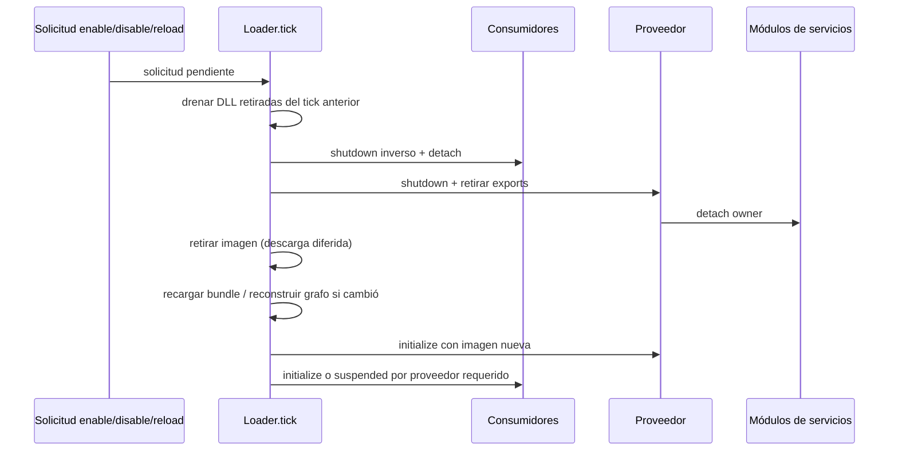

# Runtime y ciclo de vida del port y de los mods

Estado: `STATIC_CROSSCHECKED` en el commit fijado. Se estudian carga/activación/update/retirada, dependencias y frontera con el loop del juego. El bootstrap completo, menú, slots y escenas quedan fuera del alcance de esta ficha; no se presume una partida ya cargada en `mod_initialize`. Cobertura: **CROSSCHECKED** de las rutas citadas de loader/hooks; otras rutas siguen pendientes.

## Carga, estado y propietarios

RES_DIR, OVERLAY_DIR y TEXTURES_DIR se copian explícitamente al stage; mod.json y lib/plataforma se empaquetan como ZIP .dusk. No se generan paquetes en esta campaña.

**HOOK-023 · SOURCE_OBSERVED** — [cmake/ModSDK.cmake:305–375](https://github.com/TwilitRealm/dusklight/blob/40457c6adb381928e4b5fef6ed459ed291edd5e2/cmake/ModSDK.cmake#L305-L375); [cmake/ModSDK.cmake:401–415](https://github.com/TwilitRealm/dusklight/blob/40457c6adb381928e4b5fef6ed459ed291edd5e2/cmake/ModSDK.cmake#L401-L415)

Un mod puede ser asset-only, native o delegado a runtime @major.minor; runtime y código nativo juntos son conflicto y el host valida activate/update/deactivate del proveedor.

**HOOK-024 · STATIC_CROSSCHECKED** — [src/dusk/mods/loader/manifest.cpp:77–112](https://github.com/TwilitRealm/dusklight/blob/40457c6adb381928e4b5fef6ed459ed291edd5e2/src/dusk/mods/loader/manifest.cpp#L77-L112); [src/dusk/mods/loader/natives.cpp:532–551](https://github.com/TwilitRealm/dusklight/blob/40457c6adb381928e4b5fef6ed459ed291edd5e2/src/dusk/mods/loader/natives.cpp#L532-L551); [src/dusk/mods/loader/loader.cpp:213–216](https://github.com/TwilitRealm/dusklight/blob/40457c6adb381928e4b5fef6ed459ed291edd5e2/src/dusk/mods/loader/loader.cpp#L213-L216); [src/dusk/mods/loader/loader.cpp:237–271](https://github.com/TwilitRealm/dusklight/blob/40457c6adb381928e4b5fef6ed459ed291edd5e2/src/dusk/mods/loader/loader.cpp#L237-L271); [sdk/include/mods/runtime.h:5–15](https://github.com/TwilitRealm/dusklight/blob/40457c6adb381928e4b5fef6ed459ed291edd5e2/sdk/include/mods/runtime.h#L5-L15)

Un .dusk nativo Windows MSVC x64 busca lib/windows-amd64/mod.dll y carga con LoadLibraryExW SEARCH_DLL_LOAD_DIR|DEFAULT_DIRS; otros recursos de la plataforma se extraen en directorio por generación.

**HOOK-013 · STATIC_CROSSCHECKED** — [src/dusk/mods/loader/natives.cpp:25–35](https://github.com/TwilitRealm/dusklight/blob/40457c6adb381928e4b5fef6ed459ed291edd5e2/src/dusk/mods/loader/natives.cpp#L25-L35); [src/dusk/mods/loader/natives.cpp:386–403](https://github.com/TwilitRealm/dusklight/blob/40457c6adb381928e4b5fef6ed459ed291edd5e2/src/dusk/mods/loader/natives.cpp#L386-L403); [src/dusk/mods/loader/natives.cpp:429–485](https://github.com/TwilitRealm/dusklight/blob/40457c6adb381928e4b5fef6ed459ed291edd5e2/src/dusk/mods/loader/natives.cpp#L429-L485); [src/dusk/mods/loader/native_module.cpp:10–19](https://github.com/TwilitRealm/dusklight/blob/40457c6adb381928e4b5fef6ed459ed291edd5e2/src/dusk/mods/loader/native_module.cpp#L10-L19)

load_native exige cinco exports mod_meta/mod_ctx/mod_initialize/mod_update/mod_shutdown y valida metadatos antes de aceptar la biblioteca.

**HOOK-014 · SOURCE_OBSERVED** — [src/dusk/mods/loader/natives.cpp:488–528](https://github.com/TwilitRealm/dusklight/blob/40457c6adb381928e4b5fef6ed459ed291edd5e2/src/dusk/mods/loader/natives.cpp#L488-L528)

Imports obligatorios y opcionales forman grafo proveedor->consumidor; los ciclos requeridos fallan, los ciclos opcionales pierden una arista de orden y conservan resolución.

**HOOK-015 · STATIC_CROSSCHECKED** — [src/dusk/mods/loader/depgraph.cpp:21–80](https://github.com/TwilitRealm/dusklight/blob/40457c6adb381928e4b5fef6ed459ed291edd5e2/src/dusk/mods/loader/depgraph.cpp#L21-L80); [src/dusk/mods/loader/depgraph.cpp:110–204](https://github.com/TwilitRealm/dusklight/blob/40457c6adb381928e4b5fef6ed459ed291edd5e2/src/dusk/mods/loader/depgraph.cpp#L110-L204); [src/dusk/mods/loader/loader.cpp:396–438](https://github.com/TwilitRealm/dusklight/blob/40457c6adb381928e4b5fef6ed459ed291edd5e2/src/dusk/mods/loader/loader.cpp#L396-L438)

activate_mod registra exports, resuelve imports y hooks y llama initialize; solo éxito fija initialized. Un fallo de initialize inicia el cleanup de servicios pero no entra a mod_shutdown; el rollback de estado externo de init debe ser propio.

**HOOK-016 · STATIC_CROSSCHECKED** — [src/dusk/mods/loader/loader.cpp:209–294](https://github.com/TwilitRealm/dusklight/blob/40457c6adb381928e4b5fef6ed459ed291edd5e2/src/dusk/mods/loader/loader.cpp#L209-L294); [src/dusk/mods/loader/loader.cpp:296–334](https://github.com/TwilitRealm/dusklight/blob/40457c6adb381928e4b5fef6ed459ed291edd5e2/src/dusk/mods/loader/loader.cpp#L296-L334)

El host distingue `active`, `initialized`, `loadFailed`, `servicesRegistered`, `enabledApplied` y `suspendedByProvider`; no son sinónimos. Por ejemplo, `active` se establece antes de entrar a initialize; solo su éxito fija `initialized`. En init fallida, una mutación game-side o hilo ya arrancado no queda revertido por un shutdown que no se invocará. Diseñar initialize como transacción propia, con liberación al fallar cada paso (inferencia de HOOK-016).

El contexto identifica al dueño/consumidor de una llamada de servicio. Un proveedor recibe el contexto del mod llamante, no necesariamente el suyo; los punteros de servicio no sustituyen propiedad de handles. Ver [api.h:69–105](https://github.com/TwilitRealm/dusklight/blob/40457c6adb381928e4b5fef6ed459ed291edd5e2/sdk/include/mods/api.h#L69-L105).

## Tick y relación con actores

tick empieza con frameBegin y cambios pendientes, recorre updates de mods activos y acaba frameEnd. fapGm_Execute llama duskExecute/tick antes de fpcM_Management; no garantiza correspondencia uno a uno con cada frame presentado.

**HOOK-018 · STATIC_CROSSCHECKED** — [src/dusk/mods/loader/loader.cpp:1237–1266](https://github.com/TwilitRealm/dusklight/blob/40457c6adb381928e4b5fef6ed459ed291edd5e2/src/dusk/mods/loader/loader.cpp#L1237-L1266); [src/f_ap/f_ap_game.cpp:748–751](https://github.com/TwilitRealm/dusklight/blob/40457c6adb381928e4b5fef6ed459ed291edd5e2/src/f_ap/f_ap_game.cpp#L748-L751); [src/f_ap/f_ap_game.cpp:807–843](https://github.com/TwilitRealm/dusklight/blob/40457c6adb381928e4b5fef6ed459ed291edd5e2/src/f_ap/f_ap_game.cpp#L807-L843)

fail_mod marca inactivo, retira exports y encola disable sin teardown inmediato; bibliotecas retiradas se descargan realmente al siguiente apply_pending_requests.

**HOOK-019 · STATIC_CROSSCHECKED** — [src/dusk/mods/loader/context.cpp:21–37](https://github.com/TwilitRealm/dusklight/blob/40457c6adb381928e4b5fef6ed459ed291edd5e2/src/dusk/mods/loader/context.cpp#L21-L37); [src/dusk/mods/loader/loader.cpp:537–548](https://github.com/TwilitRealm/dusklight/blob/40457c6adb381928e4b5fef6ed459ed291edd5e2/src/dusk/mods/loader/loader.cpp#L537-L548); [src/dusk/mods/loader/loader.cpp:1100–1108](https://github.com/TwilitRealm/dusklight/blob/40457c6adb381928e4b5fef6ed459ed291edd5e2/src/dusk/mods/loader/loader.cpp#L1100-L1108); [src/dusk/mods/loader/natives.cpp:563–583](https://github.com/TwilitRealm/dusklight/blob/40457c6adb381928e4b5fef6ed459ed291edd5e2/src/dusk/mods/loader/natives.cpp#L563-L583)

Flujo observado de `fapGm_Execute`: `duskExecute` (incluye `updateAutoSave` y tick de mods) → `fpcM_Management` → contador → partículas de menú → GameMode `invokeOnTickFunction` → achievements. Por ello `mod_update` no demuestra que un actor concreto vaya a ejecutar ese tick ni que tenga recursos listos; el gestor de procesos aún aplica su propia programación. Pausa, carga y escena deben consultarse mediante el servicio o estado apropiado. No se equipara este tick al framerate DX12 de presentación.

## Desactivación y reload

deactivate_mod invoca módulos deactivating, shutdown si inicializado, elimina exports, invoca módulos detached y retira nativo. Excepciones/errores de shutdown se registran y continúa teardown.

**HOOK-017 · SOURCE_OBSERVED** — [src/dusk/mods/loader/loader.cpp:296–338](https://github.com/TwilitRealm/dusklight/blob/40457c6adb381928e4b5fef6ed459ed291edd5e2/src/dusk/mods/loader/loader.cpp#L296-L338); [src/dusk/mods/svc/registry.cpp:210–224](https://github.com/TwilitRealm/dusklight/blob/40457c6adb381928e4b5fef6ed459ed291edd5e2/src/dusk/mods/svc/registry.cpp#L210-L224)

Disable/reload recolecta dependientes y apaga en orden inverso, recarga manifiesto e imagen, reconstruye grafo si cambia y reactiva proveedores antes de consumidores; required ausente suspende consumidor.

**HOOK-020 · SOURCE_OBSERVED** — [src/dusk/mods/loader/loader.cpp:581–607](https://github.com/TwilitRealm/dusklight/blob/40457c6adb381928e4b5fef6ed459ed291edd5e2/src/dusk/mods/loader/loader.cpp#L581-L607); [src/dusk/mods/loader/loader.cpp:610–663](https://github.com/TwilitRealm/dusklight/blob/40457c6adb381928e4b5fef6ed459ed291edd5e2/src/dusk/mods/loader/loader.cpp#L610-L663); [src/dusk/mods/loader/loader.cpp:666–755](https://github.com/TwilitRealm/dusklight/blob/40457c6adb381928e4b5fef6ed459ed291edd5e2/src/dusk/mods/loader/loader.cpp#L666-L755)

Reload fallido deja target fallido; no hay restauración automática de la imagen vieja. mod ID cambiado devuelve CONFLICT; nativeInPlace rechaza reload sin paquete de reemplazo.

**HOOK-021 · SOURCE_OBSERVED** — [src/dusk/mods/loader/loader.cpp:610–629](https://github.com/TwilitRealm/dusklight/blob/40457c6adb381928e4b5fef6ed459ed291edd5e2/src/dusk/mods/loader/loader.cpp#L610-L629); [src/dusk/mods/loader/loader.cpp:738–755](https://github.com/TwilitRealm/dusklight/blob/40457c6adb381928e4b5fef6ed459ed291edd5e2/src/dusk/mods/loader/loader.cpp#L738-L755); [src/dusk/mods/loader/loader.cpp:900–909](https://github.com/TwilitRealm/dusklight/blob/40457c6adb381928e4b5fef6ed459ed291edd5e2/src/dusk/mods/loader/loader.cpp#L900-L909)

El contrato prohíbe hooks cuya función permanece en stack toda sesión, porque el cambio lifecycle entre frames no garantiza su descarga segura.

**HOOK-022 · DOC_CONTRACT** — [docs/modding.md:1469–1491](https://github.com/TwilitRealm/dusklight/blob/40457c6adb381928e4b5fef6ed459ed291edd5e2/docs/modding.md#L1469-L1491)

Este diagrama resume HOOK-017/019/020. Reload no es rollback transaccional a la biblioteca anterior. El bundle anterior puede seguir vivo mediante `shared_ptr` de lectores, pero eso no equivale a que el mod siga activo ni que se puedan reutilizar sus callbacks/punteros de código. Cada generación nativa tiene nuevo directorio; el host retira directorios al descargar imágenes retiradas.

## Contratos para consumidores y próximos pasos

Preferir imports declarados para dependencias: dan orden init/shutdown y reinicio en cascada. Un lookup dinámico `HostService::get_service` ve lo publicado en ese momento y no agrega esa garantía al grafo (DOC_CONTRACT [api.h:96–105](https://github.com/TwilitRealm/dusklight/blob/40457c6adb381928e4b5fef6ed459ed291edd5e2/sdk/include/mods/api.h#L96-L105)). Una dependencia opcional puede resolver NULL y puede perder su orden por ciclo; el consumidor debe tolerarlo.

OFFICIAL_SERVICE: usar lifecycle y ownership de los servicios oficiales para registros. TYPED_HOOK/SYMBOL_HOOK: solo para puntos concretos que no cubre servicio, previa validación descrita en [hooks](../HOOKING_AND_ABI.md). POTENTIAL_REQUIRES_VERIFICATION: cualquier garantía de convivencia real, scene transition, callback concurrente, exception cross-DLL y rendimiento.

Pendiente: bootstrap completo de recursos/heaps e hilos Aurora/Borealis (gitlinks no incluidos); inspección del reloj fijo frente a presentación, pausas y fast-forward; runtime Windows real de reload con dos consumidores y fallos intermedios. Evidencia histórica CP20/CP21 se registra por separado en SOURCE_PIN; no convierte esta lectura estática en runtime observado.

## Segundo contraste: cleanup anterior al shutdown y sus límites

ActorService intenta retirar perfiles propios antes de shutdown; si unregister_actor no completa borrado devuelve UNAVAILABLE y conserva perfil. actor_remove_mod sólo registra el fallo y ModLoader continúa teardown/unload; no se debe declarar garantizada la seguridad del unload con actores propios vivos.

**HOOK-029 · STATIC_CROSSCHECKED** — [src/dusk/mods/svc/actor.cpp:193–218](https://github.com/TwilitRealm/dusklight/blob/40457c6adb381928e4b5fef6ed459ed291edd5e2/src/dusk/mods/svc/actor.cpp#L193-L218); [src/dusk/mods/svc/actor.cpp:359–372](https://github.com/TwilitRealm/dusklight/blob/40457c6adb381928e4b5fef6ed459ed291edd5e2/src/dusk/mods/svc/actor.cpp#L359-L372); [src/dusk/mods/svc/actor.cpp:395–401](https://github.com/TwilitRealm/dusklight/blob/40457c6adb381928e4b5fef6ed459ed291edd5e2/src/dusk/mods/svc/actor.cpp#L395-L401); [src/dusk/mods/loader/loader.cpp:296–338](https://github.com/TwilitRealm/dusklight/blob/40457c6adb381928e4b5fef6ed459ed291edd5e2/src/dusk/mods/loader/loader.cpp#L296-L338)

GfxService retira tipos draw/encoder task del propietario y llama aurora::gfx::synchronize antes de mod_shutdown mediante modDeactivating; el detalle de sincronización reside en dependencia externa.

**HOOK-030 · STATIC_CROSSCHECKED** — [src/dusk/mods/svc/gfx.cpp:166–187](https://github.com/TwilitRealm/dusklight/blob/40457c6adb381928e4b5fef6ed459ed291edd5e2/src/dusk/mods/svc/gfx.cpp#L166-L187); [src/dusk/mods/svc/gfx.cpp:1460–1470](https://github.com/TwilitRealm/dusklight/blob/40457c6adb381928e4b5fef6ed459ed291edd5e2/src/dusk/mods/svc/gfx.cpp#L1460-L1470); [src/dusk/mods/loader/loader.cpp:296–308](https://github.com/TwilitRealm/dusklight/blob/40457c6adb381928e4b5fef6ed459ed291edd5e2/src/dusk/mods/loader/loader.cpp#L296-L308)

Los módulos deactivating se ejecutan antes del shutdown del mod. Por ello un proveedor de actores propios no debe esperar hasta shutdown para empezar un cleanup que necesite varios ticks: el host ya intentó su retirada sincrónica. En el camino de fallo conservado puede quedar un perfil con callbacks del mod mientras la DLL se retira para descarga posterior: **STATIC_INFERRED**, riesgo de vigencia, sin crash observado. No se propone modificar host/SDK; una futura integración debe demostrar destrucción sincrónica y definir política de rechazo o reinicio si no puede garantizarla.

La sincronización explícita de Gfx evita extrapolar el retraso de un tick como única protección para todos los workers. No se deduce que un hilo propio del mod o de una DLL adicional quede detenido por esa barrera: sigue siendo responsabilidad de su dueño según el contrato de runtime libraries.
